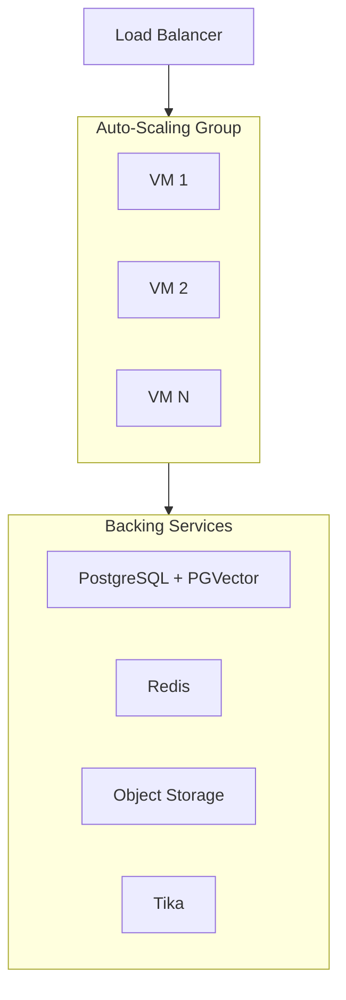

# Python / Pip on Auto-Scaling VMs

Deploy `open-webui serve` as a systemd-managed process on virtual machines in a cloud auto-scaling group (AWS ASG, Azure VMSS, GCP MIG).

:::info Prerequisites
Before proceeding, ensure you have configured the [shared infrastructure requirements](/enterprise/deployment#shared-infrastructure-requirements): PostgreSQL, Redis, a vector database, shared storage, and content extraction.
:::

## When to Choose This Pattern

- Your organization has established VM-based infrastructure and operational practices
- Regulatory or compliance requirements mandate direct OS-level control
- Your team has limited container expertise but strong Linux administration skills
- You want a straightforward deployment without container orchestration overhead

## Architecture



## Installation

Install on each VM with the `postgres` extra, which adds the PostgreSQL and PGVector drivers:

```bash
python3.12 -m venv /opt/open-webui/venv
/opt/open-webui/venv/bin/pip install "open-webui[postgres]"
```

The `all` extra also adds the optional vector store clients, Playwright and Unstructured; install it only if you use one of them.

Create a systemd unit to manage the process:

```ini
[Unit]
Description=Open WebUI
After=network.target

[Service]
Type=simple
User=openwebui
EnvironmentFile=/etc/open-webui/env
ExecStart=/opt/open-webui/venv/bin/open-webui serve
Restart=always
RestartSec=5

[Install]
WantedBy=multi-user.target
```

Place your environment variables in `/etc/open-webui/env` (see [Critical Configuration](/enterprise/deployment#critical-configuration)). Also set `DATA_DIR`, for example to `/var/lib/open-webui`, so local caches live outside the Python package directory, which is the default.

## Scaling Strategy

- **Horizontal scaling**: Configure your auto-scaling group to add or remove VMs based on CPU utilization or request count.
- **Health checks**: Point your load balancer health check at `/ready`, which answers once startup has finished and the database and Redis respond. `/health` only shows the process is running.
- **One process per VM**: Keep `UVICORN_WORKERS=1` and let the auto-scaler manage capacity.
- **Sticky sessions**: Optional; required only with `ENABLE_WEBSOCKET_SUPPORT=false`. See [Session Affinity](/troubleshooting/multi-replica#session-affinity-sticky-sessions).

## Key Considerations

| Consideration | Detail |
| :--- | :--- |
| **OS patching** | You are responsible for OS updates, security patches, and Python runtime management. |
| **Python environment** | Use Python 3.11 or 3.12 (3.12 recommended) in a virtual environment. |
| **Storage** | Use object storage (such as S3) or a shared filesystem (such as NFS) since VMs in an auto-scaling group do not share a local filesystem. |
| **Tika sidecar** | Run a Tika server on each VM or as a shared service. A shared instance simplifies management. |
| **Updates** | Scale the group to one instance, set `ENABLE_DB_MIGRATIONS=true` on it, update the package (`pip install --upgrade "open-webui[postgres]"`) and restart, wait for the migrations to finish, then scale back up with migrations off and the new version on every VM. See [Updates and Migrations](/troubleshooting/multi-replica#updates-and-migrations). |

For pip installation basics, see the [Quick Start guide](/getting-started/quick-start).

---

**Need help planning your enterprise deployment?** Our team works with organizations worldwide to design and implement production Open WebUI environments.

[**Contact Enterprise Sales →**](https://openwebui.com/contact/sales)
