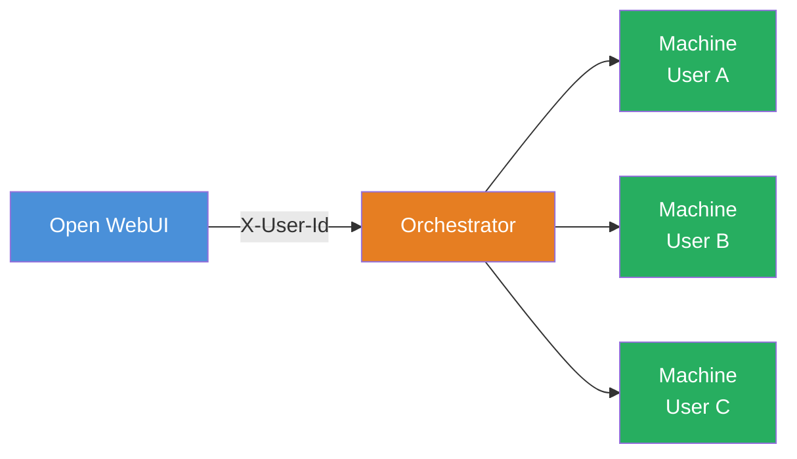

import Tabs from '@theme/Tabs';
import TabItem from '@theme/TabItem';

import Docker from './tab-deployment/Docker.md';
import Kubernetes from './tab-deployment/Kubernetes.md';

# Terminals (Orchestrator)

**Terminals** manages [Open Terminal](/features/open-terminal) machines for a team. Each machine is a container where the AI runs commands and works with files. A machine can belong to a user, a chat or a model, or be shared by everyone, with its own files, processes, packages, resource limits, network profile and optional persistent storage.

[View on GitHub →](https://github.com/open-webui/terminals)

Open Terminal gives an Open WebUI chat a real workspace to act in. Terminals manages those workspaces for many people, so everyone gets the right one without hand-wiring containers. Open WebUI is where you create, share and use terminals. Terminals starts, reuses and cleans up the machines behind them.

Terminals can give every person, chat or model its own workspace, so files and processes never mix. It also offers ready-made environments: set an image, resources, a start folder and a setup script once, then share the terminal with a group. Idle machines are cleaned up after the idle timeout you set. It is for admins who run Open WebUI for a team. Use it when one shared Open Terminal is not enough because people need separate files, tools and limits.

:::tip Quick navigation
- **Need to operate per-user terminal environments?** → [Orchestration](/features/open-terminal/terminals/orchestration)
- **Need to create and share terminals?** → [Creating Terminals](/features/open-terminal/terminals/orchestration/creating-terminals)
:::

---

## How It Works

The orchestrator sits between Open WebUI and the Open Terminal machines:

1. A user activates Open Terminal in Open WebUI.
2. Open WebUI proxies the request to the **orchestrator**, which manages workspace lifecycle.
3. The orchestrator reads the selected [terminal](/features/open-terminal/terminals/orchestration/creating-terminals): image, resources, storage, env vars, start directory, setup script and machine scope.
4. The orchestrator provisions or reuses the matching Open Terminal machine: one per user, chat or model, or a single one for everyone, depending on the terminal's machine scope.
5. All traffic goes through the orchestrator.
6. Idle machines are cleaned up after the idle timeout you set. Files in the home folder are kept: Docker keeps them in the data folder, Kubernetes keeps them on a persistent volume when storage is enabled.

The orchestrator exposes the same OpenAPI-based tool interface as Open Terminal, so the AI can work with files, run code, execute commands, start servers and inspect results, all inside the machine the terminal's scope selects.

## Why It Matters

Terminals lets admins give agents enough environment to do real work while controlling its limits:

| Need | What Terminals provides |
| :--- | :--- |
| Isolation | Separate files and processes per machine, with one machine per user, saved chat or model when the terminal asks for it |
| Governance | Terminals with set images, env vars, resource limits and storage, checked against server maximums, and shared only with chosen users and groups |
| Repeatability | Custom images and startup packages so users get the right tools every time |
| Lifecycle | Reuse, idle cleanup and start, stop, restart and delete per machine |
| Scale | Docker for a single host, Kubernetes/operator mode for larger deployments |
| Supportability | Admin UI, logs, status, templates API and predictable routing |

:::info Admin UI
The orchestrator serves a built-in minimal admin UI at `/` with **Templates** (create and edit terminals, reset schedules, delete) and **Environments** (inspect machines, including stopped ones, and start, stop, restart, reset or delete them). It signs in with `TERMINALS_API_KEY`. It is on by default and toggled with `TERMINALS_ENABLE_UI`; set it to `false` for API-only deployments.
:::

---

## Deployment

<Tabs>
  <TabItem value="docker" label="Docker" default>
    

      <Docker />
    

  </TabItem>
  <TabItem value="kubernetes" label="Kubernetes Operator">
    

      <Kubernetes />
    

  </TabItem>
</Tabs>

---

## Authentication

Open WebUI and the orchestrator share one API key. Set `TERMINALS_API_KEY` on the orchestrator, and on the connection in Open WebUI set **Auth** to **Bearer** with the same value as **API Key**. Open WebUI checks who may use a terminal. Terminal requests carry the verified user ID, and the orchestrator accepts requests that carry the key. Keep the key secret: it also opens the built-in admin UI and the templates API.

If `TERMINALS_API_KEY` is unset, `terminals serve` generates a key and prints it. The generated key changes on every restart, so set a fixed value for any real deployment.

With Helm the chart generates the shared key and configures it on both sides. With Docker Compose set `TERMINALS_API_KEY` in a `.env` file next to the Compose file, see [Deployment](#deployment).

The key covers every call from Open WebUI: **Verify Connection**, the terminals API and terminal traffic, which also carry the user's ID and the `X-Terminal-*` [headers](/features/open-terminal/terminals/orchestration/api-troubleshooting#headers-sent-to-the-terminals-server).

---

## Troubleshooting

### Terminal won't start

1. **Check orchestrator logs.** The orchestrator logs the full provisioning flow, including image pull and workspace creation. Look for errors related to image availability, terminal settings or resource limits.
2. **Verify the API key.** Ensure `TERMINALS_API_KEY` matches between Open WebUI and the orchestrator. A mismatch makes the connection fail with a `401` error.
3. **Check image pull access.** If using a private container registry, make sure the orchestrator (Docker) or cluster (Kubernetes) has pull credentials configured.
4. **Raise the timeout.** If a request fails with `Terminal '<name>' timed out. It may still be starting.`, raise [`AIOHTTP_CLIENT_TIMEOUT_TERMINAL`](/reference/env-configuration#aiohttp_client_timeout_terminal).

### Authentication failures

- Confirm the key is set identically on both sides. Check for extra whitespace or newlines.
- Check the orchestrator logs for `401` or `403` responses.

### Workspace is reaped too quickly

Raise the idle timeout, see [Idle cleanup, lifetime and scheduled resets](/features/open-terminal/terminals/orchestration#idle-cleanup-lifetime-and-scheduled-resets).

### Connection refused

- **Docker:** ensure `TERMINALS_DOCKER_NETWORK` is set so containers can communicate by name. Without it, containers use published ports and the `TERMINALS_DOCKER_HOST` address must be reachable.
- **Kubernetes:** verify the orchestrator Service is accessible from the Open WebUI Pod. Run `kubectl get svc -n open-webui` to confirm the service exists.

---

## Further reading

- [Multi-User Setup](/features/open-terminal/advanced/multi-user): comparison of isolation approaches
- [Security best practices](/features/open-terminal/advanced/security)
- [Configuration reference](/features/open-terminal/advanced/configuration): all Open Terminal container settings

---

## License

Terminals requires an [Open WebUI Enterprise License](https://docs.openwebui.com/enterprise) for production use. See the [Terminals repository](https://github.com/open-webui/terminals) for details.
