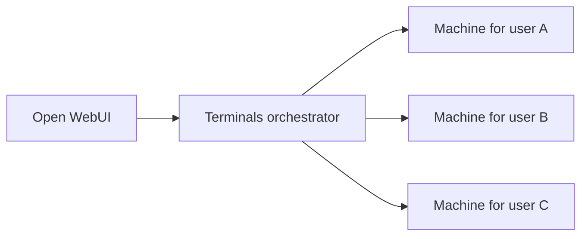

# Orchestration

The Terminals orchestrator starts and manages [Open Terminal](/features/open-terminal) machines for your team. Open WebUI stores the connection, users create terminals on it and each terminal starts machines where the agent can run commands and work with files. A machine can belong to a user, a chat or a model, or be shared by everyone, depending on the terminal's machine scope.

Use this when Open Terminal needs to become managed team infrastructure: different users, groups or workflows need different images, tools, limits, storage behavior and security boundaries.

When a user works in a terminal, Open WebUI sends the request to the orchestrator with the terminal ID, the chat ID when the request belongs to a saved chat and the model ID for a terminal with a model scope. The orchestrator starts or reuses the matching machine.

## Read This Section

- [Creating Terminals](/features/open-terminal/terminals/orchestration/creating-terminals): the dialog, machine scope, sharing and managing machines.
- [Environment Variables](/features/open-terminal/terminals/orchestration/environment-variables): raw env values, quote handling, forwarding behavior and reserved keys.
- [Custom Images](/features/open-terminal/terminals/orchestration/custom-images): build, tag, push and use custom Open Terminal images.
- [System Prompts](/features/open-terminal/terminals/orchestration/system-prompts): generated prompts, `OPEN_TERMINAL_SYSTEM_PROMPT`, placeholders and `OPEN_TERMINAL_INFO`.
- [File Browser Root](/features/open-terminal/terminals/orchestration/file-browser-home-boundary): how Open Terminal exposes a visual root for clients to render and clamp navigation.
- [OpenShift](/features/open-terminal/terminals/orchestration/openshift): restricted terminal sandboxes on OpenShift.
- [API and Troubleshooting](/features/open-terminal/terminals/orchestration/api-troubleshooting): templates API, headers sent to the server and common problems.

## Responsibilities

| Layer | Responsibility |
| :--- | :--- |
| Open WebUI | Stores the orchestrator connection, lets users create and share terminals and presents chat, terminal, file browser and preview UI |
| Terminals orchestrator | Checks the server key, stores terminals, provisions machines, forwards env vars and applies idle cleanup, scheduled resets and server maximums |
| Terminal | Defines the image, env, resources, storage, start directory, setup script and machine scope |
| Open Terminal machine | Executes commands, serves files, exposes OpenAPI tools, runs code and servers and reports file-browser root metadata |

## Orchestrator Environment Variables

These configure the orchestrator service itself, prefixed with `TERMINALS_` (or set in a `.env` file). They are distinct from the per-workspace `OPEN_TERMINAL_*` variables covered in [Environment Variables](/features/open-terminal/terminals/orchestration/environment-variables), which are forwarded into each user's Open Terminal workspace.

| Variable | Default | Description |
| :--- | :--- | :--- |
| `TERMINALS_BACKEND` | `docker` | Backend to use: `docker`, `kubernetes`, or `kubernetes-operator` |
| `TERMINALS_API_KEY` | *(generated by `terminals serve`)* | Bearer token that Open WebUI and the admin UI send. Set a fixed value, a generated one changes on every restart |
| `TERMINALS_HOST` | `0.0.0.0` | Address the orchestrator HTTP server binds to |
| `TERMINALS_PORT` | `3000` | Port the orchestrator HTTP server listens on |
| `TERMINALS_WORKERS` | `1` | Number of server processes |
| `TERMINALS_ENABLE_UI` | `true` | Serve the built-in minimal admin UI at `/`. Set `false` for API-only deployments |
| `TERMINALS_LOG_LEVEL` | `INFO` | Minimum log level: `DEBUG`, `INFO`, `WARNING`, `ERROR`, or `CRITICAL` |
| `TERMINALS_DATABASE_URL` | `sqlite+aiosqlite:///<data>/terminals.db` | SQLAlchemy database URL. SQLite is the default; PostgreSQL is optional |
| `TERMINALS_IMAGE` | `ghcr.io/open-webui/open-terminal:latest` | Default workspace image when a terminal sets none |
| `TERMINALS_IMAGE_PULL_POLICY` | *(unset)* | `Always`, `IfNotPresent` or `Never`, for every backend. Unset pulls `:latest` and untagged images on every start and other tags only when missing |
| `TERMINALS_NETWORK_PROFILES` | `{}` | JSON object of named network profiles that a terminal can select in its **Network** field |
| `TERMINALS_DOCKER_NETWORK` | *(unset)* | Docker network for Open Terminal workspaces. When set, containers are reached by name through that network. A comma-separated list spreads containers over several networks |
| `TERMINALS_DOCKER_HOST` | `127.0.0.1` | Address used to reach published container ports (Docker backend) |
| `TERMINALS_DOCKER_DATA_DIR` | `<data>/terminals` | Directory holding persisted workspace files, one `.terminals/<id>` folder per machine (Docker backend) |
| `TERMINALS_DOCKER_HOST_DATA_DIR` | *(unset)* | Absolute path of that directory on the Docker host, when it differs from `TERMINALS_DOCKER_DATA_DIR` |
| `TERMINALS_DOCKER_MOUNTS` | *(unset)* | JSON array of extra bind mounts (`source`, `target`, optional `readOnly`) added to every machine (Docker backend) |
| `TERMINALS_IDLE_TIMEOUT_MINUTES` | `0` | Stop machines after N minutes of inactivity (`0` = disabled) |
| `TERMINALS_MAX_LIFETIME_MINUTES` | `0` | Stop machines N minutes after they start, even while in use (`0` = disabled) |
| `TERMINALS_MAX_CPU` | *(unset)* | Hard cap on CPU per workspace that terminals cannot exceed |
| `TERMINALS_MAX_MEMORY` | *(unset)* | Hard cap on memory per workspace that terminals cannot exceed |
| `TERMINALS_MAX_STORAGE` | *(unset)* | Hard cap on storage per workspace that terminals cannot exceed |
| `TERMINALS_ALLOWED_IMAGES` | *(unset)* | Comma-separated list of allowed image patterns (globs). Empty allows any image |
| `TERMINALS_KUBERNETES_NAMESPACE` | `terminals` | Namespace for terminal pods (Kubernetes backends) |
| `TERMINALS_KUBERNETES_IMAGE` | *(unset)* | Default image for Open Terminal pods (Kubernetes backends). Unset uses `TERMINALS_IMAGE` |
| `TERMINALS_KUBERNETES_STORAGE_CLASS` | *(unset)* | StorageClass for PVCs. Empty uses the cluster default |
| `TERMINALS_KUBERNETES_STORAGE_SIZE` | `1Gi` | Default PVC size when a terminal sets none |
| `TERMINALS_KUBERNETES_STORAGE_MODE` | `per-user` | Storage mode: `per-user`, `shared`, or `shared-rwo` |
| `TERMINALS_KUBERNETES_SERVICE_TYPE` | `ClusterIP` | Service type for terminal pods |
| `TERMINALS_KUBERNETES_KUBECONFIG` | *(unset)* | Path to a kubeconfig. Empty uses in-cluster config |
| `TERMINALS_KUBERNETES_LABELS` | *(unset)* | Extra labels applied to created resources as `k=v,k2=v2` |
| `TERMINALS_KUBERNETES_RESTRICTED` | `false` | Enable restricted Kubernetes/OpenShift pod defaults globally |
| `TERMINALS_KUBERNETES_POD_SECURITY_CONTEXT` | `{}` | JSON pod security context merged into terminal pods |
| `TERMINALS_KUBERNETES_CONTAINER_SECURITY_CONTEXT` | `{}` | JSON container security context merged into Open Terminal containers |
| `TERMINALS_KUBERNETES_NODE_SELECTOR` | *(unset)* | Node selector for machine and reset pods, as JSON or `k=v,k2=v2` |
| `TERMINALS_KUBERNETES_TOLERATIONS` | *(unset)* | JSON array of tolerations for machine and reset pods |
| `TERMINALS_KUBERNETES_CRD_GROUP` | `openwebui.com` | CRD group watched by the operator backend |
| `TERMINALS_KUBERNETES_CRD_VERSION` | `v1alpha1` | CRD version watched by the operator backend |

Any value omitted here falls back to the default shown. The [Terminals README](https://github.com/open-webui/terminals#configuration) lists every setting, including proxy timeouts and caching.

## Important Behavior

Changes to a terminal apply to machines that start afterwards. **Restart** stops a machine and starts it again at once with the current settings.

### Idle Cleanup, Lifetime and Scheduled Resets

Idle cleanup stops a machine after `TERMINALS_IDLE_TIMEOUT_MINUTES` without activity and keeps its files. The next request starts a fresh machine on the same files. `TERMINALS_MAX_LIFETIME_MINUTES` stops a machine a fixed time after it starts, even while in use, and the files are kept as well. A terminal can carry its own `idle_timeout_minutes` and `max_lifetime_minutes` that replace the server values, and `0` disables the check for that terminal.

A reset schedule clears a terminal's files on a schedule and refreshes matching machines, including active ones. The schedule is a one-time ISO datetime, `@weekly`, `@monthly` or a five-field cron expression, with an optional time zone. Set them in the template editor of the Terminals admin UI.

The file browser starts in the home folder and hides the folders above it, see [File Browser Root](/features/open-terminal/terminals/orchestration/file-browser-home-boundary).
