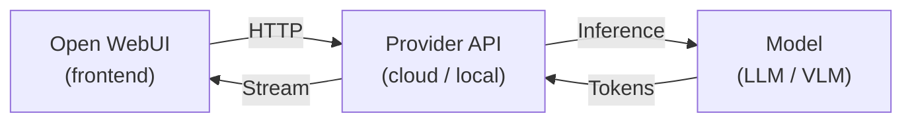

# Connect Local and Cloud Models {#connect-a-provider}

Connect local model servers and cloud APIs to the same Open WebUI instance. Add a connection for each provider, then choose which model to use for a conversation.

Open WebUI supports multiple connection protocols, including **Ollama**, **OpenAI-compatible APIs**, and **Open Responses**. Any cloud API or local server that speaks one of these protocols works out of the box. Just add a URL and API key, and your models appear in the dropdown.

---

## How It Works

1. **You type a message** in Open WebUI
2. Open WebUI sends it to your provider's API endpoint
3. The provider runs inference on the selected model
4. Tokens **stream back** to Open WebUI in real time
5. You see the response in the chat interface

:::tip
Adding a provider is as simple as entering a URL and API key in **Settings → Connections** (admin section). Open WebUI auto-detects available models from most providers.
:::

---

## Use local and cloud models together

You need a running Open WebUI instance, administrator access, a reachable local model server, and an API key for the hosted provider you choose.

1. [Connect Ollama](/getting-started/quick-start/connect-a-provider/starting-with-ollama) and make sure a downloaded local model appears in the model selector.
2. Add a hosted connection using the [OpenAI](/getting-started/quick-start/connect-a-provider/starting-with-openai), [Anthropic](/getting-started/quick-start/connect-a-provider/starting-with-anthropic), or [OpenAI-compatible provider](/getting-started/quick-start/connect-a-provider/starting-with-openai-compatible) guide.
3. Start a conversation, select the local model, and send a short test message. Start another conversation with the hosted model and confirm that it also responds.
4. To send the same prompt to both models, use [Multi-Model Chats](/features/chat-conversations/chat-features/multi-model-chats).

The selected endpoint determines where inference happens. Selecting a cloud model sends the prompt and included context to that provider; comparing models sends the prompt to each selected endpoint. Local inference does not make separately configured cloud tools, extraction, or embedding services local. See [Chat Data Privacy & Encryption](/security/chat-data-privacy-and-encryption) when choosing providers for sensitive content.

## Choose the Right Connection Settings

Most providers work with a URL and an API key. A few need one extra choice in the connection dialog so Open WebUI knows what sits on the other end. Add Ollama servers under **Manage Ollama API Connections** and everything else under **Manage OpenAI API Connections** in **Admin Settings > Connections**, then use the table to see which settings your provider needs.

| You connect | Add it under | Settings to change |
|---|---|---|
| **Ollama** | Ollama connections | URL only. Open WebUI recognises Ollama on its own. See [Starting with Ollama](/getting-started/quick-start/connect-a-provider/starting-with-ollama). |
| **OpenAI, Anthropic, Gemini, Mistral, Groq, OpenRouter, xAI, vLLM and other OpenAI-format servers** | OpenAI connections | URL and API key. Leave **Provider** on **Default**. |
| **DeepSeek (hosted API)** | OpenAI connections | URL and API key, then **Advanced > Provider > llama.cpp**. DeepSeek's thinking mode needs its earlier reasoning sent back with every tool turn, and the llama.cpp setting is the one that sends it. |
| **Azure OpenAI** | OpenAI connections | **Provider > Azure OpenAI**, an **API Version** and your deployment names under **Model IDs**. Open WebUI also switches to Azure mode on its own for Azure-looking URLs. |
| **llama.cpp server** | OpenAI connections | **Provider > llama.cpp** to manage models from Open WebUI. See [Starting with llama.cpp](/getting-started/quick-start/connect-a-provider/starting-with-llama-cpp). |
| **LM Studio** | OpenAI connections | **Provider > LM Studio** to manage models from Open WebUI. |
| **LiteLLM proxy** | OpenAI connections | **Provider > LiteLLM**, which passes requests that arrive at Open WebUI's own Anthropic Messages endpoint straight on to LiteLLM. |
| **A provider that offers the Responses API** | OpenAI connections | **API Type > Responses**. See [Open Responses](/getting-started/quick-start/connect-a-provider/starting-with-open-responses). |

The **Provider** setting names the format of the requests Open WebUI sends. **Default** sends plain OpenAI format, which every OpenAI-compatible server accepts. The [Provider Setting](/getting-started/quick-start/connect-a-provider/starting-with-openai-compatible#the-provider-setting) section lists everything each option switches on.

To change it, open **Admin Settings > Connections**, click the gear icon next to the connection (or **+** for a new one), expand **Advanced** and pick the option from **Provider**. Save the dialog and the connection list. The dropdown shows on OpenAI connections only.

The other settings in the dialog:

| Setting | What it does |
|---|---|
| **Connection Type** | Labels the connection **Local** or **External**. The model selector uses the label for its Local and External filters. |
| **Auth** | **Bearer** sends your API key. **None** calls the server without a key. **Session**, **OAuth** and **Entra ID** forward the signed-in user's credentials or an Azure identity. |
| **API Type** | **Chat Completions** is the default. **Responses** switches the connection to the Responses API. |
| **Forward cookies** | Sends the cookies of the Open WebUI request on to this server. |
| **Headers** | Extra request headers in JSON format. |
| **Prefix ID** | Adds a prefix to every model ID of this connection, so two connections that offer the same model name stay apart. |
| **Model IDs** | A list of the models to show. Leave it empty to show every model the server reports. |

---

## Cloud Providers

Hosted APIs that require an account and API key. No hardware needed.

| Provider | Models | Guide |
|----------|--------|-------|
| **OpenAI** | GPT-5.6 Sol, GPT-5.6 Terra, GPT-5.6 Luna | [Starting with OpenAI →](/getting-started/quick-start/connect-a-provider/starting-with-openai) |
| **Anthropic** | Claude Opus 5, Sonnet 5, Haiku 4.5 | [Starting with Anthropic →](/getting-started/quick-start/connect-a-provider/starting-with-anthropic) |
| **OpenAI-Compatible** | DeepSeek, Mistral, Groq, OpenRouter, Vercel AI Gateway, Amazon Bedrock, Azure, and more | [OpenAI-Compatible Providers →](/getting-started/quick-start/connect-a-provider/starting-with-openai-compatible) |

---

## Local Servers

Run downloaded models on your own hardware. Authentication depends on how you configure the local server.

| Server | Description | Guide |
|--------|-------------|-------|
| **Ollama** | Run and manage downloaded models locally | [Starting with Ollama →](/getting-started/quick-start/connect-a-provider/starting-with-ollama) |
| **llama.cpp** | Efficient GGUF model inference with OpenAI-compatible API | [Starting with llama.cpp →](/getting-started/quick-start/connect-a-provider/starting-with-llama-cpp) |
| **vLLM** | High-throughput inference engine for production workloads | [Starting with vLLM →](/getting-started/quick-start/connect-a-provider/starting-with-vllm) |

More local servers (LM Studio, LocalAI, Docker Model Runner, Lemonade) are covered in the [OpenAI-Compatible Providers](/getting-started/quick-start/connect-a-provider/starting-with-openai-compatible#local-servers) guide.

---

## Other Connection Methods

| Feature | Description | Guide |
|---------|-------------|-------|
| **Open Responses** | Connect providers using the Open Responses specification | [Starting with Open Responses →](/getting-started/quick-start/connect-a-provider/starting-with-open-responses) |
| **Functions** | Extend Open WebUI with custom pipe functions for any backend | [Starting with Functions →](/getting-started/quick-start/connect-a-provider/starting-with-functions) |

---

## Looking for Agents?

If you want to connect an autonomous AI agent (with terminal access, file operations, web search, and more) instead of a plain model provider, see [**Connect an Agent**](/getting-started/quick-start/connect-an-agent).
