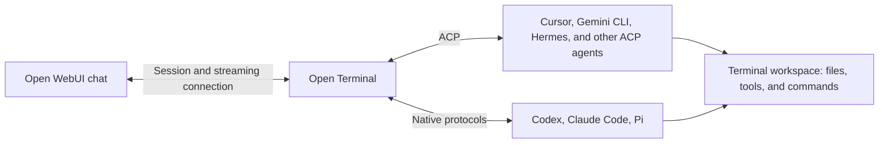

# Connect an Agent

**Run an agent in Open WebUI with Open Terminal, or connect an existing agent gateway.**

An agent harness is the software around a model that manages tools, instructions, permissions, and the loop of taking actions and checking their results. Open WebUI can run that loop with a regular model and Open Terminal, or let you work with a separate harness such as Claude Code, Codex, or Hermes from the same chat interface.

## Choose Your Setup

| What you want | Setup | Where to connect |
| :--- | :--- | :--- |
| Give your existing model a workspace for commands, files, and code | **Open WebUI + Open Terminal**: Open WebUI manages the model's tool calls; Open Terminal executes them | **Settings > Integrations > Open Terminal** (admin section) |
| Use Claude Code, Codex, Cursor, Gemini CLI, Hermes, or another supported agent in chat | **Agent through Open Terminal**: the agent CLI runs in the terminal environment and supplies its own tools and agent loop | The same **Open Terminal** connection; select the terminal, then an agent model |
| Use an agent service you already operate | **Agent gateway**: Open WebUI sends chat requests to the service's OpenAI-compatible API | **Settings > Connections > OpenAI** (admin section) |

For a new setup, start with **Open Terminal**. One connection gives you a workspace for regular models and access to the supported agent CLIs installed there.

## Quick Start with Open Terminal

### 1. Prepare the terminal environment

Follow the [Open Terminal installation guide](/features/open-terminal/setup/installation). Choose Docker for a container workspace, or bare metal to use files and tools on the host.

If you want **Codex or Claude Code**, the `ghcr.io/open-webui/open-terminal:agents` image includes both CLIs. For a new Docker installation:

```bash
docker run -d \
  --name open-terminal \
  --restart unless-stopped \
  -p 8000:8000 \
  -v open-terminal:/home/user \
  -e OPEN_TERMINAL_API_KEY=your-secret-key \
  ghcr.io/open-webui/open-terminal:agents
```

Replace `your-secret-key` with your own key. For an existing installation, follow the [update guide](/features/open-terminal/setup/updating) and retain your workspace volume when changing the image.

### 2. Install and sign in to your agent

For a regular model using terminal tools, continue to step 3. For an agent CLI, install it **inside the environment running Open Terminal** and complete its login or provider configuration as the terminal's operating-system user. A CLI installed on your laptop is not automatically available inside a Docker container or on a remote terminal.

For the Docker container above, open a shell:

```bash
docker exec -it open-terminal bash
```

Run `codex` or `claude` and complete its setup. For other agents, follow their installation instructions in that same environment. Verify that the agent can answer a prompt there before connecting it to chat. See the [supported agents](/features/open-terminal/coding-agents#supported-agents) and [agent deployment guide](https://github.com/open-webui/open-terminal/blob/main/docs/deployment.md#coding-agents).

The **Open Terminal API key** authenticates the connection to the terminal server. Each agent also needs its own login or model-provider credentials. Keep the home volume mounted so file-based agent settings and credentials survive container replacement.

### 3. Connect Open Terminal

In Open WebUI, open **Settings > Integrations** in the **Admin** section. Under **Open Terminal**, add the terminal's URL and API key, save, and enable the connection.

Use an address reachable from the Open WebUI server: for example, `http://open-terminal:8000` on a shared Docker Compose network, or `http://localhost:8000` when both processes run directly on the same machine. For separate containers, remote hosts, and access grants, follow the [connection guide](/features/open-terminal/setup/connecting).

### 4. Select a terminal and model

Start a saved chat, click the **terminal button** (cloud icon), and select your terminal. Then choose either:

- **A regular model** with capable native tool calling. Open WebUI gives it terminal tools to run commands and work with files. Check the model's [Terminal capability and bindings](/features/workspace/models#capabilities-and-bindings) if the tools are missing.
- **An agent model** named `<agent>/<model>`. Open WebUI discovers the agents and models available in the selected terminal. Only agents that successfully report their models appear.

Agent conversations support one agent at a time and require a saved chat. See [Coding Agents](/features/open-terminal/coding-agents) for how regenerating, editing and forking work.

### 5. Try a task

Open your project directory in the [file browser](/features/open-terminal/file-browser), start a new agent conversation, and ask:

> Inspect this project, explain how to run it, and run its existing tests. Report any failures with the relevant output.

The agent works in that terminal's workspace. Tool requests appear in chat and follow the selected [tool permission mode](/features/extensibility/plugin/tools#tool-approval). An existing agent conversation keeps its original working directory when you browse elsewhere.

## How Open Terminal Connects Different Harnesses

Open Terminal launches each supported agent CLI and communicates through its native interface. **Agent Client Protocol (ACP)** provides a shared interface for many agents; Codex, Claude Code, and Pi use dedicated integrations for their own protocols. See the [protocol and agent list](/features/open-terminal/coding-agents#supported-agents).



Open Terminal discovers the installed agents' models and runs their processes as the terminal user. Open WebUI turns their streamed output, tool requests, and questions into chat interactions, uploads attachments into the workspace, and stores the conversation's session information for follow-up messages. Model choices and optional controls depend on what each agent reports.

You can also [register another ACP agent](/features/open-terminal/coding-agents#add-another-acp-agent) through configuration. The agent must support the protocol used by this integration and run successfully in the terminal environment.

## Connect an Existing Agent Gateway

Use a gateway connection when you want a separately running agent service to handle requests through an OpenAI-compatible API.

| Agent | Connection | Guide |
| :--- | :--- | :--- |
| **Hermes Agent** | Hermes gateway's OpenAI-compatible API; Hermes is also supported through Open Terminal's ACP integration | [Set up the Hermes gateway](/getting-started/quick-start/connect-an-agent/hermes-agent) |
| **OpenClaw** | OpenClaw gateway's OpenAI-compatible API | [Set up OpenClaw](/getting-started/quick-start/connect-an-agent/openclaw) |

For this route, Open WebUI sends the conversation to the gateway; the remote agent manages its own workspace, tools, and execution loop. Follow the specific guide to enable the endpoint and configure its URL, authentication, and model IDs. Chat Completions compatibility alone does not guarantee support for every Open WebUI feature or for native agent approvals and session controls.
