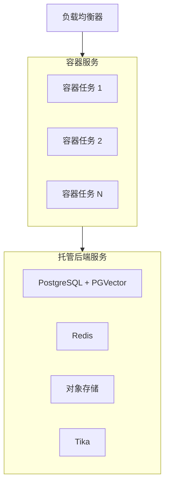

# 容器服务

在 AWS ECS/Fargate、Azure Container Apps 或 Google Cloud Run 等托管容器平台上运行官方 `ghcr.io/open-webui/open-webui` 镜像。

:::info 前提条件
继续操作前，请确保已配置[共享基础设施要求](/enterprise/deployment#shared-infrastructure-requirements)：PostgreSQL、Redis、向量数据库、共享存储和内容提取。
:::

## 何时选择此模式 {#when-to-choose-this-pattern}

- 你希望获得容器的优势（不可变镜像、版本化部署、无需管理操作系统），又不想面对 Kubernetes 的复杂性
- 你的组织已经在使用托管容器平台
- 你需要以极低的运维开销实现快速扩缩容
- 你倾向于使用托管基础设施和平台原生的自动扩缩容

## 架构 {#architecture}



## 镜像选择 {#image-selection}

为确保生产环境稳定，请使用**版本化标签**：

```
ghcr.io/open-webui/open-webui:v0.x.x
```

生产环境应避免使用滚动更新的 `:main` 和 `:latest` 标签；请固定使用 [Open WebUI 发布版本](https://github.com/open-webui/open-webui/releases)中的 `v0.x.y` 标签。如果使用 PostgreSQL、PGVector、S3 存储以及外部嵌入和提取服务，体积更小的 `v0.x.y-slim` 变体即可满足需求。请参阅[镜像变体](/getting-started/quick-start#image-variants)。

## 扩缩容策略 {#scaling-strategy}

- **平台原生自动扩缩容**：配置容器服务，根据 CPU 利用率、内存或请求数量进行扩缩容。
- **健康检查**：存活检查使用 `/health`，就绪检查使用 `/ready`；`/ready` 会等待启动完成，并检查数据库和 Redis 的连通性。
- **任务级环境变量**：在任务定义中，以环境变量或机密的形式传入所有共享基础设施配置。
- **会话亲和性**：可选；仅在使用 `ENABLE_WEBSOCKET_SUPPORT=false` 时需要。请参阅[会话亲和性](/troubleshooting/multi-replica#session-affinity-sticky-sessions)。使用 `WEBSOCKET_MANAGER=redis` 时，无论是否启用会话亲和性，Redis 都会在实例之间传递实时更新。

## 关键注意事项 {#key-considerations}

| 注意事项 | 说明 |
| :--- | :--- |
| **存储** | 使用对象存储（S3、GCS、Azure Blob）或共享文件系统（例如 EFS）。容器本地存储是临时的，不会在任务之间共享。 |
| **Tika sidecar** | 将 Tika 作为 sidecar 容器运行在同一任务定义中，或作为独立服务运行。sidecar 可将提取流量保留在本地。 |
| **机密管理** | 使用平台的机密管理器（AWS Secrets Manager、Azure Key Vault、GCP Secret Manager）管理 `DATABASE_URL`、`REDIS_URL` 和 `WEBUI_SECRET_KEY`。 |
| **更新** | 将服务缩减到单个任务，在该任务上部署新镜像（`ENABLE_DB_MIGRATIONS=true`），等待其进入健康状态，然后将其余任务恢复扩缩容（`ENABLE_DB_MIGRATIONS=false`）。对于会更改数据库架构的版本，不支持跨版本滚动更新，因此绝不能让新旧任务同时处理流量。请参阅[更新与迁移](/troubleshooting/multi-replica#updates-and-migrations)。 |

## 应避免的反模式 {#anti-patterns-to-avoid}

| 反模式 | 影响 | 解决方法 |
| :--- | :--- | :--- |
| 使用本地 SQLite | 任务重启时数据丢失，多任务运行时出现数据库锁定 | 将 `DATABASE_URL` 设置为 PostgreSQL |
| 默认使用 ChromaDB | 基于 SQLite 的向量数据库在多进程访问下崩溃 | 设置 `VECTOR_DB=pgvector`（或 Milvus/Qdrant） |
| `WEBUI_SECRET_KEY` 不一致 | 登录循环、401 错误、会话无法跨任务保持 | 通过机密管理器在每个任务上设置相同的密钥 |
| 未使用 Redis | WebSocket 故障、“Model Not Found”错误 | 设置 `REDIS_URL` 和 `WEBSOCKET_MANAGER=redis` |

有关容器基础知识，请参阅[快速开始指南](/getting-started/quick-start)。

---

**需要协助规划企业部署？** 我们的团队与全球各地的组织合作，设计并实施生产级 Open WebUI 环境。

[**联系企业销售团队 →**](https://openwebui.com/contact/sales)
