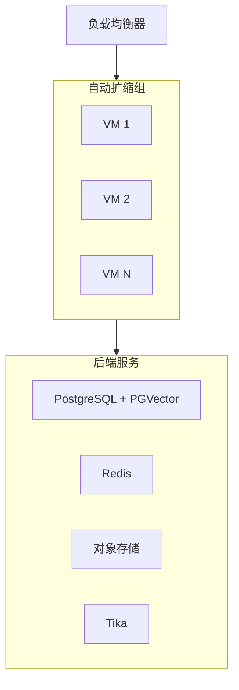

# 自动扩缩容 VM 上的 Python / Pip

在云自动扩缩组（AWS ASG、Azure VMSS、GCP MIG）中的虚拟机上，将 `open-webui serve` 部署为由 systemd 管理的进程。

:::info 前提条件
继续操作前，请确保已配置[共享基础设施要求](/enterprise/deployment#shared-infrastructure-requirements)：PostgreSQL、Redis、向量数据库、共享存储和内容提取。
:::

## 何时选择此模式 {#when-to-choose-this-pattern}

- 你的组织已经建立基于 VM 的基础设施和运维实践
- 法规或合规要求规定必须直接进行操作系统级控制
- 你的团队容器经验有限，但具备扎实的 Linux 管理能力
- 你希望采用简单的部署方式，而不承担容器编排开销

## 架构 {#architecture}



## 安装 {#installation}

在每台 VM 上使用 `postgres` 额外依赖进行安装，其中包含 PostgreSQL 和 PGVector 驱动：

```bash
python3.12 -m venv /opt/open-webui/venv
/opt/open-webui/venv/bin/pip install "open-webui[postgres]"
```

`all` 额外依赖还会添加可选的向量存储客户端、Playwright 和 Unstructured；只有在使用其中一项时才安装。

创建一个 systemd 单元来管理进程：

```ini
[Unit]
Description=Open WebUI
After=network.target

[Service]
Type=simple
User=openwebui
EnvironmentFile=/etc/open-webui/env
ExecStart=/opt/open-webui/venv/bin/open-webui serve
Restart=always
RestartSec=5

[Install]
WantedBy=multi-user.target
```

将环境变量放在 `/etc/open-webui/env` 中（请参阅[关键配置](/enterprise/deployment#critical-configuration)）。还要设置 `DATA_DIR`，例如设置为 `/var/lib/open-webui`，使本地缓存位于 Python 包目录之外；默认情况下缓存位于该目录中。

## 扩缩容策略 {#scaling-strategy}

- **水平扩缩容**：配置自动扩缩组，根据 CPU 利用率或请求数量增加或移除 VM。
- **健康检查**：将负载均衡器健康检查指向 `/ready`，它会在启动完成且数据库和 Redis 响应后给出应答。`/health` 仅表明进程正在运行。
- **每台 VM 一个进程**：保持 `UVICORN_WORKERS=1`，让自动扩缩器管理容量。
- **粘性会话**：可选；仅在使用 `ENABLE_WEBSOCKET_SUPPORT=false` 时需要。请参阅[会话亲和性](/troubleshooting/multi-replica#session-affinity-sticky-sessions)。

## 关键注意事项 {#key-considerations}

| 注意事项 | 说明 |
| :--- | :--- |
| **操作系统补丁** | 你负责操作系统更新、安全补丁和 Python 运行时管理。 |
| **Python 环境** | 在虚拟环境中使用 Python 3.11 或 3.12（建议 3.12）。 |
| **存储** | 使用对象存储（例如 S3）或共享文件系统（例如 NFS），因为自动扩缩组中的 VM 不共享本地文件系统。 |
| **Tika sidecar** | 在每台 VM 上运行一个 Tika 服务器，或将其作为共享服务运行。共享实例可简化管理。 |
| **更新** | 将组缩减到一个实例，在该实例上设置 `ENABLE_DB_MIGRATIONS=true`，更新软件包（`pip install --upgrade "open-webui[postgres]"`）并重启，等待迁移完成，然后关闭迁移并恢复扩缩容，确保每台 VM 都运行新版本。请参阅[更新与迁移](/troubleshooting/multi-replica#updates-and-migrations)。 |

有关 pip 安装的基础知识，请参阅[快速开始指南](/getting-started/quick-start)。

---

**需要协助规划企业部署？** 我们的团队与全球各地的组织合作，设计并实施生产级 Open WebUI 环境。

[**联系企业销售团队 →**](https://openwebui.com/contact/sales)
