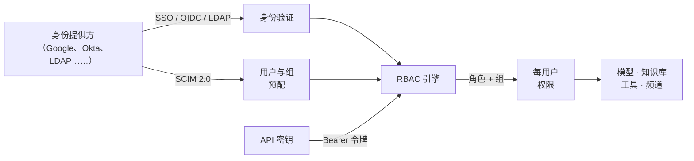

import ThemedImage from '@theme/ThemedImage';
import useBaseUrl from '@docusaurus/useBaseUrl';

# 身份验证与访问控制

<ThemedImage
  alt="身份验证：由两根立柱和一根横杆组成的大门"
  sources={{
    light: useBaseUrl('/images/banners/authentication-access-light.svg'),
    dark: useBaseUrl('/images/banners/authentication-access-dark.svg'),
  }}
  style={{ width: '100%', margin: '0.25rem 0 1.75rem' }}
/>

**控制谁可以进入、他们可以执行哪些操作，以及你的实例如何与现有身份体系集成。**

Open WebUI 从一开始就支持多用户。无论你运行的是个人实例，还是管理组织中数千个席位，都可以完全控制身份验证、授权和编程访问。连接身份提供方、定义精细权限并自动化用户生命周期管理，全程无需编写任何代码。

---

## 本节内容 {#whats-in-this-section}

| | |
| :--- | :--- |
| **[RBAC](/features/authentication-access/rbac)** | 角色、组和按资源设置的权限。定义谁可以访问哪些内容，支持[嵌套组](/features/authentication-access/rbac/groups#nested-groups)、[按组设置默认模型](/features/authentication-access/rbac/groups#default-models-per-group)和[**退出所有设备**](/features/authentication-access/rbac/roles#signing-a-user-out-of-every-device) |
| **[SSO / OIDC](/features/authentication-access/auth/sso)** | 通过 Google、Microsoft、Okta、Keycloak 或任何 OIDC 提供方进行联合身份验证 |
| **[LDAP](/features/authentication-access/auth/ldap)** | 使用现有目录服务进行身份验证 |
| **[SCIM 2.0](/features/authentication-access/auth/scim)** | 从 IdP 自动预配和取消预配用户及组 |
| **[双重验证登录（MFA）](/features/authentication-access/mfa)** | 每次登录时都要求输入身份验证器应用生成的验证码 |
| **[API 密钥](/features/authentication-access/api-keys)** | 供脚本、机器人、流水线和集成进行编程访问 |

---

## 各部分如何协同工作 {#how-it-fits-together}

1. **用户进行身份验证**：通过 SSO、OIDC、LDAP 或本地凭据。
2. **SCIM 执行预配**：从身份提供方自动预配用户和组。
3. **RBAC 决定访问权限**：根据角色（管理员、用户）和组成员关系。
4. **权限采用累加方式**：每个组成员关系只会增加能力，不会移除能力。
5. **API 密钥**继承创建者的全部权限，用于编程访问。

:::tip 面向 SSO 的用户体验
在仅使用 SSO 的环境中，可以通过 `ENABLE_PASSWORD_AUTH=false` 禁用本地密码身份验证，并通过 `ENABLE_PASSWORD_CHANGE_FORM=false` 隐藏账户页面中的密码更新控件。
:::

---

## 快速开始 {#quick-start}

### 个人或小团队？从简单配置开始 {#solo-or-small-team-start-simple}

Open WebUI 开箱即支持本地电子邮件/密码身份验证，无需外部身份提供方。创建账户、分配管理员或用户角色，即可完成设置。

### 组织使用？逐步接入 SSO 和 SCIM {#organization-layer-in-sso-and-scim}

1. **[设置 SSO](/features/authentication-access/auth/sso)**：配置身份提供方以实现单点登录
2. **[配置 RBAC](/features/authentication-access/rbac)**：创建组、分配权限并设置访问控制列表
3. **[启用 SCIM](/features/authentication-access/auth/scim)** *（可选）*：通过 IdP 自动化用户生命周期
4. **[生成 API 密钥](/features/authentication-access/api-keys)** *（可选）*：为自动化启用编程访问

---

## 核心概念 {#key-concepts}

### 累加式权限 {#additive-permissions}

Open WebUI 的安全模型采用**累加方式**。用户从其角色的默认权限开始，组成员关系只会*增加*能力。用户的有效权限是其角色和所有组所授予权限的并集。

### 资源级访问控制 {#per-resource-access-control}

模型、知识库、工具和技能均支持精细的访问控制。资源**默认为私有**。创建者可以通过向用户授权、向组授权或公开可见性，控制谁可以查看和使用这些资源。

### 管理员与用户 {#admin-vs-user}

系统有两种主要角色。**管理员**拥有完整的系统访问权限。**用户**的能力由默认权限和组成员关系共同定义。第三种角色**待审核**会让新注册用户进入队列，等待管理员批准。

[**角色 →**](/features/authentication-access/rbac/roles) · [**权限 →**](/features/authentication-access/rbac/permissions) · [**组 →**](/features/authentication-access/rbac/groups)
