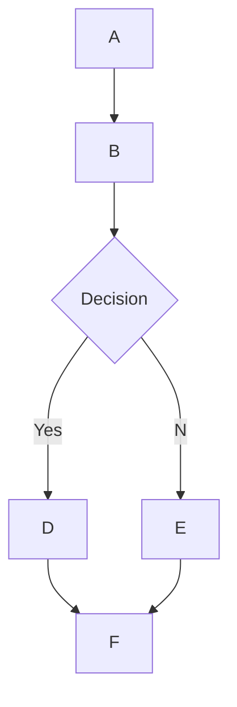

## Open WebUI 中的 MermaidJS 渲染支持 {#mermaidjs-rendering-support-in-open-webui}

## 概述 {#overview}

Open WebUI 支持直接在聊天界面中渲染美观的 MermaidJS 图表、流程图、饼图等。MermaidJS 是一款强大的复杂信息与创意可视化工具；与大语言模型（LLM）的能力结合后，它可以成为生成和探索新想法的有力工具。

## 在 Open WebUI 中使用 MermaidJS {#using-mermaidjs-in-open-webui}

要生成 MermaidJS 图表，只需在任意聊天中要求 LLM 使用 MermaidJS 创建图表。例如，你可以要求 LLM：

- “使用 Mermaid 为一个简单的决策过程创建流程图，并解释该流程图的工作原理。”
- “使用 Mermaid 可视化一棵决策树，判断是否适合外出散步。”

请注意，要正确渲染 LLM 的回复，回复必须以单词 `mermaid` 开头，后接 MermaidJS 代码。你可以参考 [MermaidJS 文档](https://mermaid.js.org/intro/)确保语法正确，并向 LLM 提供结构化提示词，引导其生成更准确的 MermaidJS 语法。

## 直接在聊天中可视化 MermaidJS 代码 {#visualizing-mermaidjs-code-directly-in-the-chat}

当你请求 MermaidJS 可视化时，大语言模型（LLM）会生成所需代码。只要代码使用有效的 MermaidJS 语法，Open WebUI 就会自动在聊天界面中直接渲染可视化内容。

如果模型生成了 MermaidJS 语法但可视化内容未渲染，通常表示代码中存在语法错误。不用担心，回复完全生成后，系统会通知你所有错误。发生这种情况时，请尝试查阅 [MermaidJS 文档](https://mermaid.js.org/intro/)定位问题，并相应地修改提示词。

如果流程图因节点标签包含括号而无法渲染，请在方括号内用双引号括住标签。例如，将 `A[Retry (manual)]` 改为 `A["Retry (manual)"]`。如果你可以编辑助手回复，请在 Mermaid 代码块中完成此修改并保存消息。

## 与可视化内容交互 {#interacting-with-your-visualization}

可视化内容显示后，你可以：

- 放大和缩小，以便更仔细地查看。
- 点击显示区域右上角的复制按钮，复制用于生成该可视化内容的原始 MermaidJS 代码。

### 示例 {#example}



这会生成类似下面的流程图：

```markdown
 startAncestor [ start ]
A[A] --> B[B]
B --> C[Decision]
C -->| Yes | D[D]
C -->| No  | E[E]
D --> F[F]
E --> F[F]
```

尝试不同类型的图表可以帮助你更细致地理解如何在 Open WebUI 中有效利用 MermaidJS。对于较小的模型，可以考虑参考 [MermaidJS 文档](https://mermaid.js.org/intro/)为 LLM 提供指导，或让模型将文档总结为全面的笔记或系统提示词。遵循这些建议并探索 MermaidJS 的功能，即可在 Open WebUI 中充分发挥这一强大工具的潜力。
