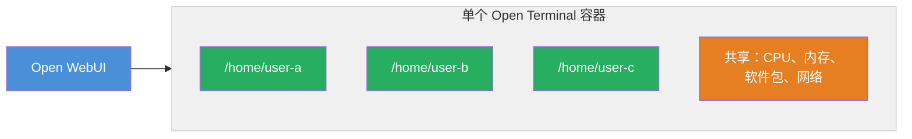
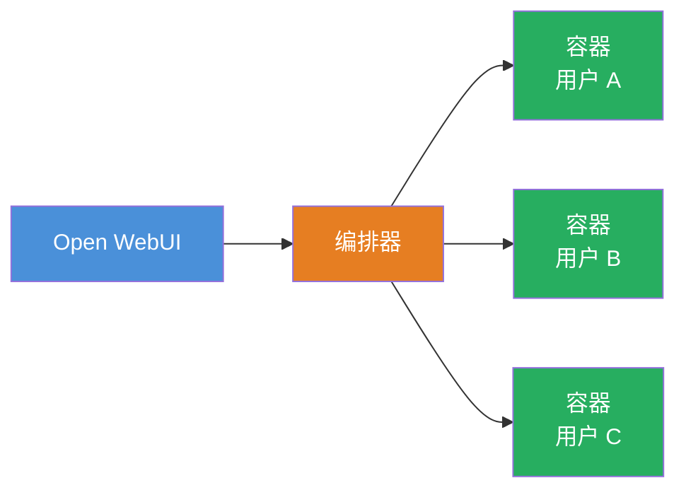

# 为团队设置 Open Terminal

当团队中的多人需要通过 Open WebUI 访问一台机器时，有两种方案可选。

| | 单容器 | Terminals |
| :--- | :--- | :--- |
| **方式** | 一个容器，内部使用独立账户 | 每位用户、每个聊天或每个模型都可以拥有自己的实例 |
| **隔离** | 一个共享容器内的独立工作区 | 每位用户、每个聊天或每个模型使用独立实例，各自拥有文件、进程和资源。在 Docker 后端上，各容器共享一个网络 |
| **设置** | 一项额外设置 | 额外的编排服务 |
| **适用场景** | 所有成员信任级别相同的小型团队 | 生产环境、较大团队、不受信任的用户 |
| **包含于** | Open Terminal（免费） | [Terminals](https://github.com/open-webui/terminals)（企业版） |

:::danger 多用户 Open WebUI 部署的必需条件
如果你的 Open WebUI 实例有**多个用户账户**，并且多个用户共享同一台机器，则**必须**使用以下两种方案之一。单个 Open Terminal 容器若未设置 `OPEN_TERMINAL_MULTI_USER=true`（或未通过 Terminals 提供每用户容器），会将所有用户置于同一个 shell、同一个文件系统和同一个网络命名空间中。这意味着任何用户都可以读取、修改或替换其他用户的文件、以共享用户身份运行命令以及绑定共享端口。多用户 Open WebUI 不支持这种配置。

**方案 1 仅分隔工作区，并不构成用户之间的安全边界。**所有人仍共享一个内核、一个进程列表、一个网络命名空间和一组系统资源；而且预配每用户账户需要容器内的提升权限，因此有意获取容器内 root 权限的用户将能够做到。只有在实例上的所有用户都具有相同信任级别时，才可运行此方案。

对于包含**不受信任用户**的部署（开放注册、面向公众的门户、彼此的数据不对对方开放的用户），请使用 **Kubernetes 后端上的方案 2（通过 Terminals 提供每用户容器）**并配置 NetworkPolicy，这种设置才能在用户之间建立真正的边界。在方案 1 上叠加 `MACHINE_PROXY_HEADERS` 可以限制代理响应在用户浏览器中的行为，但不会改变共享容器本身的任何行为。
:::

---

## 方案 1：内置多用户模式 {#option-1-built-in-multi-user-mode}

最简单的方法。添加一项设置，每个人就会自动获得独立的工作区。

```bash
docker run -d --name open-terminal -p 8000:8000 \
  -v open-terminal:/home \
  -e OPEN_TERMINAL_MULTI_USER=true \
  -e OPEN_TERMINAL_API_KEY=your-secret-key \
  ghcr.io/open-webui/open-terminal
```

{/* TODO：截图：终端中的 Docker run 命令，突出显示 MULTI_USER=true 参数。 */}

### 会发生什么 {#what-happens}

当有人通过 Open WebUI 使用机器时，Open Terminal 会自动：

1. 为该用户创建个人账户（基于其 Open WebUI 用户 ID）
2. 在 `/home/{user-id}` 设置私有主目录
3. 以其自己的账户运行所有命令
4. 将每位用户的文件保存在各自目录下

每位用户在文件浏览器中只能看到自己的文件。

{/* TODO：截图：并排显示两个视图：用户 A 的文件浏览器显示 /home/user-a/ 及其文件，用户 B 的文件浏览器显示 /home/user-b/ 及完全不同的文件。 */}

### 网络存储上的主目录 {#home-folders-on-network-storage}

每位用户的主目录仅向该用户的组开放。Open Terminal 自身通过加入每个用户的组来访问这些目录，例如在文件浏览器中列出目录。一些 NFS 设置会丢弃这些附加组，导致文件浏览器报 `403` 和 `Permission denied`，而模型的文件工具仍然正常。当 NFS 服务器运行 `rpc.mountd --manage-gids` 时会出现这种情况，因为它会忽略客户端发送的组，转而在服务器自己的用户列表中查询。使用普通 `AUTH_SYS` 时也会出现这种情况，因为它最多携带 16 个组；一旦拥有主目录的用户数超过该数量，就会遇到问题。

请将 `/home` 保存在本地存储中，例如上例中的 Docker 卷。如果必须使用 NFS，请采用能够保留客户端组的设置（如 Kerberos），或在 NFS 服务器上添加相同的用户和组。

### 哪些内容共享，哪些内容独立 {#whats-shared-vs-separate}

| | 每用户独立 | 共享 |
| :--- | :--- | :--- |
| 主目录和文件 | 是 | |
| 运行命令 | 是 | |
| 系统软件包 | | 是 |
| CPU 和内存 | | 是 |
| 网络访问 | | 是 |
| 进程列表和命令行 | | 是 |
| 系统状态和容器内 root | | 是 |

:::warning 适用于受信任的小型团队，不适用于生产环境
此模式为每个人提供独立工作区，但所有人都运行在同一容器中。内存、CPU 等资源压力由大家共同承担。网络命名空间共享，因此一个用户绑定的端口（例如 `python -m http.server 8080`）可以从该容器上任何其他用户的 shell 访问。端口列表和端口代理按端口所有者划分范围，因此该端口不会出现在其他用户的文件导航器中，但仍可通过 shell 直接请求访问。进程列表共享，因此用户可以查看彼此正在运行的命令。由于预配账户本身就需要提升权限，任何账户都可以获得容器内的 root 权限。

同一实例上的每位用户都应视为具有相同信任级别；需要保护用户免受彼此影响时，请使用下方 **Kubernetes 后端上的方案 2（每用户容器）**。在此基础上叠加 [`MACHINE_PROXY_HEADERS`](/reference/env-configuration#machine_proxy_headers) 配置，会通过浏览器中的沙箱 CSP 限制代理响应，这值得采用，但不会改变容器内部的行为。
:::



---

## 方案 2：通过 Terminals 提供每用户容器 {#option-2-per-user-containers-with-terminals}

对于较大部署或需要真正隔离的场景，[**Terminals**](../terminals/) 可以为每位用户提供独立实例，其文件、进程和资源与其他人完全分离。

- **完全隔离**：每位用户使用独立实例，每个实例拥有自己的文件、进程和资源
- **按需预配**：用户开始会话时创建实例，空闲时清理
- **资源控制**：在服务器上限内，为每台机器设置 CPU、内存和存储限制
- **多种环境**：具有写入权限的用户可以为不同团队（例如数据科学、开发）创建不同配置的机器，并与用户和组共享
- **后端**：Docker、Kubernetes 或 Kubernetes Operator
- **实例范围**：一台机器可以按用户、已保存聊天或模型分别运行一个实例，请参阅[创建机器](/features/open-terminal/terminals/orchestration/creating-terminals#machine-scope)
- **Docker 后端的网络**：设置 `TERMINALS_DOCKER_NETWORK` 后，各实例共享该 Docker 网络，编排器通过名称访问每个实例，一个实例可以访问另一个用户的实例所开放的端口。未设置时，编排器通过发布到 Docker 宿主机的端口访问实例。终端的**网络**设置可选择管理员在 `TERMINALS_NETWORK_PROFILES` 中定义的网络配置文件之一，从而将其置于另一个 Docker 网络。文件和进程仍保持独立。对于彼此不信任的用户，请运行 Kubernetes 后端并添加 NetworkPolicy



提供三种部署后端：

- **[Docker 后端](../terminals/#deployment)**：在单个 Docker 主机上运行。最适合中小型团队或没有 Kubernetes 的环境。
- **Kubernetes**：编排器自行创建 Pod、卷和服务，无需 Operator 或 CRD。设置 `TERMINALS_BACKEND=kubernetes`。
- **[Kubernetes Operator](../terminals/#deployment)**：使用基于 CRD 的 Operator 进行生产级部署，通过 Helm Chart 与 Open WebUI 一起部署。

:::info 需要企业版许可证
Terminals 需要 [Open WebUI 企业版许可证](/enterprise)。许可证详情请参阅 [Terminals 仓库](https://github.com/open-webui/terminals)。
:::

## 相关内容 {#related}

- [Terminals 概述 →](../terminals/)
- [Terminals：Docker 后端 →](../terminals/#deployment)
- [Terminals：Kubernetes Operator →](../terminals/#deployment)
- [安全最佳实践 →](./security.md)
- [所有配置选项 →](./configuration.md)
