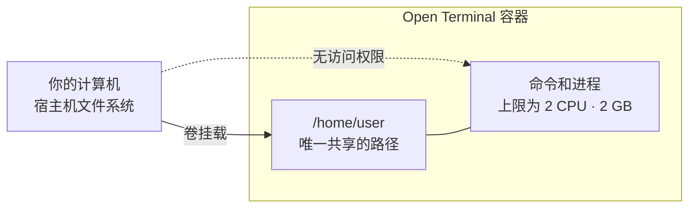
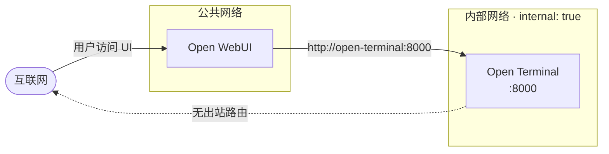
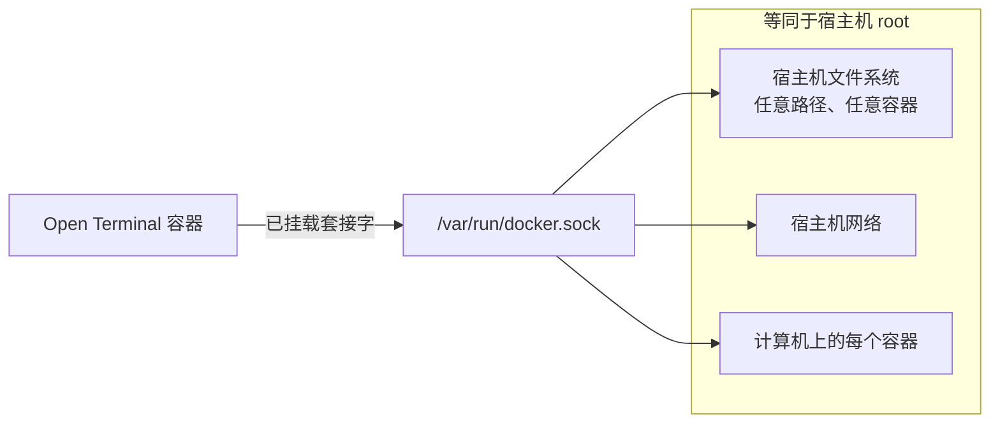

# 安全最佳实践

Open Terminal 让 AI 能够真正运行命令和管理文件。下面介绍如何确保这些能力得到安全使用。

---

## 使用 Docker {#use-docker}

除非确实需要直接访问你的计算机，否则**始终使用 Docker**。Docker 将 Open Terminal 隔离在自己的容器中：它拥有独立的文件系统和进程，除非你明确允许，否则无法访问宿主计算机上的任何内容。

```bash
docker run -d --name open-terminal -p 8000:8000 \
  --memory 2g --cpus 2 \
  -v open-terminal:/home/user \
  -e OPEN_TERMINAL_API_KEY=your-secret-key \
  ghcr.io/open-webui/open-terminal
```

`--memory 2g` 和 `--cpus 2` 参数可以防止失控进程耗尽计算机的所有资源。



容器只能访问你计算机上的一个路径，即你挂载的卷。宿主机文件系统上的其他所有内容都位于容器之外，资源限制参数则可防止失控进程拖垮整台计算机。

:::warning 不使用 Docker 运行
不使用 Docker（裸机模式）时，AI 可以以你的用户权限运行任意命令，包括删除文件、安装软件或访问你的账户有权访问的任何内容。仅在自己的个人计算机上为个人项目使用裸机模式。
:::

---

## 始终设置密码 {#always-set-a-password}

API 密钥是所有访问的关卡：任何能够访问该端口并提供密钥的人，都可以运行命令、读取文件和控制机器。没有密钥时服务器会拒绝启动：直接运行 `uvicorn` 需要设置 `OPEN_TERMINAL_API_KEY`，而 CLI 会在你未提供密钥时生成一个。请设置自己的强密钥，不要依赖生成的密钥。

```bash
-e OPEN_TERMINAL_API_KEY=a-strong-password-here
```

在生产环境中，请使用[配置文件](./configuration.md#config-file)或 [Docker secrets](./configuration.md#docker-secrets)，不要将密钥放在命令行中。

如果未提供密钥，服务器会生成一个并在启动时打印：

```bash
docker logs open-terminal
```

```
  Local:    http://localhost:8000
  Network:  http://172.17.0.2:8000

  API Key:  <auto-generated key appears here>
```

生成的值只能作为起点，不能视为安全的密码。请将其替换为你自己的强密钥，并在生产环境中避免将其放在命令行中。

---

## 使用管理员配置的连接 {#use-admin-connections}

以管理员身份添加机器。API 密钥会隐藏在服务器上，请求通过 Open WebUI 后端发送，并且你可以控制谁拥有访问权限。

用户在 Tether 中添加的机器会列在**你的设备**下，并通过该用户自己的计算机访问，请参阅[自带模型和工具](/ecosystem/tether#bring-your-own-models-and-tools)。


---

## 限制资源 {#limit-resources}

防止失控脚本耗尽所有可用的 CPU 和内存：

```yaml title="docker-compose.yml"
deploy:
  resources:
    limits:
      memory: 2G
      cpus: "2.0"
```

如果进程超出这些限制，Docker 会限制其速度（CPU）或将其终止（内存），从而保持服务器正常运行。

使用 `docker stats` 检查容器的实际资源用量：

```bash
docker stats --no-stream open-terminal
```

```
NAME             CPU %     MEM USAGE / LIMIT   MEM %
open-terminal    0.04%     67.57MiB / 2GiB     3.30%
```

限制列会反映你设置的参数，因此可以据此确认上限确实生效，而不是凭空假设。

---

## 网络隔离 {#network-isolation}

要实现最安全的设置，请将 Open Terminal 放在只有 Open WebUI 可以访问的**私有 Docker 网络**中：

```yaml title="docker-compose.yml"
services:
  open-webui:
    image: ghcr.io/open-webui/open-webui:latest
    ports:
      - "3000:8080"
    networks:
      - public
      - internal

  open-terminal:
    image: ghcr.io/open-webui/open-terminal
    # 注意：不向外部公开端口
    networks:
      - internal

networks:
  public:
  internal:
    internal: true   # 此网络无法访问互联网
```

这意味着：
- Open WebUI 可以通过 `http://open-terminal:8000` 访问 Open Terminal
- 互联网**无法访问** Open Terminal
- Open Terminal **无法发出互联网出站请求**



Open WebUI 同时位于两个网络中，因此既能服务用户，也能访问终端。终端仅位于内部网络中，因此互联网上的任何对象都无法访问它，它也无法向外发起请求。

---

## 出站过滤 {#egress-filtering}

如果 Open Terminal 需要*部分*互联网访问（例如安装软件包），可以将其限制到特定域：

```bash
-e OPEN_TERMINAL_ALLOWED_DOMAINS="pypi.org,github.com,*.npmjs.org"
```

只有这些域可以访问，其他所有域都会被阻止。这可以防止：
- 未经授权的数据离开容器
- 下载意外软件
- 访问你未打算开放的内部服务

启动时，服务器会确认解析了哪些域以及防火墙已启用：

```
Egress: DNS whitelist — pypi.org,github.com
  ✓ pypi.org (+ subdomains)
  ✓ github.com (+ subdomains)
dnsmasq started (upstream: 1.1.1.1)
Egress firewall active — dropping CAP_NET_ADMIN permanently
```

在容器内，允许的主机可以解析，被阻止的主机则无法解析：

```bash
curl https://github.com/        # 上述列表允许
curl https://example.com/       # 不在列表中，DNS 解析失败
```

:::note 需要额外能力
出站过滤会在容器内设置 `dnsmasq` 和 `iptables`，因此需要 `--cap-add NET_ADMIN`。在容器随后无法丢弃 `CAP_NET_ADMIN` 的主机上，它会在启动时退出并报告 `unable to raise CAP_SETPCAP for BSET changes`。如果遇到此问题，请先检查宿主机的 seccomp 和能力设置，再依赖此模式。
:::

---

## Docker 套接字警告 {#docker-socket-warning}

Docker 容器可以选择访问宿主机的 Docker（以便让 AI 构建镜像、运行容器等）：

```bash
-v /var/run/docker.sock:/var/run/docker.sock
```

:::danger 仅限受信任的环境
挂载 Docker 套接字会赋予容器对宿主机 Docker 的**完全控制权**。这实际上等同于你计算机上的 root 访问权限。任何拥有终端访问权限的人都可以：
- 运行挂载整个文件系统的容器
- 访问宿主机网络
- 管理计算机上的每个容器

只有完全信任所有拥有终端访问权限的人时，才可这样做。
:::



挂载套接字并不是一项范围狭窄的权限。它赋予容器与你相同的 Docker 控制权，因此只有信任所有能够访问终端的人时，才应这样做。

---

## 端口预览在沙箱中运行 {#port-previews-run-sandboxed}

当智能体启动服务器时，[浏览器选项卡](../use-cases/web-development.md#the-browser-tab)会将其显示在沙箱框架中。框架允许脚本、表单、弹出窗口、模态框和下载，因此普通应用可以正常运行；但默认情况下，该框架会被视为独立于 Open WebUI 的来源，从而使终端中运行的内容与你的会话隔离。

**设置 > 界面 > 机器预览允许同源**会放宽这一限制，除非你主动开启，否则它处于关闭状态。仅对你编写且信任、并且确实需要同源浏览器 API（如存储或 Cookie）的内容启用它；同时请记住，正在预览的代码往往就是智能体刚刚编写的代码。

## 多用户模式只是工作区划分 {#multi-user-mode-is-a-workspace-split}

`OPEN_TERMINAL_MULTI_USER=true` 会在一个容器内为每位 Open WebUI 用户提供独立的 Linux 账户和主目录，使用户及其智能体在工作时不会进入彼此的文件。所有人仍共享内核、进程列表、网络命名空间和系统；而且预配这些账户需要容器内的提升权限，因此任何账户都可以获得其中的 root 权限。只有在该实例上的所有用户都具有相同信任级别时，才可运行此模式。

需要保护用户免受彼此影响时，请使用 [Terminals](../terminals/) 为每位用户提供独立容器。两种方案的并排比较请参阅[多用户设置](./multi-user.md)。

---

## 安全检查清单 {#security-checklist}

- [ ] 使用 Docker，而不是裸机
- [ ] 设置强 API 密钥
- [ ] 使用管理员配置的连接
- [ ] 设置内存和 CPU 限制
- [ ] 使用网络隔离（内部 Docker 网络）
- [ ] 如果不需要互联网访问，请启用出站过滤
- [ ] 除非必要，否则不要挂载 Docker 套接字
- [ ] 如果不需要在运行时安装软件包，请使用 `slim` 或 `alpine` 镜像
- [ ] 除非预览确实需要，否则保持**机器预览允许同源**关闭
- [ ] 需要保护用户免受彼此影响时，为每位用户提供独立容器

## 相关内容 {#related}

- [所有配置选项 →](./configuration.md)
- [多用户设置 →](./multi-user.md)
