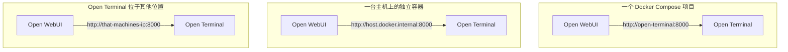

# 将 Open Terminal 连接到 Open WebUI

Open Terminal 已[安装并运行](./installation.mdx)。本指南介绍如何将其连接到 Open WebUI。

若要让 Open WebUI 为你在服务器或笔记本电脑上安装 Open Terminal，请参阅 [SSH 机器](./ssh-machines.md)。若要在 Open WebUI 自身所在的服务器上运行，请参阅[本地机器](./local-machine.md)。

---

## 推荐：管理员设置 {#recommended-admin-settings}

推荐所有部署采用此方式，包括单用户部署。管理员连接会将 API 密钥保留在服务器端。

### 1. 打开设置 {#1-open-settings}

点击左侧边栏底部的**姓名**打开用户菜单，然后点击**设置**。


### 2. 前往“设置 > 集成”（管理员部分） {#2-go-to-settings--integrations-admin-section}

在设置侧边栏中，找到**管理员**部分并点击**集成**。


### 3. 找到“Open Terminal”部分 {#3-find-the-open-terminal-section}

向下滚动，直到看到包含 **Open Terminal** 连接的**机器**部分。当 [`ENABLE_TOOL_SERVERS`](/reference/env-configuration#enable_tool_servers) 设置为 `False` 时，该部分会灰显。


:::warning 不要与“工具”混淆
请在**机器**部分添加 Open Terminal，而不是在**外部工具服务器**下的**工具**部分添加。只有**机器**部分提供内置文件浏览器和终端侧边栏。
:::

### 4. 点击 + 并填写详细信息 {#4-click--and-fill-in-the-details}

| 字段 | 填写内容 |
| :--- | :--- |
| **URL** | `http://localhost:8000`（如果使用 Docker Compose，则为 `http://open-terminal:8000`） |
| **API 密钥** | 安装时选择的密码 |
| **身份验证** | 保持为 `Bearer`（默认值）。[身份验证](#auth)介绍了其他选项会导致交互式终端无法使用的原因 |
| **聊天上传** | 新连接初始使用 `Filesystem`。[聊天上传](#chat-uploads)介绍了各选项的作用 |
| **工作目录上下文** | 位于**高级**下，默认开启。[工作目录上下文](#working-directory-context)介绍了何时应将其关闭 |
| **用户 Shell 工具** | 位于**高级**下。保持为 `Automatic`。[用户 Shell 工具](#user-shell-tools)介绍了 `Always Include` 会产生的变化 |
| **转发 Cookie** | 位于**高级**下，默认关闭。仅对通过 Cookie 进行身份验证的机器开启，因为浏览器为你的 Open WebUI 域保存的所有 Cookie 都会随请求发送 |


### 5. 保存 {#5-save}

点击**保存**。连接会显示在 **Open Terminal** 下，其开关处于开启状态。


### 6.（可选）限制特定组的访问权限 {#6-optional-restrict-access-to-specific-groups}

通过访问控制按钮，将访问权限限制为特定用户组。


:::tip 编排器连接可以进一步限定范围
与 [Terminals 编排器](/features/open-terminal/terminals/)的连接具有**读取**和**写入**访问权限。拥有**写入**权限的用户可以从消息输入框的机器菜单中创建自己的机器，每台机器都有各自的镜像、资源、环境变量和共享设置。请参阅[创建机器](/features/open-terminal/terminals/orchestration/creating-terminals)。直接 Open Terminal 连接没有可创建的机器，所有拥有访问权限的人员均可使用。
:::

### 7. 在聊天中选择机器 {#7-select-a-machine-in-chat}

在聊天输入区域，点击云图标。你的机器会显示在**机器**下。选择一台机器，为当前对话启用它。


选定的机器名称会显示在云图标旁。AI 现在可以通过它执行命令、读取文件和运行代码。除正在生成回复时外，你随时可以另选机器。

将鼠标悬停在菜单中的机器上，点击其**更多**按钮并选择**系统信息**，即可查看其报告的 CPU、内存、磁盘和网络使用情况、运行时间及主要进程。视图打开期间每 5 秒刷新一次。对于每个聊天使用独立实例的机器，**系统信息**会在聊天保存后显示。

### 8. 启用原生函数调用 {#8-enable-native-function-calling}

原生函数调用是默认的工具调用模式，因此新模型已经启用。你只需确认模型未切换为**旧版**：

1. 前往**工作区 → 模型**
2. 点击正在使用的模型上的编辑按钮
3. 确保**函数调用**设置为**默认**或**原生**，而不是**旧版**
4. 保存


:::warning 旧版模式的工具调用可靠性较低
如果模型设置为**旧版**，Open WebUI 会回退到基于提示词的工具调用，而不使用提供方的结构化工具调用格式。这种方式可靠性较低，甚至可能完全无法触发终端命令。建议使用原生模式（默认）。
:::

:::tip 性能取决于模型
并非所有模型都同样擅长使用工具。多步骤终端工作流是 Open WebUI 中对智能体能力要求最高的使用场景，因此顶级模型在这里确实能体现价值：GPT-5.6 Sol、Claude Opus 5 或 Gemini 3.5 Pro。当前的中端模型（GPT-5.6 Terra、Claude Sonnet 5、Gemini 3.6 Flash、MiniMax M3）是实际可用的**最低**配置。较旧或非常小的模型可能无法调用工具，或生成格式错误的工具调用。如果结果不佳，请尝试能力更强的模型。
:::

### 9. 试用 {#9-try-it-out}

向 AI 提出类似下面的问题：

> “你正在哪个操作系统上运行？”

AI 应使用 Open Terminal 运行命令并告诉你答案。


:::tip 通过环境变量预先配置
对于 Docker 部署，可以使用 [`MACHINE_CONNECTIONS`](/reference/env-configuration#machine_connections) 环境变量自动配置机器。当你希望在启动时完成全部设置而不手动操作时，这会很有用。
:::

---

## 你自己的机器（Tether） {#your-own-machine-tether}

没有管理员权限时，可以在 Tether 应用中添加机器。该机器仅供你使用，其 URL 和密钥会保留在你的计算机上。请参阅[自带模型和工具](/ecosystem/tether#bring-your-own-models-and-tools)。

---

## 身份验证 {#auth}

连接表单中的**身份验证**决定 Open WebUI 向终端服务器发送什么凭据。模型的工具以及文件浏览器的列表、读取和上传操作通过 HTTP 进行。**新建终端**选项卡中的 shell、文件浏览器的实时刷新和监听端口、**桌面**选项卡以及正在运行命令的流式输出通过 WebSocket 进行。这两条路径发送的内容不同：

| 身份验证 | HTTP 请求 | WebSocket 连接 |
| :--- | :--- | :--- |
| `Bearer` | 将 **API 密钥**作为 bearer 令牌 | **API 密钥** |
| `None` | 不发送密钥 | 空令牌 |
| `Session` | 将用户自己的 Open WebUI 令牌作为 bearer 令牌 | 空令牌 |
| `OAuth` | 用户具有 OAuth 登录会话时，将其 OAuth 访问令牌作为 bearer 令牌 | 空令牌 |

`Bearer` 是唯一会发送 **API 密钥**的选项，也是唯一能对两条路径都进行身份验证的选项。使用 `Session` 或 `OAuth` 时，如果终端服务器接受相应令牌，模型的工具和文件浏览器可以工作，但每个 WebSocket 功能都会以空令牌访问服务器。只有终端服务器接受无密钥连接时，这些功能才能工作。Open Terminal 配置了 API 密钥，因此请为其保留 `Bearer`。

通过 [Terminals 编排器](/features/open-terminal/terminals/)连接创建的终端始终使用 `Bearer` 和连接的 **API 密钥**，无论**身份验证**如何设置。

---

## 聊天上传 {#chat-uploads}

连接表单中的**聊天上传**决定选中某台机器时，聊天输入框中附件文件的去向。

`Default` 会将文件上传到 Open WebUI，提取其文本，并根据聊天设置通过检索或全文方式将内容交给模型读取。这与未选择任何机器时的行为相同。

新机器初始使用 `Filesystem`，[Tether](/ecosystem/tether) 机器也始终使用该选项。

`Filesystem` 会将文件写入机器的工作文件夹，即[文件浏览器](../file-browser.md)当前打开的文件夹或机器的当前工作目录，文件会立即显示在那里。Open WebUI 不存储任何内容，不提取文本，也不运行检索，因此模型不会收到文件内容。模型会收到路径，并使用机器自己的工具打开文件，就像读取工作区中的其他任何内容一样。

ZIP 压缩包、SQLite 数据库、视频文件、远超上下文窗口大小的导出文件：文本提取对它们几乎无能为力，而 shell 可以处理所有这些文件。以此方式附加文件，可以将文件放到模型运行的命令能够访问的位置。

这会带来四项变化：

- **模型无需支持文件上传。** 使用 `Default` 时，如果在选择了不支持文件上传的模型时附加文件，系统会报告“Model(s) do not support file upload”（模型不支持文件上传），且不会上传任何内容。使用 `Filesystem` 时，文件绝不会作为附件传给模型，因此不会执行这项检查。
- **仅在模型能够处理路径时才告知路径。** 当模型在已保存的对话中使用原生函数调用时，Open WebUI 会随消息一并将附件文件的路径传给模型。如果将模型设置为[旧版](#8-enable-native-function-calling)函数调用，或关闭其**内置工具**能力，文件仍会到达终端，但模型不会获得其位置。
- **图片采用相同的处理方式。** 附加到已保存对话的图片会写入工作目录，而不会作为图片传给模型。Open WebUI 仍会先根据所选模型的图片支持情况进行检查，因此不支持视觉的模型会在输入阶段拒绝图片。
- **上传限制仍然适用。** 发送任何内容之前，系统都会检查 Open WebUI 配置的最大文件大小和最大附件数量，因此 `Filesystem` 不会解除这些限制。

对于[每个聊天使用独立实例](/features/open-terminal/terminals/orchestration/creating-terminals#machine-scope)的机器，附加到新聊天第一条消息的文件会在发送时上传到该聊天的实例中。

管理员添加的每台机器都有此字段。[Tether](/ecosystem/tether) 机器始终使用 **Automatic**。


---

## 工作目录上下文 {#working-directory-context}

管理员添加的连接中，**工作目录上下文**位于**高级**下，默认开启。开启期间，Open WebUI 会在每条消息中向终端询问其当前工作目录，并将其写入命令工具的指令，使模型知道命令在哪里运行。

工具指令属于每个请求的缓存前缀，因此每次更改目录都会让提供方的[提示词缓存](/features/chat-conversations/prompt-caching)重新开始。关闭此开关可使各条消息的指令保持一致。

## 用户 Shell 工具 {#user-shell-tools}

通过**选项卡**的 **+** 菜单打开的**新建终端**选项卡是你自己的 shell。两个工具允许模型读取该 shell 最近的输出并向其发送输入。**高级**下的**用户 Shell 工具**决定模型何时获得这些工具：

- `Automatic`（默认）：仅在发送消息的聊天中打开该机器的 shell 时提供。每条消息发送前，Open WebUI 都会向终端服务器询问 shell 是否已打开。
- `Always Include`：每条消息都提供，无论 shell 是否打开。各条消息的工具列表保持一致，因此打开和关闭 shell 时可保持[提示词缓存](/features/chat-conversations/prompt-caching)不变。

自动化和子智能体永远不会获得这两个工具。管理员添加的每台机器都有此字段。[Tether](/ecosystem/tether) 机器始终使用 **Automatic**。

## AGENTS.md {#agentsmd}

在聊天中选择终端后，Open WebUI 会在每条消息中读取终端用户主目录下的 `AGENTS.md`。其内容会作为用户消息添加到对话中，位置紧挨第一条用户消息之前，使模型获得你为该工作区设置的长期指令。对文件的编辑从下一条消息开始生效。Windows 主目录同样适用。

大于 32 KiB 的文件会被跳过，读取时间超过 5 秒也会被跳过。对于管理员配置的机器，由 Open WebUI 服务器读取文件。对于用户在 Tether 应用中添加的机器，通过 Tether 读取，因此 Tether 应用必须保持连接。

---

## 故障排除 {#troubleshooting}

### “连接失败”或超时 {#connection-failed-or-timeout}

这几乎总是表示 Open WebUI 无法通过网络访问 Open Terminal。应使用的 URL 取决于你的设置：

| 你的设置 | 应使用的 URL |
| :--- | :--- |
| Docker Compose（推荐） | `http://open-terminal:8000` |
| 独立的 Docker 容器 | `http://host.docker.internal:8000` |
| 两者位于同一台机器，不使用 Docker | `http://localhost:8000` |
| Open Terminal 位于另一台机器 | `http://that-machines-ip:8000` |



Compose 为容器提供共享网络并解析服务名称，因此服务名称就是地址。独立容器没有可共同解析的名称，因此请求会通过主机转发。访问另一台机器上的终端，与访问其他任何主机的方式相同。

仅当两端都未容器化时，`localhost` 才有效，因为在容器内部，`localhost` 指的是容器本身，而不是运行容器的主机。这是本节所述超时最常见的原因。

:::tip 快速检查
运行以下命令，查看 Open WebUI 能否访问 Open Terminal：

```bash
docker exec open-webui curl -s http://open-terminal:8000/health
```

如果输出 `{"status": "ok"}`，则连接正常。如果出现错误，则容器之间无法相互访问。
:::

### 机器已显示，但 AI 不使用它 {#machine-shows-up-but-ai-doesnt-use-it}

请确保：
- 连接旁的切换开关已**开启**。关闭开关会让机器完全停止服务：模型不会获得其工具，终端和文件浏览器会拒绝连接，任何代理到该机器的请求也会被拒绝。它是真正可用的关闭开关，而不只是给模型的提示，因此可以用它停用机器，同时保留连接。
- 添加连接后已**刷新页面**
- 你的模型支持工具调用（大多数现代模型都支持）

### 机器未显示在选择器中 {#machine-is-missing-from-the-picker}

列表仅显示用户获准使用的机器，因此请检查连接的访问授权，并确认连接已启用。

对于编排器连接，只有机器共享给你，或你拥有连接的**写入**权限时，机器才会显示在列表中。每个聊天使用独立实例的机器会在临时聊天中隐藏，因为它需要已保存的对话。请参阅[创建机器](/features/open-terminal/terminals/orchestration/creating-terminals#machine-scope)。

### 命令输出为空 {#command-output-is-empty}

`run_command` 结果显示 `"status": "running"`，且 `output` 列表为空。`run_command` 会在后台启动命令并立即返回其命令 ID。仅当调用发送 `wait` 值（最多 `300` 秒）或服务器设置了 `OPEN_TERMINAL_EXECUTE_TIMEOUT` 时，它才会等待命令；后者默认未设置。模型随后使用该 ID 调用 `get_process_status` 读取输出，此调用也接受 `wait`。

若要在短命令的首次结果中获得输出，请在 Open Terminal 服务器上设置 `OPEN_TERMINAL_EXECUTE_TIMEOUT`，例如 `OPEN_TERMINAL_EXECUTE_TIMEOUT=5`，然后重启服务器。较快结束的命令会在结束时立即返回。运行时间更长的命令仍会返回 `running` 状态，其输出需要通过 `get_process_status` 获取。请参阅[配置](/features/open-terminal/advanced/configuration)。

### 多用户模式下文件浏览器显示 Permission denied {#file-browser-shows-permission-denied-in-multi-user-mode}

当[多用户模式](/features/open-terminal/advanced/multi-user)下的机器在文件浏览器中出现 `403` 和 `Permission denied` 错误，而模型仍能读取文件时，请检查 `/home` 的存储位置。请参阅[网络存储上的主目录](/features/open-terminal/advanced/multi-user#home-folders-on-network-storage)。

### API 密钥错误 {#wrong-api-key}

如果看到“unauthorized”或“invalid key”：
- 再次确认密钥与安装时设置的值一致
- 如果忘记了密钥，请运行 `docker logs open-terminal` 并查找 `API Key:` 行

## 后续步骤 {#next-steps}

- **[代码执行](../use-cases/code-execution.md)**
- **[文档与数据分析](../use-cases/file-analysis.md)**
- **[软件开发](../use-cases/software-development.md)**
- **[文件浏览器](../file-browser.md)**
