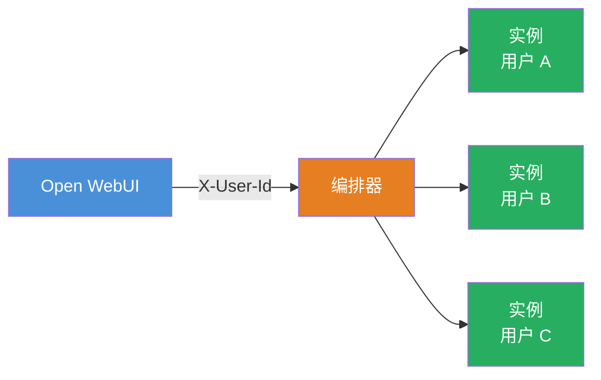

import Tabs from '@theme/Tabs';
import TabItem from '@theme/TabItem';

import Docker from './tab-deployment/Docker.md';
import Kubernetes from './tab-deployment/Kubernetes.md';

# Terminals（编排器）

**Terminals** 为团队管理 [Open Terminal](/features/open-terminal) 实例。每个实例都是一个容器，AI 在其中运行命令和处理文件。实例可以属于某个用户、聊天或模型，也可以由所有人共享，并拥有自己的文件、进程、软件包、资源限制、网络配置和可选的持久化存储。

[在 GitHub 上查看 →](https://github.com/open-webui/terminals)

Open Terminal 为 Open WebUI 聊天提供可供操作的真实工作区。Terminals 为多人管理这些工作区，让每个人都能获得合适的工作区，而无需手动连接容器。你在 Open WebUI 中创建、共享和使用终端，Terminals 负责在后台启动、复用和清理实例。

Terminals 可以为每个人员、聊天或模型提供独立工作区，使文件和进程互不混杂。它还提供预先配置的环境：只需设置一次镜像、资源、起始目录和安装脚本，即可与组共享终端。空闲实例会在你设置的空闲超时后清理。它适用于为团队运行 Open WebUI 的管理员。当一个共享 Open Terminal 无法满足需求，因为人员需要独立的文件、工具和限制时，请使用 Terminals。

:::tip 快速导航
- **需要管理按用户划分的终端环境？** → [编排](/features/open-terminal/terminals/orchestration)
- **需要创建和共享终端？** → [创建机器](/features/open-terminal/terminals/orchestration/creating-terminals)
:::

---

## 工作原理 {#how-it-works}

编排器位于 Open WebUI 和 Open Terminal 实例之间：

1. 用户在 Open WebUI 中启用 Open Terminal。
2. Open WebUI 将请求代理到负责管理工作区生命周期的**编排器**。
3. 编排器读取所选[终端](/features/open-terminal/terminals/orchestration/creating-terminals)的配置：镜像、资源、存储、环境变量、起始目录、安装脚本和实例作用域。
4. 编排器根据终端的实例作用域，预配或复用匹配的 Open Terminal 实例：每个用户、聊天或模型一个实例，或所有人共享一个实例。
5. 所有流量都经过编排器。
6. 空闲实例会在你设置的空闲超时后清理。主目录中的文件会保留：Docker 将其保存在数据文件夹中；启用存储时，Kubernetes 将其保存在持久卷上。

编排器提供与 Open Terminal 相同的基于 OpenAPI 的工具接口，因此 AI 可以处理文件、运行代码、执行命令、启动服务器和检查结果，所有这些操作都在终端作用域选定的实例内进行。

## 重要作用 {#why-it-matters}

Terminals 让管理员能够为智能体提供足以完成实际工作的环境，同时控制其限制：

| 需求 | Terminals 提供的能力 |
| :--- | :--- |
| 隔离 | 每个实例具有独立的文件和进程；终端需要时，每个用户、已保存聊天或模型使用一个实例 |
| 治理 | 终端具有指定的镜像、环境变量、资源限制和存储，根据服务器上限进行校验，并仅与选定用户和组共享 |
| 可重复性 | 自定义镜像和启动软件包，确保用户每次都获得合适的工具 |
| 生命周期 | 复用、空闲清理，以及按实例启动、停止、重启和删除 |
| 规模 | 单主机使用 Docker，较大部署使用 Kubernetes/operator 模式 |
| 可支持性 | 管理界面、日志、状态、模板 API 和可预测的路由 |

:::info 管理界面
编排器在 `/` 提供内置的精简管理界面，其中包含**模板**（创建和编辑终端、重置计划、删除）和**环境**（检查实例，包括已停止的实例，以及启动、停止、重启、重置或删除实例）。它使用 `TERMINALS_API_KEY` 登录。该界面默认开启，由 `TERMINALS_ENABLE_UI` 控制；对于仅使用 API 的部署，请将其设置为 `false`。
:::

---

## 部署 {#deployment}

<Tabs>
  <TabItem value="docker" label="Docker" default>
    

      <Docker />
    

  </TabItem>
  <TabItem value="kubernetes" label="Kubernetes Operator">
    

      <Kubernetes />
    

  </TabItem>
</Tabs>

---

## 身份验证 {#authentication}

Open WebUI 与编排器共享一个 API 密钥。在编排器上设置 `TERMINALS_API_KEY`，并在 Open WebUI 的连接中将**身份验证**设置为 **Bearer**，将相同值填写为 **API 密钥**。Open WebUI 会检查谁可以使用终端。终端请求携带已验证的用户 ID，编排器接受携带该密钥的请求。请妥善保管密钥：它还可以访问内置管理界面和模板 API。

如果未设置 `TERMINALS_API_KEY`，`terminals serve` 会生成并打印一个密钥。生成的密钥会在每次重启时变化，因此任何实际部署都应设置固定值。

使用 Helm 时，chart 会生成共享密钥并在两端进行配置。使用 Docker Compose 时，在 Compose 文件旁的 `.env` 文件中设置 `TERMINALS_API_KEY`，参见[部署](#deployment)。

该密钥覆盖来自 Open WebUI 的每次调用：**验证连接**、终端 API 和终端流量，这些调用还会携带用户 ID 和 `X-Terminal-*` [标头](/features/open-terminal/terminals/orchestration/api-troubleshooting#headers-sent-to-the-terminals-server)。

---

## 故障排除 {#troubleshooting}

### 终端无法启动 {#terminal-wont-start}

1. **检查编排器日志。** 编排器会记录完整的预配流程，包括镜像拉取和工作区创建。查找与镜像可用性、终端设置或资源限制相关的错误。
2. **验证 API 密钥。** 确保 Open WebUI 与编排器上的 `TERMINALS_API_KEY` 一致。不匹配会导致连接失败并出现 `401` 错误。
3. **检查镜像拉取权限。** 如果使用私有容器镜像仓库，请确保编排器（Docker）或集群（Kubernetes）已配置拉取凭据。
4. **延长超时时间。** 如果请求失败并出现 `Machine '<name>' timed out. It may still be starting.`，请增大 [`AIOHTTP_CLIENT_TIMEOUT_MACHINE`](/reference/env-configuration#aiohttp_client_timeout_machine)。

### 身份验证失败 {#authentication-failures}

- 确认两端设置的密钥完全相同，检查是否有多余的空格或换行。
- 检查编排器日志中是否有 `401` 或 `403` 响应。

### 工作区被过快回收 {#workspace-is-reaped-too-quickly}

延长空闲超时，参见[空闲清理、生命周期与定时重置](/features/open-terminal/terminals/orchestration#idle-cleanup-lifetime-and-scheduled-resets)。

### 连接被拒绝 {#connection-refused}

- **Docker：** 确保设置了 `TERMINALS_DOCKER_NETWORK`，使容器能够通过名称相互通信。如果未设置，容器会使用已发布的端口，且 `TERMINALS_DOCKER_HOST` 地址必须可访问。
- **Kubernetes：** 验证 Open WebUI Pod 可以访问编排器 Service。运行 `kubectl get svc -n open-webui`，确认服务存在。

---

## 延伸阅读 {#further-reading}

- [多用户设置](/features/open-terminal/advanced/multi-user)：隔离方案比较
- [安全最佳实践](/features/open-terminal/advanced/security)
- [配置参考](/features/open-terminal/advanced/configuration)：所有 Open Terminal 容器设置

---

## 许可证 {#license}

在生产环境使用 Terminals 需要 [Open WebUI 企业许可证](/enterprise)。详情请参阅 [Terminals 仓库](https://github.com/open-webui/terminals)。
