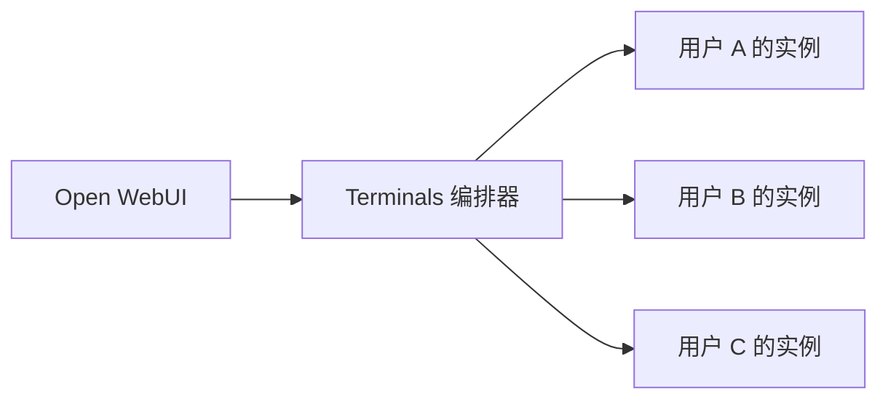

# 编排

Terminals 编排器为你的团队启动和管理 [Open Terminal](/features/open-terminal) 实例。Open WebUI 存储连接，用户在连接上创建终端，每个终端启动实例，供智能体运行命令和处理文件。根据终端的实例作用域，实例可以属于某个用户、聊天或模型，也可以由所有人共享。

当 Open Terminal 需要成为受管理的团队基础设施时，请使用此功能：不同的用户、组或工作流需要不同的镜像、工具、限制、存储行为和安全边界。

当用户在终端中工作时，Open WebUI 会将请求连同终端 ID 一起发送给编排器；请求属于已保存聊天时还会携带聊天 ID，对于模型作用域的终端则携带模型 ID。编排器启动或复用匹配的实例。

## 阅读本节 {#read-this-section}

- [创建机器](/features/open-terminal/terminals/orchestration/creating-terminals)：对话框、实例作用域、共享和实例管理。
- [环境变量](/features/open-terminal/terminals/orchestration/environment-variables)：原始环境变量值、引号处理、转发行为和保留键。
- [自定义镜像](/features/open-terminal/terminals/orchestration/custom-images)：构建、标记、推送和使用自定义 Open Terminal 镜像。
- [系统提示词](/features/open-terminal/terminals/orchestration/system-prompts)：生成的提示词、`OPEN_TERMINAL_SYSTEM_PROMPT`、占位符和 `OPEN_TERMINAL_INFO`。
- [文件浏览器根目录](/features/open-terminal/terminals/orchestration/file-browser-home-boundary)：Open Terminal 如何提供可视根目录，供客户端渲染并限制导航范围。
- [OpenShift](/features/open-terminal/terminals/orchestration/openshift)：OpenShift 上的受限终端沙盒。
- [API 与故障排除](/features/open-terminal/terminals/orchestration/api-troubleshooting)：模板 API、发送到服务器的标头和常见问题。

## 职责 {#responsibilities}

| 层 | 职责 |
| :--- | :--- |
| Open WebUI | 存储编排器连接，允许用户创建和共享终端，并提供聊天、终端、文件浏览器和预览界面 |
| Terminals 编排器 | 校验服务器密钥，存储终端，预配实例，转发环境变量，并应用空闲清理、定时重置和服务器上限 |
| 终端 | 定义镜像、环境、资源、存储、起始目录、安装脚本和实例作用域 |
| Open Terminal 实例 | 执行命令、提供文件、开放 OpenAPI 工具、运行代码和服务器，并报告文件浏览器根目录元数据 |

## 编排器环境变量 {#orchestrator-environment-variables}

这些变量配置编排器服务本身，使用 `TERMINALS_` 前缀（或在 `.env` 文件中设置）。它们不同于[环境变量](/features/open-terminal/terminals/orchestration/environment-variables)中介绍的按工作区设置的 `OPEN_TERMINAL_*` 变量，后者会转发到每个用户的 Open Terminal 工作区。

| 变量 | 默认值 | 说明 |
| :--- | :--- | :--- |
| `TERMINALS_BACKEND` | `docker` | 要使用的后端：`docker`、`kubernetes` 或 `kubernetes-operator` |
| `TERMINALS_API_KEY` | *（由 `terminals serve` 生成）* | Open WebUI 和管理界面发送的 bearer 令牌。请设置固定值，生成的值会在每次重启时变化 |
| `TERMINALS_HOST` | `0.0.0.0` | 编排器 HTTP 服务器绑定的地址 |
| `TERMINALS_PORT` | `3000` | 编排器 HTTP 服务器监听的端口 |
| `TERMINALS_WORKERS` | `1` | 服务器进程数量 |
| `TERMINALS_ENABLE_UI` | `true` | 在 `/` 提供内置的精简管理界面。对于仅使用 API 的部署，请设置为 `false` |
| `TERMINALS_LOG_LEVEL` | `INFO` | 最低日志级别：`DEBUG`、`INFO`、`WARNING`、`ERROR` 或 `CRITICAL` |
| `TERMINALS_DATABASE_URL` | `sqlite+aiosqlite:///<data>/terminals.db` | SQLAlchemy 数据库 URL。默认使用 SQLite，也可选用 PostgreSQL |
| `TERMINALS_IMAGE` | `ghcr.io/open-webui/open-terminal:latest` | 终端未指定镜像时使用的默认工作区镜像 |
| `TERMINALS_IMAGE_PULL_POLICY` | *（未设置）* | 适用于所有后端的 `Always`、`IfNotPresent` 或 `Never`。未设置时，每次启动都会拉取 `:latest` 和无标签镜像，其他标签仅在本地缺失时拉取 |
| `TERMINALS_NETWORK_PROFILES` | `{}` | 命名网络配置的 JSON 对象，终端可在其**网络**字段中选择 |
| `TERMINALS_DOCKER_NETWORK` | *（未设置）* | Open Terminal 工作区使用的 Docker 网络。设置后，通过该网络按名称访问容器。逗号分隔的列表可将容器分布到多个网络 |
| `TERMINALS_DOCKER_HOST` | `127.0.0.1` | 用于访问已发布容器端口的地址（Docker 后端） |
| `TERMINALS_DOCKER_DATA_DIR` | `<data>/terminals` | 保存持久化工作区文件的目录，每个实例对应一个 `.terminals/<id>` 文件夹（Docker 后端） |
| `TERMINALS_DOCKER_HOST_DATA_DIR` | *（未设置）* | 当该目录在 Docker 主机上的绝对路径与 `TERMINALS_DOCKER_DATA_DIR` 不同时，在此指定主机路径 |
| `TERMINALS_DOCKER_MOUNTS` | *（未设置）* | 添加到每个实例的额外绑定挂载的 JSON 数组，包含 `source`、`target` 和可选的 `readOnly`（Docker 后端） |
| `TERMINALS_IDLE_TIMEOUT_MINUTES` | `0` | 实例在 N 分钟无活动后停止（`0` = 禁用） |
| `TERMINALS_MAX_LIFETIME_MINUTES` | `0` | 实例启动 N 分钟后停止，即使仍在使用（`0` = 禁用） |
| `TERMINALS_MAX_CPU` | *（未设置）* | 每个工作区的 CPU 硬性上限，终端不能超过此值 |
| `TERMINALS_MAX_MEMORY` | *（未设置）* | 每个工作区的内存硬性上限，终端不能超过此值 |
| `TERMINALS_MAX_STORAGE` | *（未设置）* | 每个工作区的存储硬性上限，终端不能超过此值 |
| `TERMINALS_ALLOWED_IMAGES` | *（未设置）* | 允许的镜像模式（通配符）列表，以逗号分隔。留空允许任何镜像 |
| `TERMINALS_KUBERNETES_NAMESPACE` | `terminals` | 终端 Pod 的命名空间（Kubernetes 后端） |
| `TERMINALS_KUBERNETES_IMAGE` | *（未设置）* | Open Terminal Pod 的默认镜像（Kubernetes 后端）。未设置时使用 `TERMINALS_IMAGE` |
| `TERMINALS_KUBERNETES_STORAGE_CLASS` | *（未设置）* | PVC 的 StorageClass。留空使用集群默认值 |
| `TERMINALS_KUBERNETES_STORAGE_SIZE` | `1Gi` | 终端未指定大小时使用的默认 PVC 大小 |
| `TERMINALS_KUBERNETES_STORAGE_MODE` | `per-user` | 存储模式：`per-user`、`shared` 或 `shared-rwo` |
| `TERMINALS_KUBERNETES_SERVICE_TYPE` | `ClusterIP` | 终端 Pod 的 Service 类型 |
| `TERMINALS_KUBERNETES_KUBECONFIG` | *（未设置）* | kubeconfig 的路径。留空使用集群内配置 |
| `TERMINALS_KUBERNETES_LABELS` | *（未设置）* | 应用到所创建资源的额外标签，格式为 `k=v,k2=v2` |
| `TERMINALS_KUBERNETES_RESTRICTED` | `false` | 全局启用受限的 Kubernetes/OpenShift Pod 默认设置 |
| `TERMINALS_KUBERNETES_POD_SECURITY_CONTEXT` | `{}` | 合并到终端 Pod 的 JSON Pod 安全上下文 |
| `TERMINALS_KUBERNETES_CONTAINER_SECURITY_CONTEXT` | `{}` | 合并到 Open Terminal 容器的 JSON 容器安全上下文 |
| `TERMINALS_KUBERNETES_NODE_SELECTOR` | *（未设置）* | 实例和重置 Pod 的节点选择器，使用 JSON 或 `k=v,k2=v2` 格式 |
| `TERMINALS_KUBERNETES_TOLERATIONS` | *（未设置）* | 实例和重置 Pod 的容忍度 JSON 数组 |
| `TERMINALS_KUBERNETES_CRD_GROUP` | `openwebui.com` | operator 后端监视的 CRD 组 |
| `TERMINALS_KUBERNETES_CRD_VERSION` | `v1alpha1` | operator 后端监视的 CRD 版本 |

此处省略的任何值都会回退到所示默认值。[Terminals README](https://github.com/open-webui/terminals#configuration) 列出了所有设置，包括代理超时和缓存。

## 重要行为 {#important-behavior}

对终端的更改会应用于之后启动的实例。**重启**会立即停止实例，并使用当前设置重新启动。

### 空闲清理、生命周期与定时重置 {#idle-cleanup-lifetime-and-scheduled-resets}

空闲清理会在实例持续 `TERMINALS_IDLE_TIMEOUT_MINUTES` 没有活动后停止实例，并保留其文件。下一次请求会在相同文件上启动一个全新的实例。`TERMINALS_MAX_LIFETIME_MINUTES` 会在实例启动后的固定时间停止实例，即使它仍在使用，文件也会保留。终端可以携带自己的 `idle_timeout_minutes` 和 `max_lifetime_minutes`，以替换服务器值；`0` 会为该终端禁用对应检查。

重置计划会按计划清除终端文件并刷新匹配的实例，包括活动实例。计划可以是一次性 ISO 日期时间、`@weekly`、`@monthly` 或五字段 cron 表达式，并可选择时区。请在 Terminals 管理界面的模板编辑器中设置。

文件浏览器从主目录开始，并隐藏其上层的文件夹，参见[文件浏览器根目录](/features/open-terminal/terminals/orchestration/file-browser-home-boundary)。
