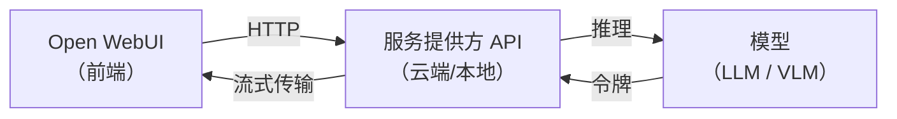

# 连接本地和云端模型 {#connect-a-provider}

将本地模型服务器和云端 API 连接到同一个 Open WebUI 实例。为每个服务提供方添加连接，然后选择对话要使用的模型。

Open WebUI 支持多种连接协议，包括 **Ollama**、**OpenAI 兼容 API** 和 **Open Responses**。任何支持其中一种协议的云端 API 或本地服务器都可以开箱即用。只需添加 URL 和 API 密钥，你的模型就会显示在下拉菜单中。

---

## 工作原理 {#how-it-works}

1. **你在 Open WebUI 中输入消息**
2. Open WebUI 将消息发送到你的服务提供方 API 端点
3. 服务提供方使用所选模型运行推理
4. 令牌实时**流式返回** Open WebUI
5. 你在聊天界面中看到响应

:::tip
添加服务提供方只需在**设置（Settings）→ 连接（Connections）**（管理员区域）中输入 URL 和 API 密钥。Open WebUI 可以自动检测大多数服务提供方的可用模型。
:::

---

## 同时使用本地和云端模型 {#use-local-and-cloud-models-together}

你需要一个正在运行的 Open WebUI 实例、管理员访问权限、一个可访问的本地模型服务器，以及所选托管服务提供方的 API 密钥。

1. [连接 Ollama](/getting-started/quick-start/connect-a-provider/starting-with-ollama)，并确保已下载的本地模型显示在模型选择器中。
2. 按照 [OpenAI](/getting-started/quick-start/connect-a-provider/starting-with-openai)、[Anthropic](/getting-started/quick-start/connect-a-provider/starting-with-anthropic) 或 [OpenAI 兼容服务提供方](/getting-started/quick-start/connect-a-provider/starting-with-openai-compatible)指南添加托管连接。
3. 开始一个对话，选择本地模型并发送一条简短的测试消息。使用托管模型开始另一个对话，确认它也能响应。
4. 要向两个模型发送相同的提示词，请使用[多模型聊天](/features/chat-conversations/chat-features/multi-model-chats)。

所选端点决定推理发生的位置。选择云端模型会将提示词和包含的上下文发送给该服务提供方；比较模型会将提示词发送到每个所选端点。本地推理并不会让单独配置的云端工具、内容提取或嵌入服务变成本地服务。为敏感内容选择服务提供方时，请参阅[聊天数据隐私与加密](/security/chat-data-privacy-and-encryption)。

## 选择正确的连接设置 {#choose-the-right-connection-settings}

大多数服务提供方只需 URL 和 API 密钥即可工作。少数服务提供方需要在连接对话框中额外选择一项，以便 Open WebUI 了解另一端的服务类型。在**管理员设置（Admin Settings）> 连接（Connections）**中，将 Ollama 服务器添加到**管理 Ollama API 连接（Manage Ollama API Connections）**下，将其他所有服务添加到**管理 OpenAI API 连接（Manage OpenAI API Connections）**下，然后使用下表查看你的服务提供方需要哪些设置。

| 连接对象 | 添加位置 | 需要更改的设置 |
|---|---|---|
| **Ollama** | Ollama 连接 | 仅需 URL。Open WebUI 会自行识别 Ollama。请参阅[从 Ollama 开始](/getting-started/quick-start/connect-a-provider/starting-with-ollama)。 |
| **OpenAI、Anthropic、Gemini、Mistral、Groq、xAI 和其他 OpenAI 格式服务器** | OpenAI 连接 | URL 和 API 密钥。将**提供方（Provider）**保留为**默认（Default）**。 |
| **OpenRouter 和 vLLM** | OpenAI 连接 | URL 和 API 密钥，然后选择**高级（Advanced）> 提供方（Provider）> OpenRouter** 或 **vLLM**，这会将已保存的推理内容发送回模型。 |
| **DeepSeek（托管 API）** | OpenAI 连接 | URL 和 API 密钥，然后选择**高级（Advanced）> 提供方（Provider）> llama.cpp**。DeepSeek 的思考模式需要在每次工具调用轮次中回传此前的推理内容，而 llama.cpp 设置会执行此操作。 |
| **Azure OpenAI** | OpenAI 连接 | **提供方（Provider）> Azure OpenAI**、一个 **API 版本（API Version）**，以及在**模型 ID（Model IDs）**下填写你的部署名称。对于看起来像 Azure 的 URL，Open WebUI 也会自动切换到 Azure 模式。 |
| **llama.cpp 服务器** | OpenAI 连接 | 选择**提供方（Provider）> llama.cpp**，以便从 Open WebUI 管理模型。请参阅[从 llama.cpp 开始](/getting-started/quick-start/connect-a-provider/starting-with-llama-cpp)。 |
| **LM Studio** | OpenAI 连接 | 选择**提供方（Provider）> LM Studio**，以便从 Open WebUI 管理模型。 |
| **LiteLLM 代理** | OpenAI 连接 | 选择**提供方（Provider）> LiteLLM**，它会将到达 Open WebUI 自身 Anthropic Messages 端点的请求直接传递给 LiteLLM。 |
| **提供 Responses API 的服务提供方** | OpenAI 连接 | **API 类型（API Type）> Responses**。请参阅 [Open Responses](/getting-started/quick-start/connect-a-provider/starting-with-open-responses)。 |

**提供方（Provider）**设置指定 Open WebUI 发送的请求格式。llama.cpp 选项使用这个名称，是因为 llama.cpp 引入了该格式；任何支持该格式的服务器都可以使用此选项，包括 DeepSeek 的托管 API。**默认（Default）**发送普通 OpenAI 格式，所有 OpenAI 兼容服务器都接受该格式。[提供方设置](/getting-started/quick-start/connect-a-provider/starting-with-openai-compatible#the-provider-setting)一节列出了每个选项启用的所有功能，[如何回传推理内容](/features/chat-conversations/chat-features/reasoning-models#how-reasoning-is-sent-back)则说明了各服务提供方在哪个字段中回传推理内容。

要更改此设置，请打开**管理员设置（Admin Settings）> 连接（Connections）**，点击连接旁边的齿轮图标（新连接则点击 **+**），展开**高级（Advanced）**，然后从**提供方（Provider）**中选择选项。保存对话框和连接列表。此下拉菜单仅显示在 OpenAI 连接上。

对话框中的其他设置：

| 设置 | 作用 |
|---|---|
| **连接类型（Connection Type）** | 将连接标记为**本地（Local）**或**外部（External）**。模型选择器使用该标记进行本地和外部筛选。 |
| **身份验证（Auth）** | **Bearer** 发送你的 API 密钥。**None** 在没有密钥的情况下调用服务器。**Session**、**OAuth** 和 **Entra ID** 转发已登录用户的凭据或 Azure 身份。 |
| **API 类型（API Type）** | 默认为 **Chat Completions**。**Responses** 将连接切换到 Responses API；输入 `api.openai.com` URL 时会自动选择它。 |
| **转发 Cookie（Forward cookies）** | 将 Open WebUI 请求的 Cookie 继续发送到此服务器。 |
| **请求头（Headers）** | JSON 格式的额外请求头。 |
| **前缀 ID（Prefix ID）** | 在此连接每个模型的 ID 和显示名称前添加前缀和点号，例如 `work.gpt-5.6`，从而区分提供相同模型的两个连接。在**设置（Settings）> 模型（Models）**（管理员区域）中为模型保存的名称会替换带前缀的名称。 |
| **模型 ID（Model IDs）** | 要显示的模型列表。留空则显示服务器报告的所有模型。 |

---

## 云服务提供方 {#cloud-providers}

需要账号和 API 密钥的托管 API，无需自备硬件。

| 服务提供方 | 模型 | 指南 |
|----------|--------|-------|
| **OpenAI** | GPT-5.6 Sol、GPT-5.6 Terra、GPT-5.6 Luna | [从 OpenAI 开始 →](/getting-started/quick-start/connect-a-provider/starting-with-openai) |
| **Anthropic** | Claude Opus 5、Sonnet 5、Haiku 4.5 | [从 Anthropic 开始 →](/getting-started/quick-start/connect-a-provider/starting-with-anthropic) |
| **OpenAI 兼容** | DeepSeek、Mistral、Groq、OpenRouter、Vercel AI Gateway、Amazon Bedrock、Azure 等 | [OpenAI 兼容服务提供方 →](/getting-started/quick-start/connect-a-provider/starting-with-openai-compatible) |

---

## 本地服务器 {#local-servers}

在你自己的硬件上运行已下载的模型。身份验证取决于本地服务器的配置方式。

| 服务器 | 描述 | 指南 |
|--------|-------------|-------|
| **Ollama** | 在本地运行和管理已下载的模型 | [从 Ollama 开始 →](/getting-started/quick-start/connect-a-provider/starting-with-ollama) |
| **llama.cpp** | 通过 OpenAI 兼容 API 进行高效的 GGUF 模型推理 | [从 llama.cpp 开始 →](/getting-started/quick-start/connect-a-provider/starting-with-llama-cpp) |
| **vLLM** | 面向生产工作负载的高吞吐量推理引擎 | [从 vLLM 开始 →](/getting-started/quick-start/connect-a-provider/starting-with-vllm) |

更多本地服务器（LM Studio、LocalAI、Docker Model Runner、Lemonade）请参阅 [OpenAI 兼容服务提供方](/getting-started/quick-start/connect-a-provider/starting-with-openai-compatible#local-servers)指南。

---

## 其他连接方式 {#other-connection-methods}

| 功能 | 描述 | 指南 |
|---------|-------------|-------|
| **Open Responses** | 使用 Open Responses 规范连接服务提供方 | [从 Open Responses 开始 →](/getting-started/quick-start/connect-a-provider/starting-with-open-responses) |
| **Functions** | 使用适用于任何后端的自定义管道函数扩展 Open WebUI | [从 Functions 开始 →](/getting-started/quick-start/connect-a-provider/starting-with-functions) |

---

## 需要连接智能体？ {#looking-for-agents}

如果你要连接自主 AI 智能体（具有终端访问、文件操作、Web 搜索等功能），而不是普通模型服务提供方，请参阅[**连接智能体**](/getting-started/quick-start/connect-an-agent)。
