:::warning

本教程为社区贡献，不受 Open WebUI 团队支持，仅用于演示如何针对特定用例定制 Open WebUI。想要贡献内容？请参阅贡献教程。

:::

> [!WARNING]
## Open WebUI 内部 SQLite 数据库 {#open-webui-internal-sqlite-database}

对于 Open WebUI，SQLite 数据库是用户管理、聊天历史、文件存储及其他各种核心功能的基础。对于希望为项目做贡献或有效维护项目的人员来说，理解此结构至关重要。

## 内部 SQLite 的位置 {#internal-sqlite-location}

SQLite 数据库位于 `root` -> `data` -> `webui.db`。

```txt
Root (/)
├── data
│   ├── cache
│   ├── uploads
│   ├── vector_db
│   └── webui.db
├── dev.sh
├── open_webui
├── requirements.txt
├── start.sh
└── start_windows.bat
```

## 将数据库复制到本地 {#copy-database-locally}

如果要将容器中运行的 Open WebUI SQLite 数据库复制到本地计算机，可以使用：

```bash
docker cp open-webui:/app/backend/data/webui.db ./webui.db
```

也可以使用以下命令访问容器内的数据库：

```bash
docker exec -it open-webui /bin/sh
```

## 表概览 {#table-overview}

以下是 Open WebUI SQLite 数据库中所有表的完整列表。为方便查阅，各表已编号。

| **序号** | **表名** | **描述** |
| ------- | ---------------- | ------------------------------------------------------------ |
| 01      | access_grant     | 存储所有资源的规范化访问控制授权 |
| 02      | auth             | 存储用户身份验证凭据和登录信息 |
| 03      | calendar         | 存储用户拥有且支持访问控制的日历 |
| 04      | calendar_event   | 存储支持重复规则（RRULE）的日历事件 |
| 05      | calendar_event_attendee | 跟踪共享日历事件参与者的 RSVP 状态 |
| 06      | channel          | 管理聊天频道及其配置 |
| 07      | channel_file     | 将文件关联到频道和消息 |
| 08      | channel_member   | 跟踪频道内的用户成员身份和权限 |
| 09      | chat             | 存储聊天会话及其元数据 |
| 10      | chat_file        | 将文件关联到聊天和消息 |
| 11      | chatidtag        | **旧版。** 引入 `tag` 之前的聊天/标签映射；数据已迁移到 `chat`，不再使用（见下文说明） |
| 12      | config           | 维护系统范围的配置设置 |
| 13      | document         | **旧版。** 知识功能之前的文档表；数据已迁移到 `knowledge`，不再使用（见下文说明） |
| 14      | feedback         | 收集用户反馈和评分 |
| 15      | file             | 管理已上传的文件及其元数据 |
| 16      | folder           | 将文件和内容组织为分层结构 |
| 17      | function         | 存储自定义函数及其配置 |
| 18      | group            | 管理用户组及其权限 |
| 19      | group_member     | 跟踪用户在组内的成员身份 |
| 20      | knowledge        | 存储知识库条目及相关信息 |
| 21      | knowledge_file   | 将文件关联到知识库 |
| 22      | memory           | 维护聊天历史和上下文记忆 |
| 23      | message          | 存储各条聊天消息及其内容 |
| 24      | message_reaction | 记录用户对消息的回应（表情符号/响应） |
| 25      | migrate_history  | **旧版。** Alembic 之前的迁移系统留下的迁移记录，当前代码不使用 |
| 26      | model            | 管理 AI 模型配置和设置 |
| 27      | note             | 存储用户创建的笔记和批注 |
| 28      | oauth_session    | 管理用户的活动 OAuth 会话 |
| 29      | prompt           | 存储 AI 提示词的模板和配置 |
| 30      | prompt_history   | 跟踪提示词的版本历史和快照 |
| 31      | shared_chat      | 存储用于链接共享的共享聊天快照 |
| 32      | skill            | 存储可重复使用的 Markdown 指令集（Skills） |
| 33      | tag              | 管理用于内容分类的标签 |
| 34      | tool             | 存储系统工具和集成的配置 |
| 35      | user             | 维护用户个人资料和账户信息 |
| 36      | automation       | 存储用户定义的定时自动化 |
| 37      | automation_run   | 存储自动化运行的执行历史 |
| 38      | pinned_note      | 跟踪每个用户的笔记置顶状态（每行表示一个用户置顶一篇笔记） |
| 39      | chat_message     | 用于聊天对话的规范化逐消息存储 |
| 40      | api_key          | 存储每个用户的 API 密钥 |
| 41      | knowledge_directory | 可在知识库内组织文件的可嵌套文件夹 |
| 42      | channel_webhook  | 存储各频道用于未经身份验证发布内容的传入 Webhook |
| 43      | model_history    | 工作区模型配置的已保存版本 |
| 44      | tool_history     | 工具源代码和元数据的已保存版本 |
| 45      | function_history | 函数源代码和元数据的已保存版本 |
| 46      | skill_history    | 技能及其支持文件的已保存版本 |
| 47      | app              | 已安装的[应用](/features/channels/apps)及其加密凭据 |
| 48      | auth_session     | 供 [Tether](/ecosystem/tether) 等原生应用使用的可续期登录会话 |
| 49      | comment          | 存储对工作区项目、笔记和聊天的评论及回复 |
| 50      | comment_reaction | 记录对评论的表情符号回应 |
| 51      | notification     | 存储每个用户的收件箱通知 |
| 52      | chat_view_state  | 存储每个用户为聊天保存的选项卡布局 |
| 53      | resource_tag     | 将标签关联到带有这些标签的聊天和笔记 |
| 54      | folder_view_state | 存储每个用户为文件夹保存的选项卡布局 |

注意：`alembic_version` 表用于记录已应用的迁移，与 Open WebUI 的核心功能无关，因此未包含在此列表中。

关于 `document` 表的说明：它是知识功能出现之前的**旧版**表。其中的行已迁移到 `knowledge` 表（迁移 `6a39f3d8e55c`），目前已没有代码向其中写入数据，但也没有迁移会删除它，因此在知识功能出现之前创建的数据库中，它可能仍然存在（为空）。当前代码中没有与其对应的模型。

了解所有表之后，下面介绍每张表的结构。

## 访问授权表 {#access-grant-table}

| **列名** | **数据类型** | **约束** | **描述** |
| --------------- | ------------- | ----------------------- | ------------------------------------------------------ |
| id              | Text          | PRIMARY KEY             | 唯一标识符 |
| resource_type   | Text          | NOT NULL                | 资源类型（例如 `model`、`knowledge`、`tool`） |
| resource_id     | Text          | NOT NULL                | 特定资源的 ID |
| principal_type  | Text          | NOT NULL                | 被授权方类型：`user`、`group` 或 `anyone` |
| principal_id    | Text          | NOT NULL                | 用户或组的 ID（公开访问时为 `*`） |
| permission      | Text          | NOT NULL                | 权限级别：`read` 或 `write` |
| created_at      | BigInteger    | NOT NULL                | 授权创建时间戳 |

关于 access_grant 表，需要了解：

- （`resource_type`、`resource_id`、`principal_type`、`principal_id`、`permission`）上的唯一约束可防止重复授权
- 在（`resource_type`、`resource_id`）和（`principal_type`、`principal_id`）上建立索引，以实现高效查找
- `principal_type` 为 `user` 且 `principal_id` 为 `*` 表示公开访问，即每个已登录用户。它不包括未登录的访问者
- `principal_type` 为 `anyone` 是[开放共享链接](/features/chat-conversations/chat-features/chatshare#open-links-no-sign-in)背后无需登录的授权。它只能以 `anyone` / `*` / `read` 的组合存储，任何其他组合都会被拒绝，并且仅对 `shared_chat` 资源类型生效。其他所有资源都会移除该授权
- 支持组级别和单个用户级别的访问授权
- 组级授权同样适用于该组子组的成员。删除组会删除其授权，删除用户会删除授予该用户的授权

## API 密钥表 {#api-key-table}

| **列名** | **数据类型** | **约束** | **描述** |
| --------------- | ------------- | -------------------------------------- | ------------------------------------- |
| id              | Text          | PRIMARY KEY, UNIQUE                    | 唯一标识符 |
| user_id         | Text          | FOREIGN KEY(user.id) CASCADE           | 密钥所有者 |
| key             | Text          | UNIQUE, NOT NULL                       | API 密钥本身 |
| data            | JSON          | nullable                               | 可扩展的数据负载 |
| expires_at      | BigInteger    | nullable                               | 过期时间戳 |
| last_used_at    | BigInteger    | nullable                               | 密钥上次使用的时间戳 |
| created_at      | BigInteger    | NOT NULL                               | 创建时间戳 |
| updated_at      | BigInteger    | NOT NULL                               | 上次更新时间戳 |

关于 api_key 表，需要了解：

- 删除用户会级联删除其密钥。
- 生成密钥时会先删除该账户的现有行，因此一个账户最多持有一个密钥。行的固定 id 为 `key_{user_id}`。
- 密钥的生成、检索和删除都通过 `/api/v1/auths/api_key` 进行。除非启用 `auth.enable_api_keys` 配置键，否则这三种操作都会被拒绝；非管理员还需要 `features.api_keys` 权限。
- `data`、`expires_at` 和 `last_used_at` 存在于架构中，但没有代码路径写入它们。密钥查找仅使用 `key` 进行连接，不检查 `expires_at`。

## 应用表 {#app-table}

由迁移 `c92da83b017f` 添加，用于[应用](/features/channels/apps)。

| **列名** | **数据类型** | **约束** | **描述** |
| --------------- | ------------- | ---------------------------- | -------------------------------------------------- |
| id              | Text          | PRIMARY KEY                  | 唯一标识符（UUID），即发送给应用的 `app_id` |
| slug            | Text          | UNIQUE, NOT NULL             | 安装时选择的应用句柄 |
| name            | Text          | NOT NULL                     | 显示名称 |
| user_id         | Text          | nullable                     | 安装应用的管理员 |
| is_active       | Boolean       | NOT NULL, server_default=false | 应用是否已启用 |
| data            | JSON          | NOT NULL                     | 应用 URL、清单、已授予的范围、设置、安装 ID 和加密的连接凭据 |
| api_key         | Text          | nullable                     | 应用的 API 密钥，已加密 |
| created_at      | BigInteger    | NOT NULL                     | 创建时间戳（纳秒） |
| updated_at      | BigInteger    | NOT NULL                     | 上次更新时间戳（纳秒） |

关于 app 表，需要了解：

- `api_key` 和 `data` 中的连接凭据使用从 `WEBUI_SECRET_KEY` 派生的密钥加密。
- 卸载应用会保留该行及其 `slug`：清除 `api_key`、连接凭据和安装 ID，将 `is_active` 设为 false，并停用该应用的频道成员身份。
- 谁可以使用应用存储在 `access_grant` 表中，其 `resource_type = 'app'`。
- 只要 `message` 中有任何行包含 `app_id`，就会拒绝降级到 `c92da83b017f` 之前的版本。

## 身份验证表 {#auth-table}

| **列名** | **数据类型** | **约束** | **描述** |
| --------------- | ------------- | --------------- | ----------------- |
| id              | String        | PRIMARY KEY     | 唯一标识符 |
| email           | String        | -               | 用户电子邮件 |
| password        | Text          | -               | 哈希后的密码 |
| active          | Boolean       | -               | 账户状态 |
| mfa             | JSON          | nullable        | 双重验证登录状态：加密的验证器密钥、哈希后的恢复代码、待完成的登录步骤和尝试计数器 |
| session_stamp   | Text          | nullable        | 每个会话令牌携带的标记；替换它会使该账户在所有设备上退出登录 |

关于 auth 表，需要了解：

- 使用 UUID 作为主键
- 与 `user` 表为一对一关系（共享 id）
- `mfa` 和 `session_stamp` 由迁移 `a7d3e9f2b641` 添加。在此之前存在的行一开始两者均为空；升级前签发的会话仍然有效，直到该账户首次在所有位置退出登录。
- 迁移 `0bd252b206fb` 会为每个没有对应行的用户添加一行，其 `password` 为空且永远无法匹配。该迁移仅更改数据，其降级操作会保留添加的行。

## 身份验证会话表 {#auth-session-table}

| **列名** | **数据类型** | **约束** | **描述** |
| --------------- | ------------- | --------------- | ---------------------------------------------------------------------------------- |
| id              | Text          | PRIMARY KEY     | 唯一会话标识符（UUID） |
| user_id         | Text          | nullable        | 已登录用户；浏览器登录请求等待批准时为空 |
| refresh_token_id | Text         | nullable        | 当前刷新令牌的标识符；登录完成前为空 |
| data            | JSON          | NOT NULL        | 应用名称和待处理登录请求的状态 |
| created_at      | BigInteger    | NOT NULL        | 会话创建时间戳 |
| updated_at      | BigInteger    | NOT NULL        | 会话上次更新时间戳 |
| expires_at      | BigInteger    | NOT NULL        | 过期时间戳 |

关于 auth_session 表，需要了解：

- 由迁移 `8bc7e5a902d1` 创建。一行可以是由已登录用户创建的会话，也可以是待处理的登录请求，后者会在应用完成登录后成为会话。登录流程请参阅 [Tether 客户端协议](/reference/tether-client-protocol)。
- `user_id` 没有外键。它与 `user` 是一对多关系：一个用户可以持有多个会话，每个已登录应用对应一个会话。
- 在 `user_id` 和 `expires_at` 上建立索引（`idx_auth_session_user`、`idx_auth_session_expires`）。
- 待处理请求的 `expires_at` 是其创建后 10 分钟。会话的 `expires_at` 是其创建或上次令牌刷新后的 [`SESSION_EXPIRES_IN`](/reference/env-configuration#session_expires_in)。每当创建新行时，都会删除过期行。
- 退出登录以及通过 API 删除会话都会移除该行。

## 频道表 {#channel-table}

| **列名** | **数据类型** | **约束** | **描述** |
| --------------- | ------------- | --------------- | ----------------------------------- |
| id              | Text          | PRIMARY KEY     | 唯一标识符（UUID） |
| user_id         | Text          | -               | 频道所有者/创建者 |
| type            | Text          | nullable        | 频道类型 |
| name            | Text          | -               | 频道名称 |
| description     | Text          | nullable        | 频道描述 |
| is_private      | Boolean       | nullable        | `group` 类型频道的私密标志 |
| data            | JSON          | nullable        | 灵活的数据存储 |
| meta            | JSON          | nullable        | 频道元数据 |
| created_at      | BigInteger    | -               | 创建时间戳（纳秒） |
| updated_at      | BigInteger    | -               | 上次更新时间戳（纳秒） |
| updated_by      | Text          | nullable        | 上次更新频道的用户 |
| archived_at     | BigInteger    | nullable        | 归档时间戳（纳秒） |
| archived_by     | Text          | nullable        | 归档频道的用户 |
| deleted_at      | BigInteger    | nullable        | 删除时间戳（纳秒） |
| deleted_by      | Text          | nullable        | 删除频道的用户 |

关于 channel 表，需要了解：

- 使用 UUID 作为主键
- 频道名称不区分大小写（以小写存储）
- `type` 在迁移 `3781e22d8b01` 中添加。`is_private`、`updated_by`、`archived_at`、`archived_by`、`deleted_at` 和 `deleted_by` 在迁移 `90ef40d4714e` 中添加。
- 频道列表和成员查询仅返回 `archived_at` 和 `deleted_at` 都为 null 的行，因此该架构支持归档和软删除。
- 没有代码路径写入 `archived_at`、`archived_by`、`deleted_at`、`deleted_by` 或 `updated_by`。删除频道会直接移除该行，因此已删除频道不会留下任何内容供 `deleted_at` 过滤器排除。直接查询此表的人会发现，每一行中的这五列都为 null。
- 创建此表时包含的 `access_control` 列已在迁移 `f1e2d3c4b5a6` 中删除。频道访问通过 `access_grant` 表管理，其 `resource_type = 'channel'`。

## 频道成员表 {#channel-member-table}

| **列名** | **数据类型** | **约束** | **描述** |
| ----------------- | ------------- | ------------------------------- | -------------------------------------------- |
| id                | Text          | PRIMARY KEY, UNIQUE             | 频道成员身份的唯一标识符 |
| channel_id        | Text          | NOT NULL                        | 对频道的引用 |
| user_id           | Text          | nullable                        | 对用户的引用 |
| app_id            | Text          | nullable                        | 对应用的引用，用于应用成员身份 |
| role              | Text          | nullable                        | 成员在频道内的角色 |
| status            | Text          | nullable                        | 成员身份状态：`joined` 或 `left` |
| is_active         | Boolean       | NOT NULL, server_default=true   | 成员身份是否有效 |
| is_channel_muted  | Boolean       | NOT NULL, server_default=false  | 每个成员的静音标志 |
| is_channel_pinned | Boolean       | NOT NULL, server_default=false  | 每个成员的置顶标志 |
| data              | JSON          | nullable                        | 可扩展的数据负载 |
| meta              | JSON          | nullable                        | 可选元数据 |
| invited_at        | BigInteger    | nullable                        | 邀请时间戳（纳秒） |
| invited_by        | Text          | nullable                        | 添加此成员的用户 |
| joined_at         | BigInteger    | NOT NULL                        | 加入时间戳（纳秒） |
| left_at           | BigInteger    | nullable                        | 离开时间戳（纳秒） |
| last_read_at      | BigInteger    | nullable                        | 上次阅读时间戳，用于确定未读状态 |
| created_at        | BigInteger    | -                               | 成员身份创建时间戳 |
| updated_at        | BigInteger    | nullable                        | 上次更新时间戳（纳秒） |

关于 channel_member 表，需要了解：

- `role`、`invited_at` 和 `invited_by` 在迁移 `90ef40d4714e` 中添加。`status`、`is_active`、`is_channel_muted`、`is_channel_pinned`、`data`、`meta`、`joined_at`、`left_at`、`last_read_at` 和 `updated_at` 在迁移 `2f1211949ecc` 中添加。
- 创建成员身份时，`status` 写为 `joined`。离开频道会写入 `left`，将 `is_active` 设为 false，并记录 `left_at`。该行会保留。
- `is_active` 是频道列表和成员列表用于过滤的标志，因此某人离开的成员身份会从这些结果中消失，但仍保留在表中。`POST /api/v1/channels/{id}/members/active` 也会写入该字段。
- 创建成员身份时会记录 `last_read_at`，并在用户阅读频道时通过 Socket 连接更新。
- `role` 仅在一个位置读取，用于检查成员是否为 `manager`。没有任何代码写入 `manager`：用户成员身份的 `role` 保持为 null，应用成员身份则写为 `member`，因此该检查永远不会匹配。查看和创建频道 Webhook 等仅管理员可执行的操作会进入该检查的另外两个分支：频道自身的 `user_id`，或实例管理员。
- `is_channel_muted` 是成员的[**仅提及**](/features/channels#muting-a-channel)设置，由 `POST /api/v1/channels/{id}/members/mute` 写入。将成员从未打开过的普通频道静音会创建其成员行。该值为 true 时，只有提及该成员的消息才会向其发送频道通知 Webhook。`is_channel_pinned` 在模型上有一个设置方法 `Channels.pin_channel`，但没有代码调用它。
- `joined_at` 在数据库中为 NOT NULL（迁移 `2f1211949ecc`），而 SQLAlchemy 模型未设置此标志。实际生效的是数据库约束。
- 从频道中移除应用或卸载应用会将 `is_active` 设为 false 并记录 `left_at`；`status` 保持为 `joined`。再次添加应用会重新激活同一行。
- 迁移 `c92da83b017f` 使 `user_id` 可为空并添加了 `app_id`。检查约束要求每行中两者恰好有一个有值，且（`channel_id`、`app_id`）组合唯一。
- 删除用户账户会保留其 `channel_member` 行。成员列表、频道的成员计数以及用于查找一组人现有私信会话的查询，都会跳过 `user_id` 不再匹配账户的行，因此遗留行不会计为成员，也不会使私信进入另一个会话。

## 频道 Webhook 表 {#channel-webhook-table}

传入 Webhook 可在没有已登录用户的情况下向一个频道发布消息。由迁移 `90ef40d4714e` 添加。

| **列名** | **数据类型** | **约束** | **描述** |
| ----------------- | ------------- | ------------------------------------------- | ---------------------------------- |
| id                | Text          | PRIMARY KEY, UNIQUE                         | 唯一标识符（UUID） |
| channel_id        | Text          | FOREIGN KEY(channel.id) CASCADE, NOT NULL   | Webhook 发布消息的频道 |
| user_id           | Text          | NOT NULL                                    | 创建 Webhook 的用户 |
| name              | Text          | NOT NULL                                    | 在其消息上显示的名称 |
| profile_image_url | Text          | nullable                                    | 在其消息上显示的头像 |
| token             | Text          | NOT NULL                                    | 用于授权发布消息的机密 |
| last_used_at      | BigInteger    | nullable                                    | 上次发布消息的时间戳 |
| created_at        | BigInteger    | NOT NULL                                    | 创建时间戳 |
| updated_at        | BigInteger    | NOT NULL                                    | 上次更新时间戳 |

关于 channel_webhook 表，需要了解：

- 删除频道会级联删除其 Webhook。
- `token` 是包含 32 字节熵的 URL 安全随机令牌，使用 `secrets.token_urlsafe(32)` 生成，以纯文本存储并携带在请求路径中。`POST /api/v1/channels/webhooks/{webhook_id}/{token}` 无需身份验证，会将 `id` 和 `token` 组合与此表匹配，因此持有该组合的任何人都可向频道发布消息。
- 每次接受发布请求时都会记录 `last_used_at`。
- 列出和创建 Webhook 要求调用方是实例管理员或频道本身的创建者。有关该检查中基于成员身份的管理员分支为何永不匹配，请参阅[频道成员表](#channel-member-table)中的 `role` 说明。
- Webhook 的 `id` 和 `name` 会复制到所发布消息的 `meta.webhook` 中，界面会用它代替作者账户进行渲染。

## 频道文件表 {#channel-file-table}

| **列名** | **数据类型** | **约束** | **描述** |
| --------------- | ------------- | ---------------------------------- | --------------------------------- |
| id              | Text          | PRIMARY KEY                        | 唯一标识符（UUID） |
| user_id         | Text          | NOT NULL                           | 关联关系的所有者 |
| channel_id      | Text          | FOREIGN KEY(channel.id) CASCADE, NOT NULL | 对频道的引用 |
| file_id         | Text          | FOREIGN KEY(file.id) CASCADE, NOT NULL | 对文件的引用 |
| message_id      | Text          | FOREIGN KEY(message.id) CASCADE, nullable | 对关联消息的引用 |
| created_at      | BigInteger    | NOT NULL                           | 创建时间戳 |
| updated_at      | BigInteger    | NOT NULL                           | 上次更新时间戳 |

关于 channel_file 表，需要了解：

- （`channel_id`、`file_id`）上的唯一约束可防止重复条目
- 三个外键都会在删除时级联，包括 `message_id`，因此删除文件所附加的消息也会移除此处的行，删除频道或文件同样如此
- 在 `channel_id`、`file_id` 和 `user_id` 上建立索引以提高性能

## 聊天表 {#chat-table}

| **列名** | **数据类型** | **约束** | **描述** |
| --------------- | ------------- | ----------------------- | ------------------------ |
| id              | String        | PRIMARY KEY             | 唯一标识符（UUID） |
| user_id         | String        | -                       | 聊天所有者 |
| title           | Text          | -                       | 聊天标题 |
| chat            | JSON          | -                       | 模型和参数等聊天设置，消息存储在 `chat_message` 中 |
| created_at      | BigInteger    | -                       | 创建时间戳 |
| updated_at      | BigInteger    | -                       | 上次更新时间戳 |
| share_id        | Text          | UNIQUE, nullable        | 共享标识符 |
| archived        | Boolean       | default=False           | 归档状态 |
| pinned          | Boolean       | default=False, nullable | 置顶状态 |
| meta            | JSON          | server_default="{}"     | 元数据 |
| folder_id       | Text          | nullable                | 父文件夹 ID |
| tasks           | JSON          | nullable                | 供智能体工作流使用的聊天级任务/待办列表 |
| summary         | Text          | nullable                | 可选的聊天摘要文本 |
| last_read_at    | BigInteger    | nullable                | 用于未读指示器的上次阅读时间戳 |
| current_message_id | Text       | nullable                | 聊天历史中的当前（活动叶节点）消息 |
| variables       | JSON          | nullable                | 为模型的聊天变量填写的值 |
| timer_at        | BigInteger    | nullable                | 以纳秒为单位的到期时间，仅在计时器聊天等待认领时设置 |

关于 chat 表，需要了解：

- `tasks` 和 `summary` 支持聊天会话中的结构化计划/状态界面。
- `last_read_at` 由侧边栏未读状态逻辑使用（与 `updated_at` 比较）。
- 聊天具有活动共享链接时，`share_id` 引用 `shared_chat.id` 令牌。
- `current_message_id` 由迁移 `9a1b2c3d4e5f` 添加。它记录聊天的当前消息，即新回复所接续的活动分支叶节点，并在迁移运行时根据现有历史回填。上下文压缩和上下文用量解析会读取它，以便处理实际使用的分支，而不是整个消息树。
- `variables` 由迁移 `c49178636c78` 添加。它以变量名为键的扁平映射形式，保存用户为模型系统提示词声明的[聊天变量](/features/chat-conversations/chat-features/chat-params#chat-variables)填写的值，并在聊天所有者分叉或克隆聊天时一并复制。其他人创建的副本以空映射开始。临时聊天仅在请求中保留这些值，不会存储任何内容。
- 迁移 `242a2047eae0` 会暂时将原来的 Text 类型 `chat` 列重命名为 `old_chat`，添加新的 JSON 类型 `chat` 列，复制数据，然后删除 `old_chat`；升级后的数据库不会保留 `old_chat` 列。

## 共享聊天表 {#shared-chat-table}

| **列名** | **数据类型** | **约束** | **描述** |
| --------------- | ------------- | -------------------------------- | ---------------------------------- |
| id              | Text          | PRIMARY KEY                      | `/s/{id}` URL 中使用的共享令牌（UUID） |
| chat_id         | Text          | FOREIGN KEY(chat.id) CASCADE, NOT NULL | 对原始聊天的引用 |
| user_id         | Text          | NOT NULL                         | 创建共享的用户 |
| title           | Text          | nullable                         | 共享时的聊天标题 |
| chat            | JSON          | nullable                         | 共享时的聊天内容快照 |
| created_at      | BigInteger    | nullable                         | 共享创建时间戳 |
| updated_at      | BigInteger    | nullable                         | 上次重新创建快照的时间戳 |

关于 shared_chat 表，需要了解：

- 取代了之前在 `chat` 表中以 `user_id` 为 `shared-{chat_id}` 的虚拟行存储共享聊天快照的方式。
- 每行都是原始聊天在共享时（或上次重新共享时）的不可变快照。用户点击“Update and Copy Link”（更新并复制链接）时会更新快照。
- 删除原始聊天会级联删除共享快照。
- 共享聊天的访问控制通过 `access_grant` 表管理，其 `resource_type = 'shared_chat'`。

## 聊天消息表 {#chat-message-table}

`chat_message` 表保存每个聊天的消息，每条消息一行。它不同于保存频道和线程消息的频道[消息表](#message-table)。

| **列名** | **数据类型** | **约束** | **描述** |
| --------------- | ------------- | ---------------------------------------- | -------------------------------------------------------- |
| id              | Text          | PRIMARY KEY                              | 唯一标识符（UUID） |
| chat_id         | Text          | FOREIGN KEY(chat.id) CASCADE, NOT NULL   | 父聊天 |
| user_id         | Text          | indexed                                  | 消息作者 |
| role            | Text          | NOT NULL                                 | 消息角色：`user`、`assistant` 或 `system` |
| parent_id       | Text          | nullable                                 | 父消息 id（用于分支对话） |
| content         | JSON          | nullable                                 | 消息内容（字符串或内容块列表） |
| output          | JSON          | nullable                                 | 生成的输出负载 |
| model_id        | Text          | nullable, indexed                        | 生成消息的模型 |
| files           | JSON          | nullable                                 | 附加文件 |
| sources         | JSON          | nullable                                 | 检索/引用来源 |
| embeds          | JSON          | nullable                                 | 嵌入的工件 |
| meta            | JSON          | nullable                                 | 消息元数据；标记内部子智能体和计时器消息 |
| done            | Boolean       | default=True                             | 生成是否完成 |
| status_history  | JSON          | nullable                                 | 生成期间流式传输的状态更新 |
| error           | JSON          | nullable                                 | 生成失败时的错误负载 |
| usage           | JSON          | nullable                                 | 令牌/用量统计 |
| context_summary | Text          | nullable                                 | 每条消息的上下文摘要 |
| data            | JSON          | nullable                                 | 没有独立列的其他消息字段 |
| created_at      | BigInteger    | indexed                                  | 创建时间戳 |
| updated_at      | BigInteger    | -                                        | 上次更新时间戳 |

关于 chat_message 表，需要了解：

- 删除聊天会级联删除其消息（`chat_id` 外键使用 `ON DELETE CASCADE`）。
- 复合索引支持常见的访问模式：（`chat_id`、`parent_id`）、（`model_id`、`created_at`）、（`user_id`、`created_at`）和（`chat_id`、`role`、`done`）。
- `context_summary` 由迁移 `4c5ce3d2f27f` 添加，用于存储消息上下文的摘要。
- `meta` 由迁移 `856c5b02fb54` 添加。它携带每条消息的元数据，用于标记 Open WebUI 代表用户注入的消息，例如[子智能体](/features/chat-conversations/chat-features/subagents)结果或触发的[计时器](/features/chat-conversations/chat-features/timers)，使界面能够以不同于用户输入消息的方式渲染它们。
- 迁移 `5e7a2c9d4b13` 将每个聊天的消息从 `chat.chat` 数据块（其中的 `history` 和较旧的扁平 `messages` 列表）移入此表，并添加了 `data`。在大型实例上，升级后的首次启动需要一段时间。
- [聊天搜索](/features/chat-conversations/chat-features/history-search)会匹配 `chat_message.content` 中的文本和聊天标题。

## 聊天视图状态表 {#chat-view-state-table}

| **列名** | **数据类型** | **约束** | **描述** |
| --------------- | ------------- | --------------- | ------------------------------------------------------------ |
| user_id         | Text          | PRIMARY KEY     | 视图所属的用户 |
| chat_id         | Text          | PRIMARY KEY, indexed | 视图所属的聊天 |
| state           | JSON          | NOT NULL        | 打开的选项卡、拆分布局和选定的终端 |
| updated_at      | BigInteger    | NOT NULL        | 上次更新时间戳（秒） |

关于 chat_view_state 表，需要了解：

- 由迁移 `6a23bd107e54` 创建。主键为（`user_id`、`chat_id`），并在 `chat_id` 上建立索引（`ix_chat_view_state_chat_id`）。
- 它保存用户在聊天中打开的选项卡，以便在任何设备上重新打开聊天时恢复。`GET` 和 `POST /api/v1/chats/{id}/view` 可为任何能够读取该聊天的用户读取和保存此状态。
- 每行仅属于其用户，即使对于共享聊天也是如此：端点只读取和写入已登录用户自己的行。已保存视图的大小上限为 1 MiB。
- 删除聊天会删除其行，删除用户会删除该用户的行。

## 自动化表 {#automation-table}

| **列名** | **数据类型** | **约束** | **描述** |
| --------------- | ------------- | ----------------------- | --------------- |
| id              | Text          | PRIMARY KEY             | 唯一标识符（UUID） |
| user_id         | Text          | NOT NULL                | 自动化所有者 |
| folder_id       | Text          | nullable                | 创建运行所得聊天的文件夹 |
| name            | Text          | NOT NULL                | 自动化显示名称 |
| data            | JSON          | NOT NULL                | 自动化负载（`prompt`、`model_id`、`rrule`、可选的机器配置） |
| meta            | JSON          | nullable                | 可选元数据 |
| is_active       | Boolean       | NOT NULL, default=True  | 活动/暂停状态 |
| last_run_at     | BigInteger    | nullable                | 上次执行时间 |
| next_run_at     | BigInteger    | nullable                | 下次计划执行时间 |
| created_at      | BigInteger    | NOT NULL                | 创建时间戳 |
| updated_at      | BigInteger    | NOT NULL                | 上次更新时间戳 |

关于 automation 表，需要了解：

- `next_run_at` 已建立索引，以便高效轮询到期运行。
- `data.rrule` 定义重复规则并驱动调度器计算。
- `folder_id` 由迁移 `959eaac8f909` 与（`user_id`、`folder_id`）索引一起添加，因此可按文件夹列出所有者的自动化。它不是外键：删除文件夹会清除该所有者自动化上的此列，而不是删除自动化；如果运行时文件夹已消失，则会清除此列并将聊天归入任何文件夹之外。

## 自动化运行表 {#automation-run-table}

| **列名** | **数据类型** | **约束** | **描述** |
| --------------- | ------------- | --------------- | --------------- |
| id              | Text          | PRIMARY KEY     | 唯一标识符（UUID） |
| automation_id   | Text          | NOT NULL        | 对自动化的引用 |
| chat_id         | Text          | nullable        | 此次运行创建的聊天（如果可用） |
| status          | Text          | NOT NULL        | 运行状态（`success` / `error`） |
| error           | Text          | nullable        | 状态为 `error` 时的错误详情 |
| created_at      | BigInteger    | NOT NULL        | 执行记录时间戳 |

关于 automation_run 表，需要了解：

- 按 `automation_id` 建立索引，以便快速查询每个自动化的运行历史。
- 删除自动化时会删除相应行。

## 日历表 {#calendar-table}

| **列名** | **数据类型** | **约束** | **描述** |
| --------------- | ------------- | ----------------------- | ---------------------------------- |
| id              | Text          | PRIMARY KEY             | 唯一标识符（UUID） |
| user_id         | Text          | NOT NULL                | 日历所有者 |
| name            | Text          | NOT NULL                | 日历显示名称 |
| color           | Text          | nullable                | 显示颜色（十六进制，例如 `#3b82f6`） |
| is_default      | Boolean       | NOT NULL, default=False | 是否为用户的默认日历 |
| data            | JSON          | nullable                | 可扩展的数据负载 |
| meta            | JSON          | nullable                | 可选元数据 |
| created_at      | BigInteger    | NOT NULL                | 创建时间戳 |
| updated_at      | BigInteger    | NOT NULL                | 上次更新时间戳 |

关于 calendar 表，需要了解：

- 在 `user_id` 上建立索引，以便高效列出每个用户的日历。
- 首次访问时会自动创建默认的“Personal”（个人）日历。
- “Scheduled Tasks”（计划任务）日历是**虚拟的**：不存储在此表中。API 会在响应时为具有自动化访问权限的用户动态生成它（使用常量 ID `__scheduled_tasks__`）。自动化 RRULE 的未来运行和过去的执行记录会渲染为此日历上的虚拟事件。
- 访问控制通过 `access_grant` 表管理，其 `resource_type = 'calendar'`，从而支持在用户和组之间共享日历。
- 用户只能删除非默认日历。删除日历会级联删除其所有事件、参与者和访问授权。

## 日历事件表 {#calendar-event-table}

| **列名** | **数据类型** | **约束** | **描述** |
| --------------- | ------------- | ----------------------- | ---------------------------------- |
| id              | Text          | PRIMARY KEY             | 唯一标识符（UUID） |
| calendar_id     | Text          | NOT NULL                | 对父日历的引用 |
| user_id         | Text          | NOT NULL                | 创建事件的用户 |
| title           | Text          | NOT NULL                | 事件标题 |
| description     | Text          | nullable                | 事件描述 |
| start_at        | BigInteger    | NOT NULL                | 开始时间（Unix 纪元纳秒数） |
| end_at          | BigInteger    | nullable                | 结束时间（Unix 纪元纳秒数） |
| all_day         | Boolean       | NOT NULL, default=False | 是否为全天事件 |
| rrule           | Text          | nullable                | 用于重复规则的 iCalendar RRULE |
| color           | Text          | nullable                | 每个事件的颜色覆盖值 |
| location        | Text          | nullable                | 事件地点 |
| data            | JSON          | nullable                | 可扩展的数据负载 |
| meta            | JSON          | nullable                | 可选元数据（例如 `automation_id`） |
| is_cancelled    | Boolean       | NOT NULL, default=False | 软取消标志 |
| created_at      | BigInteger    | NOT NULL                | 创建时间戳 |
| updated_at      | BigInteger    | NOT NULL                | 上次更新时间戳 |

关于 calendar_event 表，需要了解：

- （`calendar_id`、`start_at`）上的复合索引支持日历内的高效范围查询。
- （`user_id`、`start_at`）上的复合索引支持按用户进行高效的日期范围查询。
- 重复事件存储 `rrule` 字符串，并在查询时扩展为单个实例（服务端使用 `dateutil` 进行 Python 扩展）。扩展在用户时区中运行，因此每个实例都保留所存储 `start_at` 的本地时钟时间，包括跨夏令时变化的情况。没有可用时区的账户会回退到服务器时区。
- 已取消事件（`is_cancelled = True`）会从范围查询中排除，但保留在数据库中。

## 日历事件参与者表 {#calendar-event-attendee-table}

| **列名** | **数据类型** | **约束** | **描述** |
| --------------- | ------------- | ---------------------------------- | ---------------------------------- |
| id              | Text          | PRIMARY KEY                        | 唯一标识符（UUID） |
| event_id        | Text          | NOT NULL                           | 对日历事件的引用 |
| user_id         | Text          | NOT NULL                           | 受邀参加事件的用户 |
| status          | Text          | NOT NULL, default='pending'        | RSVP 状态：`pending`、`accepted`、`declined`、`tentative` |
| meta            | JSON          | nullable                           | 可选元数据 |
| created_at      | BigInteger    | NOT NULL                           | 创建时间戳 |
| updated_at      | BigInteger    | NOT NULL                           | 上次更新时间戳 |

关于 calendar_event_attendee 表，需要了解：

- （`event_id`、`user_id`）上的唯一约束可防止重复的参与者条目。
- 在（`user_id`、`status`）上建立索引，以便高效查找用户受邀参加的事件。
- 使用新的参与者列表更新事件时，会批量替换参与者。
- 删除事件会级联删除所有参与者记录。

## 聊天文件表 {#chat-file-table}

| **列名** | **数据类型** | **约束** | **描述** |
| --------------- | ------------- | ---------------------------------- | --------------------------------- |
| id              | Text          | PRIMARY KEY                      | 唯一标识符（UUID） |
| user_id         | Text          | NOT NULL                         | 与文件关联的用户 |
| chat_id         | Text          | FOREIGN KEY(chat.id), NOT NULL   | 对聊天的引用 |
| file_id         | Text          | FOREIGN KEY(file.id), NOT NULL   | 对文件的引用 |
| message_id      | Text          | nullable                         | 对关联消息的引用 |
| created_at      | BigInteger    | NOT NULL                         | 创建时间戳 |
| updated_at      | BigInteger    | NOT NULL                         | 上次更新时间戳 |

关于 chat_file 表，需要了解：

- （`chat_id`、`file_id`）上的唯一约束可防止重复条目
- 外键关系使用 CASCADE 删除
- 在 `chat_id`、`file_id`、`message_id` 和 `user_id` 上建立索引以提高性能

**添加此表的原因：**

- **查询效率**：在此之前，文件嵌入在消息对象中。此表支持直接进行索引查找，无需遍历每条消息即可找到聊天中的所有文件。
- **数据一致性**：作为文件关联的单一事实来源。在多节点部署中，所有节点都查询此表，而不是依赖可能不一致的嵌入数据。
- **去重**：数据库级唯一约束可防止重复的文件关联，比应用程序级检查更可靠。

## 聊天 ID 标签表 {#chat-id-tag-table}

| **列名** | **数据类型** | **约束** | **描述** |
| --------------- | ------------- | --------------- | ------------------ |
| id              | String        | PRIMARY KEY     | 唯一标识符 |
| tag_name        | String        | nullable        | 标签名称 |
| chat_id         | String        | nullable        | 对聊天的引用 |
| user_id         | String        | nullable        | 对用户的引用 |
| timestamp       | BigInteger    | nullable        | 创建时间戳 |

关于 `chatidtag` 表的说明：它是聊天标签移至聊天记录之前的**旧版**表。其中的行已读取并写入 `chat` 表（迁移 `1af9b942657b`），该迁移将每个标签写入 `chat.meta.tags`，并将 `pinned` 标签转换为 `chat.pinned`；目前已没有代码向旧表写入数据。该迁移保留原有行，表也仍留在架构中，因此较旧的数据库可能仍在其中保存过时行。当前代码中没有与其对应的模型。聊天和笔记上的标签现在通过[资源标签表](#resource-tag-table)关联。

## 评论表 {#comment-table}

| **列名** | **数据类型** | **约束** | **描述** |
| --------------- | ------------- | --------------- | ------------------------------------------------------------------------ |
| id              | Text          | PRIMARY KEY     | 唯一标识符（UUID） |
| user_id         | Text          | nullable        | 作者；评论删除后为空 |
| resource_type   | Text          | NOT NULL        | 被评论项目的类型：`model`、`knowledge`、`prompt`、`skill`、`tool`、`note` 或 `chat` |
| resource_id     | Text          | NOT NULL        | 被评论项目的 ID |
| parent_id       | Text          | nullable        | 线程的顶层评论；顶级评论为空 |
| reply_to_id     | Text          | nullable        | 此回复所回答的评论 |
| content         | Text          | NOT NULL        | 评论文本 |
| target_type     | Text          | nullable        | 评论指向的项目部分：`note_page` 或 `chat_message` |
| target_id       | Text          | nullable        | 该部分的 ID |
| meta            | JSON          | nullable        | 对所选文本发表评论时的引用文本范围（`anchor`） |
| created_at      | BigInteger    | NOT NULL        | 创建时间戳（纳秒） |
| updated_at      | BigInteger    | NOT NULL        | 上次更新时间戳（纳秒） |
| deleted_at      | BigInteger    | nullable        | 删除时间戳（纳秒） |

关于 comment 表，需要了解：

- 在（`resource_type`、`resource_id`、`parent_id`、`created_at`、`id`）、（`parent_id`、`created_at`、`id`）以及（`resource_type`、`resource_id`、`target_type`、`target_id`）上建立索引。
- 删除评论会保留其行，使线程和引用回复保持完整：`content` 被清空，`user_id` 和 `meta` 被清除，并设置 `deleted_at`。
- 删除被评论的项目会删除其评论及相应的回应。

## 评论回应表 {#comment-reaction-table}

| **列名** | **数据类型** | **约束** | **描述** |
| --------------- | ------------- | ---------------------------- | ---------------------------- |
| id              | Text          | PRIMARY KEY                  | 唯一标识符（UUID） |
| user_id         | Text          | NOT NULL                     | 作出回应的用户 |
| comment_id      | Text          | NOT NULL, INDEX              | 对评论的引用 |
| name            | Text          | NOT NULL                     | 回应（表情符号）名称 |
| created_at      | BigInteger    | NOT NULL                     | 创建时间戳 |

关于 comment_reaction 表，需要了解：

- （`comment_id`、`user_id`、`name`）上的唯一约束：一个用户对一条评论只能添加一次每种回应。

## 配置 {#config}

config 表**按键存储**：每项设置都是由点号表示法路径作为键的独立行。

| **列名** | **数据类型** | **约束** | **描述** |
| --------------- | ------------- | --------------- | -------------------------------------------------------- |
| key             | Text          | PRIMARY KEY     | 点号表示法的配置键（例如 `audio.stt.engine`） |
| value           | JSON          | NOT NULL        | 此键存储的值 |
| updated_at      | BigInteger    | nullable        | 上次更新时间戳（Unix 纪元） |

关于 config 表，需要了解：

- 在迁移 `3ff2c63645b8` 中重塑。旧的单行架构（`id` INTEGER PK、`data` JSON、`version` INTEGER、`created_at`/`updated_at` DATETIME）通过将 JSON 数据块展开为每键一行完成迁移。
- 迁移前的表保留为 **`config_old`**（重命名而非删除），因此此更改可以逆转；运行时不会使用它。
- 读写均通过单个键进行，避免每次更改都重写整个配置数据块。

## 反馈表 {#feedback-table}

| **列名** | **数据类型** | **约束** | **描述** |
| --------------- | ------------- | --------------- | ------------------------------- |
| id              | Text          | PRIMARY KEY     | 唯一标识符（UUID） |
| user_id         | Text          | -               | 提供反馈的用户 |
| version         | BigInteger    | default=0       | 反馈版本号 |
| type            | Text          | -               | 反馈类型 |
| data            | JSON          | nullable        | 包含评分的反馈数据 |
| meta            | JSON          | nullable        | 元数据（chat_id 等） |
| snapshot        | JSON          | nullable        | 关联的聊天快照 |
| created_at      | BigInteger    | -               | 创建时间戳 |
| updated_at      | BigInteger    | -               | 上次更新时间戳 |

## 文件表 {#file-table}

| **列名** | **数据类型** | **约束** | **描述** |
| --------------- | ------------- | --------------- | --------------------- |
| id              | String        | PRIMARY KEY     | 唯一标识符 |
| user_id         | String        | -               | 文件所有者 |
| hash            | Text          | nullable        | 文件哈希/校验和 |
| filename        | Text          | -               | 文件名称 |
| path            | Text          | nullable        | 文件系统路径 |
| data            | JSON          | nullable        | 文件相关数据 |
| meta            | JSON          | nullable        | 文件元数据 |
| created_at      | BigInteger    | -               | 创建时间戳 |
| updated_at      | BigInteger    | -               | 上次更新时间戳 |

`meta` 字段的预期结构：

```python
{
    "name": string,          # 可选的显示名称
    "content_type": string,  # MIME 类型
    "size": integer,         # 以字节为单位的文件大小
    # 通过 ConfigDict(extra="allow") 支持其他元数据
}
```

- 在 PostgreSQL 上，部分索引 `file_pending_knowledge_idx`（迁移 `b8f2c6d91a04`）涵盖 `data.status` 为 `pending` 或 `processing` 的文件，并以 `meta.data.knowledge_id` 中的知识库 id 为键。打开知识库时，会通过简短的索引查找使用它找到仍在处理的文件。在 SQLite 上，该迁移没有效果。如果 PostgreSQL 无法创建索引，迁移会记录一条警告并被标记为已应用，因此启动会继续，但不会创建该索引。

## 文件夹表 {#folder-table}

| **列名** | **数据类型** | **约束** | **描述** |
| --------------- | ------------- | --------------- | ------------------------------ |
| id              | Text          | PK (composite)  | 唯一标识符（UUID） |
| parent_id       | Text          | nullable        | 用于层级结构的父文件夹 ID |
| user_id         | Text          | PK (composite)  | 文件夹所有者 |
| name            | Text          | -               | 文件夹名称 |
| items           | JSON          | nullable        | 文件夹内容 |
| data            | JSON          | nullable        | 其他文件夹数据 |
| meta            | JSON          | nullable        | 文件夹元数据 |
| is_expanded     | Boolean       | default=False   | UI 展开状态 |
| created_at      | BigInteger    | -               | 创建时间戳 |
| updated_at      | BigInteger    | -               | 上次更新时间戳 |

关于 folder 表，需要了解：

- 主键是复合主键（`id`、`user_id`）
- 文件夹可以嵌套（`parent_id` 引用）
- 根文件夹的 `parent_id` 为 null
- 同一父级下的文件夹名称必须唯一

## 文件夹视图状态表 {#folder-view-state-table}

| **列名** | **数据类型** | **约束** | **描述** |
| --------------- | ------------- | -------------------- | ------------------------------------------------------------ |
| user_id         | Text          | PRIMARY KEY          | 视图所属的用户 |
| folder_id       | Text          | PRIMARY KEY, indexed | 视图所属的文件夹 |
| state           | JSON          | NOT NULL             | 打开的选项卡、拆分布局和选定的终端 |
| revision        | BigInteger    | NOT NULL             | 保存计数器。对过期修订版本的保存会被拒绝 |
| updated_at      | BigInteger    | NOT NULL             | 上次更新时间戳（秒） |

关于 folder_view_state 表，需要了解：

- 由迁移 `d2f86c0b41ae` 创建。主键为（`user_id`、`folder_id`），并在 `folder_id` 上建立索引（`ix_folder_view_state_folder_id`）。
- 它保存用户在文件夹中打开的选项卡，以便在任何设备上重新打开文件夹时恢复。每行仅属于其用户，即使对于共享文件夹也是如此。
- 删除文件夹会删除其行。

## 函数表 {#function-table}

| **列名** | **数据类型** | **约束** | **描述** |
| --------------- | ------------- | --------------- | ------------------------- |
| id              | String        | PRIMARY KEY     | 唯一标识符 |
| user_id         | String        | -               | 函数所有者 |
| name            | Text          | -               | 函数名称 |
| type            | Text          | -               | 函数类型 |
| content         | Text          | -               | 函数内容/代码 |
| meta            | JSON          | -               | 函数元数据 |
| valves          | JSON          | -               | 函数控制设置 |
| is_active       | Boolean       | -               | 函数活动状态 |
| is_global       | Boolean       | -               | 全局可用标志 |
| version_id      | Text          | nullable        | 生产版本（`function_history.id`） |
| created_at      | BigInteger    | -               | 创建时间戳 |
| updated_at      | BigInteger    | -               | 上次更新时间戳 |

关于 function 表，需要了解：

- `type` 是以下值之一：`pipe`、`filter`、`action`、`event`。类型根据函数源代码中的顶层类名自动检测。

## 函数历史表 {#function-history-table}

| **列名** | **数据类型** | **约束** | **描述** |
| --------------- | ------------- | --------------- | -------------------------------------- |
| id              | Text          | PRIMARY KEY     | 唯一标识符（UUID） |
| function_id     | Text          | NOT NULL, INDEX | 版本所属的函数 |
| parent_id       | Text          | nullable        | 此版本所基于的版本 |
| snapshot        | JSON          | NOT NULL        | 已保存的名称、源代码和元数据 |
| user_id         | Text          | NOT NULL        | 保存版本的用户 |
| commit_message  | Text          | nullable        | 保存时输入的描述 |
| created_at      | BigInteger    | NOT NULL        | 创建时间戳 |

关于 function history 表，需要了解：

- 快照保存名称、源代码以及 `meta` 中的描述和翻译。Valves、活动和全局开关以及检测到的类型仍保留在 `function` 行上。
- 迁移 `f8c0e5b134cd` 创建了此表和 `tool_history`，并为每个现有函数提供了一个初始版本。

## 组表 {#group-table}

| **列名** | **数据类型** | **约束** | **描述** |
| --------------- | ------------- | ------------------- | ------------------------ |
| id              | Text          | PRIMARY KEY, UNIQUE | 唯一标识符（UUID） |
| parent_group_id | Text          | FOREIGN KEY(group.id), nullable, indexed | 用于[嵌套组](/features/authentication-access/rbac/groups#nested-groups)的父组；顶级组为 `NULL` |
| user_id         | Text          | -                   | 组所有者/创建者 |
| name            | Text          | -                   | 组名称 |
| description     | Text          | -                   | 组描述 |
| data            | JSON          | nullable            | 其他组数据 |
| meta            | JSON          | nullable            | 组元数据 |
| permissions     | JSON          | nullable            | 权限配置 |
| created_at      | BigInteger    | -                   | 创建时间戳 |
| updated_at      | BigInteger    | -                   | 上次更新时间戳 |

注意：`user_ids` 列已迁移到 `group_member` 表。

关于 group 表，需要了解：

- `parent_group_id` 在迁移 `b8e4f0a3c752` 中添加。组内成员会继承其所有上级组的权限和访问授权
- 删除组会将其子组上移至该组自己的父级，并删除其成员身份和访问授权
- `data.config.default_models` 以模型 ID 列表的形式保存组的[默认模型](/features/authentication-access/rbac/groups#default-models-per-group)，`data.config.share` 保存**谁可以共享到此组**设置

## 组成员表 {#group-member-table}

| **列名** | **数据类型** | **约束** | **描述** |
| --------------- | ------------- | -------------------------------------- | --------------------------------- |
| id              | Text          | PRIMARY KEY, UNIQUE                  | 唯一标识符（UUID） |
| group_id        | Text          | FOREIGN KEY(group.id), NOT NULL  | 对组的引用 |
| user_id         | Text          | FOREIGN KEY(user.id), NOT NULL, indexed | 对用户的引用 |
| created_at      | BigInteger    | nullable                         | 创建时间戳 |
| updated_at      | BigInteger    | nullable                         | 上次更新时间戳 |

关于 group_member 表，需要了解：

- （`group_id`、`user_id`）上的唯一约束可防止重复成员身份，同时支持从组开始的查找
- 在（`user_id`、`group_id`）上建立索引，以便高效查找用户所属的组（迁移 `1ce6ade7d93b`）。唯一约束以 `group_id` 开头，无法回答该问题；如果没有此索引，每次权限和访问检查都要读取整个成员表，其成本会随实例上的成员身份总数增长，而不是随单个用户拥有的成员身份数量增长
- 外键关系会级联删除到组表和用户表

## 知识表 {#knowledge-table}

| **列名** | **数据类型** | **约束** | **描述** |
| --------------- | ------------- | ------------------- | -------------------------- |
| id              | Text          | PRIMARY KEY, UNIQUE | 唯一标识符（UUID） |
| user_id         | Text          | -                   | 知识库所有者 |
| name            | Text          | -                   | 知识库名称 |
| description     | Text          | -                   | 知识库描述 |
| meta            | JSON          | nullable            | 其他元数据 |
| created_at      | BigInteger    | -                   | 创建时间戳 |
| updated_at      | BigInteger    | -                   | 上次更新时间戳 |

## 知识目录表 {#knowledge-directory-table}

可嵌套的文件夹，用于组织一个知识库内的文件。由迁移 `3c9b0ca343fd` 添加，该迁移还向[知识文件表](#knowledge-file-table)添加了 `directory_id`。

| **列名** | **数据类型** | **约束** | **描述** |
| --------------- | ------------- | -------------------------------------------------------- | ------------------------------- |
| id              | Text          | PRIMARY KEY                                              | 唯一标识符（UUID） |
| knowledge_id    | Text          | FOREIGN KEY(knowledge.id) CASCADE, NOT NULL              | 父知识库 |
| parent_id       | Text          | FOREIGN KEY(knowledge_directory.id) CASCADE, nullable    | 用于嵌套的父目录 |
| name            | Text          | NOT NULL                                                 | 目录名称 |
| user_id         | Text          | NOT NULL                                                 | 创建目录的用户 |
| created_at      | BigInteger    | NOT NULL                                                 | 创建时间戳 |
| updated_at      | BigInteger    | NOT NULL                                                 | 上次更新时间戳 |

关于 knowledge_directory 表，需要了解：

- 目录通过自引用的 `parent_id` 嵌套。根目录的 `parent_id` 为 null。
- （`knowledge_id`、`parent_id`、`name`）上的唯一约束（`uq_knowledge_directory_knowledge_parent_name`）确保一个知识库内的同级目录名称唯一。
- 在 `knowledge_id` 和 `parent_id` 上建立索引（`ix_knowledge_directory_knowledge_id`、`ix_knowledge_directory_parent_id`）。
- 删除知识库会级联删除其目录。删除目录会级联删除嵌套在其中的目录。

## 知识文件表 {#knowledge-file-table}

| **列名** | **数据类型** | **约束** | **描述** |
| --------------- | ------------- | ---------------------------------------------------------- | --------------------------------- |
| id              | Text          | PRIMARY KEY                                                | 唯一标识符（UUID） |
| user_id         | Text          | NOT NULL                                                   | 关联关系的所有者 |
| knowledge_id    | Text          | FOREIGN KEY(knowledge.id), NOT NULL                        | 对知识库的引用 |
| file_id         | Text          | FOREIGN KEY(file.id), NOT NULL                             | 对文件的引用 |
| directory_id    | Text          | FOREIGN KEY(knowledge_directory.id) SET NULL, nullable, indexed | 保存文件的目录 |
| created_at      | BigInteger    | NOT NULL                                                   | 创建时间戳 |
| updated_at      | BigInteger    | NOT NULL                                                   | 上次更新时间戳 |

关于 knowledge_file 表，需要了解：

- （`knowledge_id`、`file_id`）上的唯一约束可防止重复条目
- 外键关系使用 CASCADE 删除
- 在 `knowledge_id`、`file_id` 和 `user_id` 上建立索引以提高性能
- `directory_id` 在迁移 `3c9b0ca343fd` 中添加，索引为 `ix_knowledge_file_directory_id`。它是此处唯一不级联删除的外键：删除目录会将其文件的 `directory_id` 重新设为 null，而不是删除文件；`directory_id` 为 null 会将文件放在其知识库的根目录中

资源（模型、知识库、工具、提示词、笔记、文件、频道）的访问控制通过 `access_grant` 表管理，而不是嵌入的 JSON。每个授权条目指定一个资源、一个主体（用户或组）和一个权限级别（读取或写入）。详情请参阅上文的[访问授权表](#access-grant-table)部分。

## 记忆表 {#memory-table}

| **列名** | **数据类型** | **约束** | **描述** |
| --------------- | ------------- | -------------------------- | ------------------------ |
| id              | String        | PRIMARY KEY                | 唯一标识符（UUID） |
| user_id         | String        | indexed                    | 记忆所有者 |
| type            | String        | default `context`, indexed | 记忆类型：`user` 或 `context` |
| path            | Text          | nullable                   | 用于将记忆组织为层级结构的可选路径 |
| content         | Text          | -                          | 记忆内容 |
| meta            | JSON          | nullable                   | 可选元数据 |
| created_at      | BigInteger    | -                          | 创建时间戳 |
| updated_at      | BigInteger    | -                          | 上次更新时间戳 |

关于 memory 表，需要了解：

- `type` 区分 `user` 记忆（由用户明确整理的事实）和 `context` 记忆（从对话中学习）；它已建立索引以支持按类型查找。在迁移 `7b3f2a9c1d4e` 中添加（之后还有一个索引修正迁移）。
- `path` 和 `meta` 支持扩展的内置记忆工具，使模型能够在路径下组织记忆并附加结构化元数据。
- 迁移 `55f1302ac17c` 添加了 `(id, user_id)` 上的覆盖索引，以加快按用户查找记忆。

## 消息表 {#message-table}

| **列名** | **数据类型** | **约束** | **描述** |
| --------------- | ------------- | --------------- | ------------------------------------- |
| id              | Text          | PRIMARY KEY     | 唯一标识符（UUID） |
| user_id         | Text          | -               | 消息作者 |
| app_id          | Text          | nullable        | 发布消息的应用 |
| channel_id      | Text          | nullable        | 关联的频道 |
| reply_to_id     | Text          | nullable        | 此消息在回复中引用的消息 |
| parent_id       | Text          | nullable        | 线程回复的线程根消息 |
| is_pinned       | Boolean       | NOT NULL, server_default=false | 消息是否在其频道中置顶 |
| pinned_at       | BigInteger    | nullable        | 置顶时间戳（纳秒） |
| pinned_by       | Text          | nullable        | 置顶消息的用户 |
| content         | Text          | -               | 消息内容 |
| data            | JSON          | nullable        | 其他消息数据 |
| meta            | JSON          | nullable        | 消息元数据 |
| created_at      | BigInteger    | -               | 创建时间戳（纳秒） |
| updated_at      | BigInteger    | -               | 上次更新时间戳（纳秒） |

关于 message 表，需要了解：

- `parent_id` 在迁移 `3781e22d8b01` 中添加，`reply_to_id` 在迁移 `a5c220713937` 中添加。`is_pinned`、`pinned_at` 和 `pinned_by` 在迁移 `2f1211949ecc` 中添加。
- 在（`channel_id`、`parent_id`、`created_at`）和 `parent_id` 上建立索引（`ix_message_channel_parent_created`、`ix_message_parent_id`，迁移 `9f6c2a8d1b43`），用于加载频道消息列表和线程。
- `parent_id` 和 `reply_to_id` 用途不同。`parent_id` 是线程根：频道的消息列表选择 `parent_id` 为 null 的行，而线程通过选择 `parent_id` 为根消息的行来读取。`reply_to_id` 指向回复所引用的单条消息，提供消息时会获取并附加被引用的消息。它不影响消息出现在哪个列表中。
- `is_pinned`、`pinned_at` 和 `pinned_by` 由 `POST /api/v1/channels/{id}/messages/{message_id}/pin` 一起写入。取消置顶会将 `pinned_at` 和 `pinned_by` 清回 null。`GET /api/v1/channels/{id}/messages/pinned` 读取这些字段。
- `app_id` 在迁移 `c92da83b017f` 中添加。应用发布的消息携带其 `app_id` 和 null 的 `user_id`，并在 `data` 下的 `app` 中保留其按钮和卡片（`actions` 和 `embeds`）。
- 对于通过[频道 Webhook](#channel-webhook-table)发布的消息，`meta` 在 `webhook` 键下携带 Webhook 身份，使这些消息能够使用 Webhook 的名称和图像渲染。模型的回复会在其中携带模型 ID 和名称，并在回复完成后携带 `done`。自动化发布的两条消息都携带其 `automation_id`。Open WebUI 自行写入 `meta`，发布或编辑消息的请求中发送的 `meta` 会被忽略。

## 消息回应表 {#message-reaction-table}

| **列名** | **数据类型** | **约束** | **描述** |
| --------------- | ------------- | --------------- | ------------------------ |
| id              | Text          | PRIMARY KEY, UNIQUE | 唯一标识符（UUID） |
| user_id         | Text          | NOT NULL        | 作出回应的用户 |
| message_id      | Text          | NOT NULL        | 关联的消息 |
| name            | Text          | NOT NULL        | 回应名称/表情符号 |
| created_at      | BigInteger    | nullable        | 回应时间戳 |

关于 message_reaction 表，需要了解：

- `user_id`、`message_id` 和 `name` 在数据库中为 NOT NULL（迁移 `3781e22d8b01`），而 SQLAlchemy 模型声明它们时未设置此标志。实际生效的是数据库约束。
- 在 `message_id` 上建立索引（`ix_message_reaction_message_id`，迁移 `9f6c2a8d1b43`）。

## 模型表 {#model-table}

| **列名** | **数据类型** | **约束** | **描述** |
| --------------- | ------------- | --------------- | ---------------------- |
| id              | Text          | PRIMARY KEY     | 模型标识符 |
| user_id         | Text          | -               | 模型所有者 |
| base_model_id   | Text          | nullable        | 父模型引用 |
| name            | Text          | -               | 显示名称 |
| params          | JSON          | -               | 模型参数 |
| meta            | JSON          | -               | 模型元数据 |
| version_id      | Text          | nullable        | 生产版本（`model_history.id`） |
| is_active       | Boolean       | default=True    | 活动状态 |
| created_at      | BigInteger    | -               | 创建时间戳 |
| updated_at      | BigInteger    | -               | 上次更新时间戳 |

## 模型历史表 {#model-history-table}

| **列名** | **数据类型** | **约束** | **描述** |
| --------------- | ------------- | --------------- | -------------------------------------- |
| id              | Text          | PRIMARY KEY     | 唯一标识符（UUID） |
| model_id        | Text          | NOT NULL, INDEX | 版本所属的模型 |
| parent_id       | Text          | nullable        | 此版本所基于的版本 |
| snapshot        | JSON          | NOT NULL        | 已保存的名称、基础模型、参数和元数据 |
| user_id         | Text          | NOT NULL        | 保存版本的用户 |
| commit_message  | Text          | nullable        | 保存时输入的描述 |
| created_at      | BigInteger    | NOT NULL        | 创建时间戳 |

关于 model history 表，需要了解：

- 快照保存 `name`、`base_model_id`、`params` 和 `meta`。隐藏标志、启用开关和访问授权仍保留在活动模型上。
- 迁移 `e7b9d4a023bc` 创建了此表，并为每个现有模型提供了一个初始版本。

## 笔记表 {#note-table}

| **列名** | **数据类型** | **约束** | **描述** |
| --------------- | ------------- | --------------- | -------------------------- |
| id              | Text          | PRIMARY KEY     | 唯一标识符 |
| user_id         | Text          | nullable        | 笔记所有者 |
| title           | Text          | nullable        | 笔记标题 |
| data            | JSON          | nullable        | 笔记内容和数据 |
| meta            | JSON          | nullable        | 笔记元数据 |
| created_at      | BigInteger    | nullable        | 创建时间戳 |
| updated_at      | BigInteger    | nullable        | 上次更新时间戳 |
| folder_id       | Text          | nullable, INDEX | 父文件夹 ID |

笔记正文位于 `data` 下的 `content.md` 中，是 Markdown 文本。如果模型通过向笔记工具传递结构化数据，使该行在此处保存对象或数组，则提供笔记时会将该内容渲染为带 `json` 标记的围栏代码块，并在下次保存笔记时重写该行以匹配此格式。

置顶状态不再存储在此表中。旧版 `is_pinned` 列已在迁移 `4de81c2a3af1` 中移除，并由按用户区分的[置顶笔记表](#pinned-note-table)取代。已有置顶状态已回填给笔记所有者；API 通过与调用用户的行进行按请求连接来提供 `is_pinned`。

## 置顶笔记表 {#pinned-note-table}

按用户区分的笔记置顶状态。每行记录一个用户为自己的侧边栏置顶了一篇笔记。置顶是私密的，不影响有权访问同一笔记的任何其他用户。

| **列名** | **数据类型** | **约束** | **描述** |
| --------------- | ------------- | ---------------------------------------------------- | ------------------------------------------------ |
| id              | Text          | PRIMARY KEY                                          | 唯一标识符（UUID） |
| user_id         | Text          | NOT NULL                                             | 置顶笔记的用户 |
| note_id         | Text          | NOT NULL, FOREIGN KEY(note.id) ON DELETE CASCADE     | 被置顶的笔记 |
| created_at      | BigInteger    | NOT NULL                                             | 置顶创建时间戳（用于排序） |

`UNIQUE(user_id, note_id)` 约束可防止同一用户/笔记组合出现重复置顶。置顶笔记列表按每个用户的 `created_at DESC` 排序，因此最近置顶的笔记显示在最前面。删除笔记会级联删除此表中的相应记录；切换置顶状态**不会**修改 `note.updated_at`。

## 通知表 {#notification-table}

| **列名** | **数据类型** | **约束** | **描述** |
| --------------- | ------------- | --------------- | ----------------------------------------------------------------- |
| id              | Text          | PRIMARY KEY     | 唯一标识符（UUID） |
| user_id         | Text          | NOT NULL        | 接收者 |
| event_type      | Text          | NOT NULL        | 通知类型，例如 `comment.replied`、`channel.mentioned`、`calendar.alert`、`automation.run_failed` 或 `system.announcement` |
| event_key       | Text          | NOT NULL        | 引发通知的事件实例标识符 |
| actor_type      | Text          | NOT NULL        | `user` 或 `system` |
| actor_id        | Text          | nullable        | 引发通知的用户；`system` 类型时为空 |
| resource_type   | Text          | nullable        | 通知所属项目的类型 |
| resource_id     | Text          | nullable        | 该项目的 ID |
| object_type     | Text          | nullable        | 特定对象的类型，例如 `comment` |
| object_id       | Text          | nullable        | 该对象的 ID |
| data            | JSON          | NOT NULL        | 收件箱中显示的事件详情 |
| seen_at         | BigInteger    | nullable        | 用户在收件箱中看到通知的时间（纳秒） |
| read_at         | BigInteger    | nullable        | 用户阅读通知的时间（纳秒） |
| created_at      | BigInteger    | NOT NULL        | 创建时间戳（纳秒） |
| updated_at      | BigInteger    | NOT NULL        | 上次更新时间戳（纳秒） |

关于 notification 表，需要了解：

- （`user_id`、`event_key`）上的唯一约束确保同一事件实例只通知用户一次。
- `resource_type` 和 `resource_id` 必须同时设置或同时为空，`object_type` 和 `object_id` 也是如此。
- 仅在启用通知设置时创建行。
- 在（`user_id`、`created_at`、`id`）、仅针对未读行的相同列、（`resource_type`、`resource_id`）以及（`object_type`、`object_id`）上建立索引。

## OAuth 会话表 {#oauth-session-table}

| **列名** | **数据类型** | **约束** | **描述** |
| --------------- | ------------- | ------------------------------------------ | --------------------------------- |
| id              | Text          | PRIMARY KEY, UNIQUE                        | 唯一会话标识符 |
| user_id         | Text          | FOREIGN KEY(user.id) CASCADE, NOT NULL     | 关联用户 |
| provider        | Text          | NOT NULL                                   | OAuth 提供方（例如 'google'） |
| token           | Text          | NOT NULL                                   | 加密的 OAuth 令牌集 |
| expires_at      | BigInteger    | NOT NULL                                   | 令牌过期时间戳 |
| created_at      | BigInteger    | NOT NULL                                   | 会话创建时间戳 |
| updated_at      | BigInteger    | NOT NULL                                   | 会话上次更新时间戳 |

关于 oauth_session 表，需要了解：

- 与 `user` 是一对多关系。每次登录都会插入新行，因此同一用户和同一提供方可以存在多行。`OAUTH_MAX_SESSIONS_PER_USER`（默认 10）限制用户每个提供方可持有的会话数；登录时，会根据上次登录或令牌刷新时间删除超出上限的最旧行。
- 在 `user_id`、`expires_at` 和（`user_id`、`provider`）上建立索引（`idx_oauth_session_user_id`、`idx_oauth_session_expires_at`、`idx_oauth_session_user_provider`，均来自迁移 `38d63c18f30f`）。
- 删除用户会级联删除其会话。
- `token` 以 JSON 形式保存提供方的令牌集（访问令牌、ID 令牌和刷新令牌），写入前使用 Fernet 进行静态加密，读取时解密。密钥来自 `OAUTH_SESSION_TOKEN_ENCRYPTION_KEY`，未设置时回退到 `WEBUI_SECRET_KEY`。长度不是 44 个字符的密钥会先经过 SHA-256 哈希，再进行 base64 编码，以达到 Fernet 要求的长度。

## 提示词表 {#prompt-table}

| **列名** | **数据类型** | **约束** | **描述** |
| --------------- | ------------- | --------------- | ----------------------------------- |
| id              | Text          | PRIMARY KEY     | 唯一标识符（UUID） |
| command         | String        | UNIQUE, INDEX   | 唯一命令标识符 |
| user_id         | String        | NOT NULL        | 提示词所有者 |
| name            | Text          | NOT NULL        | 提示词显示名称 |
| content         | Text          | NOT NULL        | 提示词内容/模板 |
| data            | JSON          | nullable        | 其他提示词数据 |
| meta            | JSON          | nullable        | 提示词元数据 |
| is_active       | Boolean       | default=True    | 活动状态 |
| version_id      | Text          | nullable        | 当前版本标识符 |
| tags            | JSON          | nullable        | 关联标签 |
| created_at      | BigInteger    | NOT NULL        | 创建时间戳 |
| updated_at      | BigInteger    | NOT NULL        | 上次更新时间戳 |

## 提示词历史表 {#prompt-history-table}

| **列名** | **数据类型** | **约束** | **描述** |
| --------------- | ------------- | ------------------------------ | --------------------------------- |
| id              | Text          | PRIMARY KEY                    | 唯一标识符（UUID） |
| prompt_id       | Text          | FOREIGN KEY(prompt.id), INDEX  | 对提示词的引用 |
| parent_id       | Text          | nullable                       | 对父版本的引用 |
| snapshot        | JSON          | NOT NULL                       | 该版本提示词的快照 |
| user_id         | Text          | NOT NULL                       | 创建版本的用户 |
| commit_message  | Text          | nullable                       | 版本提交消息 |
| created_at      | BigInteger    | NOT NULL                       | 创建时间戳 |

## 技能表 {#skill-table}

| **列名** | **数据类型** | **约束** | **描述** |
| --------------- | ------------- | --------------- | ---------------------------------- |
| id              | String        | PRIMARY KEY     | 唯一标识符（UUID） |
| user_id         | String        | -               | 技能所有者/创建者 |
| name            | Text          | NOT NULL        | 技能显示名称 |
| description     | Text          | nullable        | 简短描述（用于清单） |
| content         | Text          | NOT NULL        | 完整技能指令（Markdown） |
| data            | JSON          | nullable        | 技能文件：`SKILL.md` 及其支持文件 |
| version_id      | Text          | nullable        | 生产版本（`skill_history.id`） |
| meta            | JSON          | nullable        | 技能元数据 |
| is_active       | Boolean       | default=True    | 活动状态 |
| created_at      | BigInteger    | NOT NULL        | 创建时间戳 |
| updated_at      | BigInteger    | NOT NULL        | 上次更新时间戳 |

关于 skill 表，需要了解：

- 使用 UUID 作为主键
- 访问控制通过 `access_grant` 表管理（resource_type 为 `skill`）
- `description` 列在隐藏的 `list_available_skills` 结果中；`content` 通过 `view_skill` 内置工具按需加载
- `data` 和 `version_id` 在迁移 `d6a8c3f912ab` 中添加，该迁移还为每个现有技能播种一个 `skill_history` 版本

## 技能历史表 {#skill-history-table}

| **列名** | **数据类型** | **约束** | **描述** |
| --------------- | ------------- | --------------- | -------------------------------------- |
| id              | Text          | PRIMARY KEY     | 唯一标识符（UUID） |
| skill_id        | Text          | NOT NULL, INDEX | 版本所属的技能 |
| parent_id       | Text          | nullable        | 此版本所基于的版本 |
| snapshot        | JSON          | NOT NULL        | 已保存的技能内容及其文件 |
| user_id         | Text          | NOT NULL        | 保存版本的用户 |
| commit_message  | Text          | nullable        | 保存时输入的描述 |
| created_at      | BigInteger    | NOT NULL        | 创建时间戳 |

## 标签表 {#tag-table}

| **列名** | **数据类型** | **约束** | **描述** |
| --------------- | ------------- | --------------- | ------------------------- |
| id              | String        | PK (composite)  | 规范化的标签标识符 |
| name            | String        | -               | 显示名称 |
| user_id         | String        | PK (composite)  | 标签所有者 |
| meta            | JSON          | nullable        | 标签元数据 |

关于 tag 表，需要了解：

- 主键是复合主键（id、user_id）
- 一个标签行属于一个用户，并由该用户的聊天和笔记共享。当不再有任何聊天或笔记携带它时，该行会被删除。

## 资源标签表 {#resource-tag-table}

将标签关联到携带它的每个聊天和笔记。

| **列名** | **数据类型** | **约束** | **描述** |
| --------------- | ------------- | --------------- | ------------------------------------------------- |
| id              | Text          | PRIMARY KEY     | 唯一标识符（UUID） |
| resource_type   | Text          | NOT NULL        | `chat` 或 `note` |
| resource_id     | Text          | NOT NULL        | 聊天或笔记的 ID |
| tag_id          | Text          | NOT NULL        | 规范化的标签标识符，与 `tag` 表中一致 |
| user_id         | Text          | NOT NULL        | 聊天或笔记的所有者，即此标签的所属用户 |
| created_at      | BigInteger    | NOT NULL        | 创建时间戳，用于保持标签顺序 |

关于 resource tag 表，需要了解：

- `UNIQUE(resource_type, resource_id, tag_id)` 约束可防止同一标签重复关联到同一个聊天或笔记，（`user_id`、`tag_id`）上的索引用于标签查找和过滤。
- 迁移 `b7d4f1a2c960` 创建了此表，并将所有标签从 `chat.meta.tags` 和 `note.meta.tags` 移入其中，因此 `meta` 不再保存标签。
- 删除聊天或笔记会移除其在此处的关联。

## 工具表 {#tool-table}

| **列名** | **数据类型** | **约束** | **描述** |
| --------------- | ------------- | --------------- | --------------------- |
| id              | String        | PRIMARY KEY     | 唯一标识符 |
| user_id         | String        | -               | 工具所有者 |
| name            | Text          | -               | 工具名称 |
| content         | Text          | -               | 工具内容/代码 |
| specs           | JSON          | -               | 工具规范 |
| meta            | JSON          | -               | 工具元数据 |
| valves          | JSON          | -               | 工具控制设置 |
| version_id      | Text          | nullable        | 生产版本（`tool_history.id`） |
| is_active       | Boolean       | NOT NULL, default=True | 工具是否已启用 |
| created_at      | BigInteger    | -               | 创建时间戳 |
| updated_at      | BigInteger    | -               | 上次更新时间戳 |

## 工具历史表 {#tool-history-table}

| **列名** | **数据类型** | **约束** | **描述** |
| --------------- | ------------- | --------------- | -------------------------------------- |
| id              | Text          | PRIMARY KEY     | 唯一标识符（UUID） |
| tool_id         | Text          | NOT NULL, INDEX | 版本所属的工具 |
| parent_id       | Text          | nullable        | 此版本所基于的版本 |
| snapshot        | JSON          | NOT NULL        | 已保存的名称、源代码和元数据 |
| user_id         | Text          | NOT NULL        | 保存版本的用户 |
| commit_message  | Text          | nullable        | 保存时输入的描述 |
| created_at      | BigInteger    | NOT NULL        | 创建时间戳 |

关于 tool history 表，需要了解：

- 快照保存名称、源代码以及 `meta` 中的描述和翻译。Valves 和访问授权仍保留在 `tool` 行上。
- 迁移 `f8c0e5b134cd` 创建了此表，并为每个现有工具提供了一个初始版本。

## 用户表 {#user-table}

| **列名** | **数据类型** | **约束** | **描述** |
| ------------------------ | ------------- | ----------------- | -------------------------- |
| id                       | String        | PRIMARY KEY       | 唯一标识符 |
| username                 | String(50)    | nullable          | 用户句柄 |
| name                     | String        | NOT NULL          | 用户姓名 |
| email                    | String        | -                 | 用户电子邮件 |
| role                     | String        | default='pending' | 用户角色 |
| profile_image_url        | Text          | -                 | 个人资料图像路径 |
| profile_banner_image_url | Text          | nullable          | 个人资料横幅图像路径 |
| bio                      | Text          | nullable          | 用户简介 |
| gender                   | Text          | nullable          | 用户性别 |
| date_of_birth            | Date          | nullable          | 用户出生日期 |
| timezone                 | String        | nullable          | IANA 时区名称 |
| presence_state           | String        | nullable          | 在线状态 |
| status_emoji             | String        | nullable          | 随状态显示的表情符号 |
| status_message           | Text          | nullable          | 状态文本 |
| status_expires_at        | BigInteger    | nullable          | 状态过期时间戳 |
| last_active_at           | BigInteger    | -                 | 上次活动时间戳 |
| updated_at               | BigInteger    | -                 | 上次更新时间戳 |
| created_at               | BigInteger    | -                 | 创建时间戳 |
| settings                 | JSON          | nullable          | 用户偏好设置 |
| info                     | JSON          | nullable          | 其他用户信息 |
| variables                | JSON          | nullable          | 替换到系统提示词中的用户变量 |
| oauth                    | JSON          | nullable          | 以提供方为键的身份提供方主体 |
| scim                     | JSON          | nullable          | SCIM 预配数据 |

关于 user 表，需要了解：

- 使用 UUID 作为主键
- 与 `auth` 表为一对一关系（共享 id）
- 与 `oauth_session` 表为一对多关系（通过 `user_id` 外键），每次登录一行
- `email` 的唯一性不区分大小写，由 `lower(email)` 上的部分唯一索引 `uq_user_email_lower` 强制执行，条件是 `email` 不为 null（迁移 `f0bd01a18a3d`）。如果升级到已存在两个仅大小写不同账户的数据库，升级会停止并指出这些账户，而不是在两者之间选择；请参阅[重复电子邮件](/troubleshooting/manual-database-migration#duplicate-emails-migration-failure)。
- `email` 列在数据库中没有普通的 `UNIQUE` 约束，因此上一行未显示该约束。SQLAlchemy 模型在其上声明了 `unique=True`，但架构仅根据迁移构建，而没有任何迁移创建该约束，因此上述索引是全部的强制执行机制。
- `variables` 由迁移 `b0018471bbbe` 添加。它以字符串键到字符串值的扁平映射形式保存用户自己的[用户变量](/features/chat-conversations/chat-features/chat-params#user-variables)，并在请求时替换到系统提示词中。它不会包含在用户 API 响应中，而是通过专用端点读取。
- `oauth` 取代了单个 `oauth_sub` 文本列（迁移 `b10670c03dd5`），因此一个账户可以同时保存来自多个身份提供方的主体。它存储 `{"<provider>": {"sub": "<subject>"}}`。跨较大版本差距升级的数据库可能将该值写成文本而不是对象，导致受影响账户无法登录；迁移 `6d09d1bf1f23` 会在启动时重写这些行，而不改动其他行。请参阅[延迟较久的升级后，现有账户无法登录](/troubleshooting/sso#12-existing-accounts-cannot-sign-in-after-a-long-delayed-upgrade)。
- API 密钥是 [API 密钥表](#api-key-table)中的行。
- `timezone` 保存 IANA 时区名称（例如 `Europe/Vienna`），由 `POST /api/v1/auths/update/timezone` 写入。日历重复规则扩展、自动化调度和按用户统计的用量数据都会读取它。未设置或无法识别的值会让日历和自动化回退到服务器时区，让用量统计回退到 UTC。
- `status_emoji`、`status_message` 和 `status_expires_at` 保存用户为自己设置的状态。它们通过 `POST /api/v1/users/user/status/update` 写入；除非启用 `users.enable_status` 配置键，否则请求会被拒绝。这些字段会随登录响应和频道成员列表返回。
- `presence_state` 会在频道成员列表和 Socket 会话负载中返回。没有代码路径写入它。

`scim` 字段的预期结构：

```python
{
    "<provider>": {
        "external_id": string,  # 来自身份提供方的 externalId
    },
    # 可以同时存储多个提供方
    # 示例：
    # "microsoft": { "external_id": "abc-123" },
    # "okta": { "external_id": "def-456" }
}
```

**添加此列的原因：**

- **SCIM 账户关联**：存储 SCIM 预配中每个提供方的 `externalId` 值，使身份提供方（如 Azure AD、Okta）能够通过外部标识符匹配用户，而不只依赖电子邮件。
- **多提供方支持**：按提供方设置键的结构允许同时从多个身份提供方预配同一个用户，并分别存储各自的 `externalId`。
- **OAuth 回退**：按 `externalId` 查找用户时，如果未找到 `scim` 条目，系统会回退到匹配同一提供方在 `oauth` 字段中存储的主体，从而实现 SCIM 预配账户与 OAuth 身份验证账户的无缝关联。

## 实体关系图 {#entity-relationship-diagram}

为帮助直观了解各表之间的关系，请参阅下面使用 Mermaid 生成的实体关系图（ERD）。

```mermaid
erDiagram
    %% 用户与身份验证
    user ||--o{ auth : "具有"
    user ||--o{ chat : "拥有"
    user ||--o{ shared_chat : "共享"
    user ||--o{ calendar : "拥有"
    user ||--o{ calendar_event : "创建"
    user ||--o{ channel : "拥有"
    user ||--o{ message : "创建"
    user ||--o{ folder : "拥有"
    user ||--o{ file : "拥有"
    user ||--o{ feedback : "提供"
    user ||--o{ function : "管理"
    user ||--o{ group : "管理"
    user ||--o{ knowledge : "管理"
    user ||--o{ memory : "拥有"
    user ||--o{ model : "管理"
    user ||--o{ prompt : "创建"
    user ||--o{ prompt_history : "创建"
    prompt ||--o{ prompt_history : "具有"
    user ||--o{ tag : "创建"
    user ||--o{ skill : "管理"
    skill ||--o{ skill_history : "具有"
    user ||--o{ tool : "管理"
    model ||--o{ model_history : "具有"
    tool ||--o{ tool_history : "具有"
    function ||--o{ function_history : "具有"
    user ||--o{ note : "拥有"
    user ||--o{ pinned_note : "置顶"
    note ||--o{ pinned_note : "被其置顶"
    user ||--o{ oauth_session : "具有"
    user ||--o{ auth_session : "登录"
    user ||--o{ api_key : "持有"
    user ||--o{ comment : "撰写"
    comment ||--o{ comment_reaction : "具有"
    user ||--o{ notification : "接收"

    %% 内容关系
    message ||--o{ message_reaction : "具有"
    chat ||--o{ resource_tag : "带有标签"
    note ||--o{ resource_tag : "带有标签"
    tag ||--o{ resource_tag : "关联标签"
    chat ||--o{ chat_message : "包含"
    chat ||--o{ shared_chat : "共享方式"
    chat ||--o{ chat_view_state : "视图布局"
    user ||--o{ chat_view_state : "保存"
    chat }|--|| folder : "组织于"
    folder ||--o{ folder_view_state : "视图布局"
    user ||--o{ folder_view_state : "保存"
    calendar ||--o{ calendar_event : "包含"
    calendar_event ||--o{ calendar_event_attendee : "具有"
    channel ||--o{ message : "包含"
    channel ||--o{ channel_member : "具有"
    channel ||--o{ channel_webhook : "具有"
    user ||--o{ channel_member : "加入"
    message ||--o{ message : "回复"
    knowledge ||--o{ knowledge_directory : "包含"
    knowledge_directory ||--o{ knowledge_directory : "嵌套"
    knowledge_directory ||--o{ knowledge_file : "持有"

    user {
        string id PK
        string username
        string name
        string email
        string role
        text profile_image_url
        text profile_banner_image_url
        text bio
        text gender
        date date_of_birth
        string timezone
        string presence_state
        string status_emoji
        text status_message
        bigint status_expires_at
        bigint last_active_at
        json settings
        json info
        json variables
        json oauth
        json scim
    }

    auth {
        string id PK
        string email
        text password
        boolean active
    }

    chat {
        string id PK
        string user_id FK
        string title
        json chat
        text share_id
        boolean archived
        boolean pinned
        json meta
        text folder_id FK
        bigint timer_at
    }

    shared_chat {
        text id PK
        text chat_id FK
        text user_id FK
        text title
        json chat
        bigint created_at
        bigint updated_at
    }

    chat_message {
        text id PK
        text chat_id FK
        text user_id FK
        text role
        text parent_id FK
        json content
        json output
        text model_id
        json files
        json sources
        boolean done
        json usage
        text context_summary
    }

    chat_view_state {
        text user_id PK
        text chat_id PK
        json state
        bigint updated_at
    }

    folder_view_state {
        text user_id PK
        text folder_id PK
        json state
        bigint revision
        bigint updated_at
    }

    calendar {
        text id PK
        text user_id FK
        text name
        text color
        boolean is_default
        json data
        json meta
    }

    calendar_event {
        text id PK
        text calendar_id FK
        text user_id FK
        text title
        text description
        bigint start_at
        bigint end_at
        boolean all_day
        text rrule
        text color
        text location
        json data
        json meta
        boolean is_cancelled
    }

    calendar_event_attendee {
        text id PK
        text event_id FK
        text user_id FK
        text status
        json meta
    }

    channel {
        text id PK
        text user_id FK
        text type
        text name
        text description
        boolean is_private
        json data
        json meta
        text updated_by
        bigint archived_at
        text archived_by
        bigint deleted_at
        text deleted_by
    }

    channel_member {
        text id PK
        text channel_id FK
        text user_id FK
        text role
        text status
        boolean is_active
        boolean is_channel_muted
        boolean is_channel_pinned
        json data
        json meta
        bigint invited_at
        text invited_by
        bigint joined_at
        bigint left_at
        bigint last_read_at
    }

    channel_webhook {
        text id PK
        text channel_id FK
        text user_id FK
        text name
        text profile_image_url
        text token
        bigint last_used_at
    }

    message {
        text id PK
        text user_id FK
        text channel_id FK
        text reply_to_id FK
        text parent_id FK
        boolean is_pinned
        bigint pinned_at
        text pinned_by
        text content
        json data
        json meta
    }

    message_reaction {
        text id PK
        text user_id FK
        text message_id FK
        text name
    }

    feedback {
        text id PK
        text user_id FK
        bigint version
        text type
        json data
        json meta
        json snapshot
    }

    file {
        string id PK
        string user_id FK
        text hash
        text filename
        text path
        json data
        json meta
    }

    folder {
        text id PK "复合"
        text user_id PK "复合"
        text parent_id FK
        text name
        json items
        json data
        json meta
        boolean is_expanded
    }

    function {
        string id PK
        string user_id FK
        text name
        text content
        json meta
        json valves
        boolean is_active
        boolean is_global
        text version_id
    }

    function_history {
        text id PK
        text function_id FK
        text parent_id FK
        json snapshot
        text user_id FK
        text commit_message
    }

    group {
        text id PK
        text user_id FK
        text name
        text description
        json data
        json meta
        json permissions
    }

    knowledge {
        text id PK
        text user_id FK
        text name
        text description
        json data
        json meta
    }

    knowledge_directory {
        text id PK
        text knowledge_id FK
        text parent_id FK
        text name
        text user_id FK
        bigint created_at
        bigint updated_at
    }

    knowledge_file {
        text id PK
        text knowledge_id FK
        text file_id FK
        text directory_id FK
        text user_id FK
        bigint created_at
        bigint updated_at
    }

    memory {
        string id PK
        string user_id FK
        string type
        text path
        text content
        json meta
    }

    model {
        text id PK
        text user_id FK
        text base_model_id FK
        text name
        json params
        json meta
        text version_id
        boolean is_active
    }

    model_history {
        text id PK
        text model_id FK
        text parent_id FK
        json snapshot
        text user_id FK
        text commit_message
    }

    note {
        text id PK
        text user_id FK
        text title
        json data
        json meta
    }

    pinned_note {
        text id PK
        text user_id FK
        text note_id FK
        bigint created_at
    }

    oauth_session {
        text id PK
        text user_id FK
        text provider
        text token
        bigint expires_at
    }

    auth_session {
        text id PK
        text user_id
        text refresh_token_id
        json data
        bigint created_at
        bigint updated_at
        bigint expires_at
    }

    comment {
        text id PK
        text user_id FK
        text resource_type
        text resource_id
        text parent_id FK
        text reply_to_id FK
        text content
        text target_type
        text target_id
        json meta
        bigint created_at
        bigint updated_at
        bigint deleted_at
    }

    comment_reaction {
        text id PK
        text user_id FK
        text comment_id FK
        text name
        bigint created_at
    }

    notification {
        text id PK
        text user_id FK
        text event_type
        text event_key
        text actor_type
        text actor_id FK
        text resource_type
        text resource_id
        text object_type
        text object_id
        json data
        bigint seen_at
        bigint read_at
        bigint created_at
        bigint updated_at
    }

    api_key {
        text id PK
        text user_id FK
        text key
        json data
        bigint expires_at
        bigint last_used_at
    }

    prompt {
        text id PK
        string command
        string user_id FK
        text name
        text content
        json data
        json meta
        boolean is_active
        text version_id
        json tags
    }

    prompt_history {
        text id PK
        text prompt_id FK
        text parent_id FK
        json snapshot
        text user_id FK
        text commit_message
    }

    tag {
        string id PK "复合"
        string user_id PK "复合"
        string name
        json meta
    }

    resource_tag {
        text id PK
        text resource_type
        text resource_id
        text tag_id FK
        text user_id FK
        bigint created_at
    }

    skill {
        text id PK
        text user_id FK
        text name
        text description
        text content
        json data
        json meta
        boolean is_active
        text version_id
    }

    skill_history {
        text id PK
        text skill_id FK
        text parent_id FK
        json snapshot
        text user_id FK
        text commit_message
    }

    tool {
        string id PK
        string user_id FK
        text name
        text content
        json specs
        json meta
        json valves
        text version_id
        boolean is_active
    }

    tool_history {
        text id PK
        text tool_id FK
        text parent_id FK
        json snapshot
        text user_id FK
        text commit_message
    }
```



---

## 使用 SQLCipher 加密数据库 {#database-encryption-with-sqlcipher}

:::danger 不受支持

SQLCipher 不受支持。异步数据库层没有 SQLCipher 驱动程序，因此当设置 `DATABASE_TYPE=sqlite+sqlcipher` 或 `sqlite+sqlcipher://` URL 时，Open WebUI 会拒绝启动。

:::

如需静态加密，请将数据目录放在加密文件系统上（Linux 上的 LUKS、Windows 上的 BitLocker、macOS 上的 FileVault），或将 PostgreSQL 与加密存储结合使用。

### 升级现有 SQLCipher 数据库 {#upgrading-an-existing-sqlcipher-database}

启动 Open WebUI 前，使用 `sqlcipher` CLI 将数据库解密为普通 SQLite 文件：

```sql
-- 在以下命令内运行：sqlcipher webui.db
PRAGMA key = 'your-secure-password';
ATTACH DATABASE 'webui-plain.db' AS plaintext KEY '';
SELECT sqlcipher_export('plaintext');
DETACH DATABASE plaintext;
```

用 `webui-plain.db` 替换 `webui.db`，然后设置 `DATABASE_TYPE=sqlite`（或取消设置）并移除 `DATABASE_PASSWORD`。

### 相关数据库环境变量 {#related-database-environment-variables}

| 变量 | 默认值 | 描述 |
|----------|---------|-------------|
| `DATABASE_ENABLE_SQLITE_WAL` | `True` | 启用预写日志以提高性能 |
| `DATABASE_SQLITE_PRAGMA_SYNCHRONOUS` | `NORMAL` | SQLite 同步模式（与 WAL 搭配安全，避免每个事务都执行 fsync） |
| `DATABASE_SQLITE_PRAGMA_BUSY_TIMEOUT` | `5000` | 写入锁等待时间（毫秒） |
| `DATABASE_SQLITE_PRAGMA_CACHE_SIZE` | `-65536` | 页面缓存大小（负数表示 KiB；约 64 MB） |
| `DATABASE_SQLITE_PRAGMA_TEMP_STORE` | `MEMORY` | 临时表存储（`MEMORY` 将临时表保留在 RAM 中） |
| `DATABASE_SQLITE_PRAGMA_MMAP_SIZE` | `268435456` | 内存映射 I/O 大小（字节，约 256 MB） |
| `DATABASE_SQLITE_PRAGMA_JOURNAL_SIZE_LIMIT` | `67108864` | 检查点后的 WAL 文件大小上限（约 64 MB） |
| `DATABASE_POOL_SIZE` | `None` | 数据库连接池大小 |
| `DATABASE_POOL_MAX_OVERFLOW` | `0` | 允许超出连接池大小的额外连接数 |
| `DATABASE_POOL_TIMEOUT` | `30` | 连接池连接超时时间（秒） |
| `DATABASE_POOL_RECYCLE` | `3600` | 连接池连接回收时间（秒） |

更多详情请参阅[环境变量配置](/reference/env-configuration)文档。
