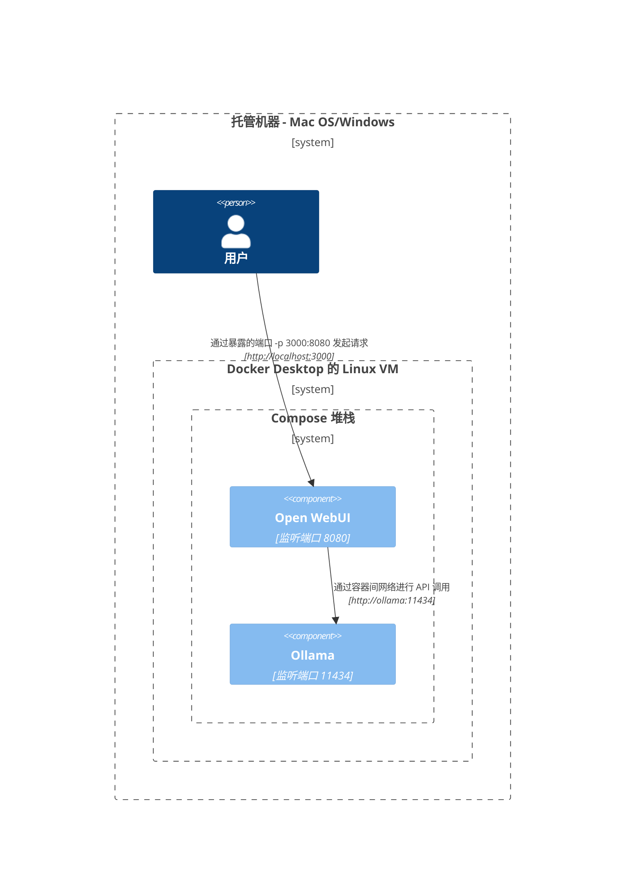
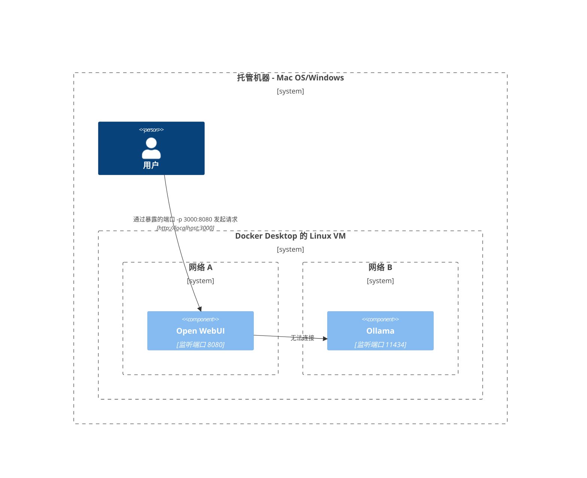
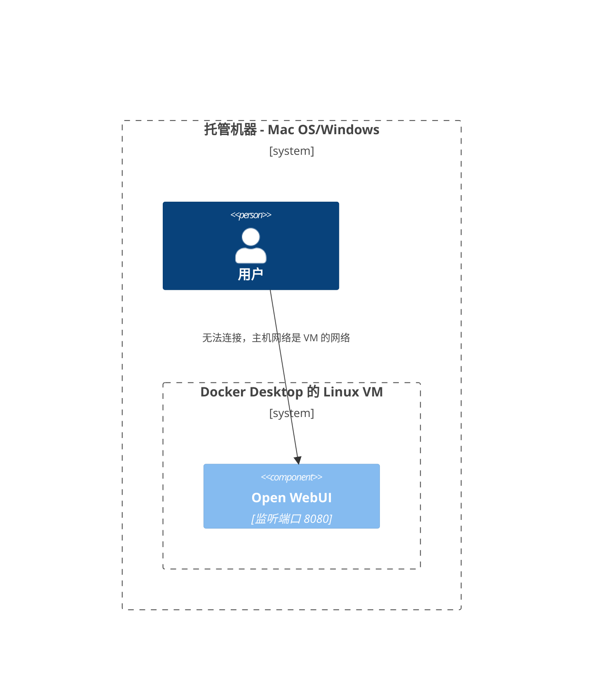
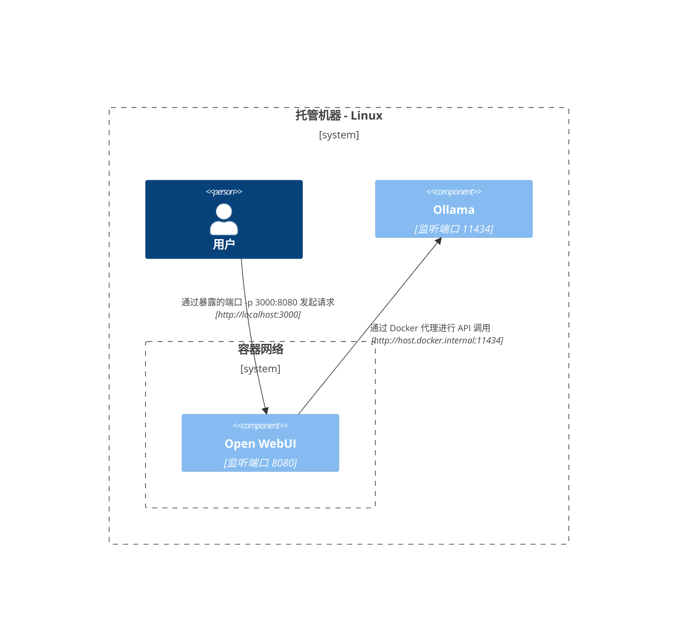
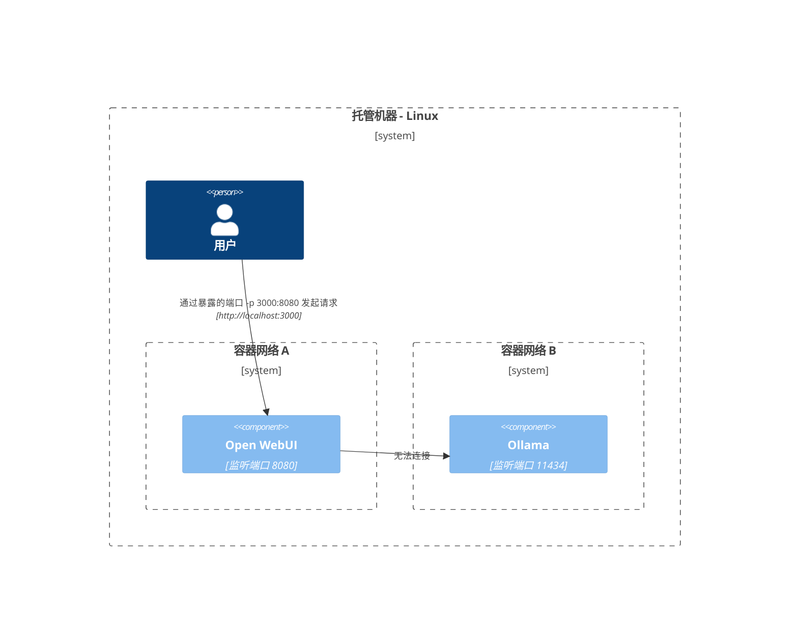
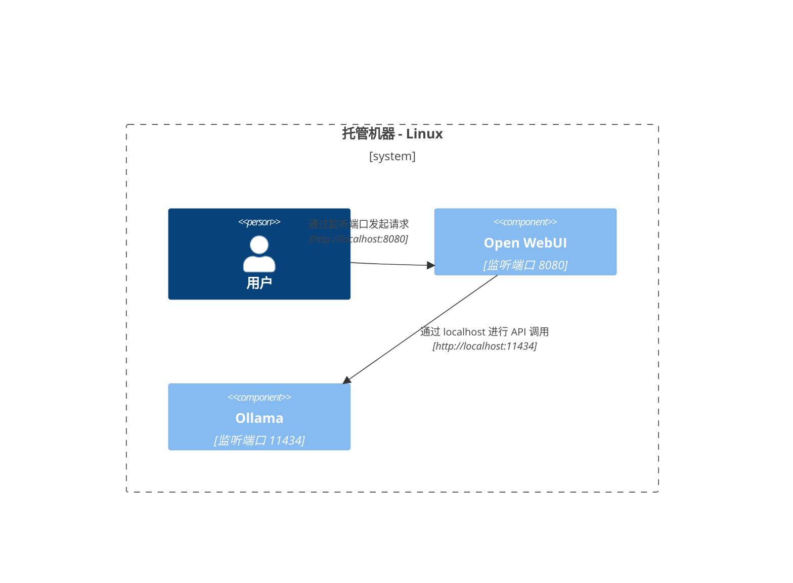

import Tabs from '@theme/Tabs';
import TabItem from '@theme/TabItem';

常见部署拓扑的可视化 C4 图，展示 Open WebUI、Ollama 和 Docker 如何通信。可用于排查连接问题或规划架构。

<Tabs groupId="os-platform">
  <TabItem value="macos-windows" label="macOS / Windows" default>

  <Tabs groupId="macos-topology">
    <TabItem value="host-ollama-mac" label="主机上的 Ollama" default>

    <h4 id="ollama-on-host-open-webui-in-container">Ollama 在主机上，Open WebUI 在容器中</h4>

`Ollama` 直接在主机上运行，而 `Open WebUI` 在 Docker 容器内运行。

    </TabItem>
    <TabItem value="compose-stack-mac" label="Compose 堆栈">

    <h4 id="ollama-and-open-webui-in-compose-stack">Ollama 和 Open WebUI 位于 Compose 堆栈中</h4>

`Ollama` 和 `Open WebUI` 都配置在同一个 Docker Compose 堆栈中，从而简化网络通信。

    </TabItem>
    <TabItem value="separate-networks-mac" label="独立网络">

    <h4 id="ollama-and-open-webui-separate-networks">Ollama 和 Open WebUI 位于独立网络中</h4>

`Ollama` 和 `Open WebUI` 部署在不同的 Docker 网络中。这会导致连接问题。

    </TabItem>
    <TabItem value="host-network-mac" label="主机网络">

    <h4 id="open-webui-in-host-network">Open WebUI 位于主机网络中</h4>

`Open WebUI` 使用主机网络，这会影响它在某些环境中的连接能力。

    </TabItem>
  </Tabs>

  </TabItem>
  <TabItem value="linux" label="Linux">

  <Tabs groupId="linux-topology">
    <TabItem value="host-ollama-linux" label="主机上的 Ollama" default>

    <h4 id="ollama-on-host-open-webui-in-container-1">Ollama 在主机上，Open WebUI 在容器中</h4>

`Ollama` 在主机上运行，`Open WebUI` 部署在 Docker 容器内。

    </TabItem>
    <TabItem value="compose-stack-linux" label="Compose 堆栈">

    <h4 id="ollama-and-open-webui-in-compose-stack-1">Ollama 和 Open WebUI 位于 Compose 堆栈中</h4>

`Ollama` 和 `Open WebUI` 都位于同一个 Docker Compose 堆栈中，可以直接进行网络通信。

    </TabItem>
    <TabItem value="separate-networks-linux" label="独立网络">

    <h4 id="ollama-and-open-webui-separate-networks-1">Ollama 和 Open WebUI 位于独立网络中</h4>

`Ollama` 和 `Open WebUI` 位于不同的 Docker 网络中，这可能会阻碍连接。

    </TabItem>
    <TabItem value="host-network-linux" label="主机网络">

    <h4 id="open-webui-in-host-network-ollama-on-host">Open WebUI 位于主机网络中，Ollama 在主机上</h4>

`Open WebUI` 和 `Ollama` 都使用主机网络，可以实现无缝交互。

    </TabItem>
  </Tabs>

  </TabItem>
</Tabs>
